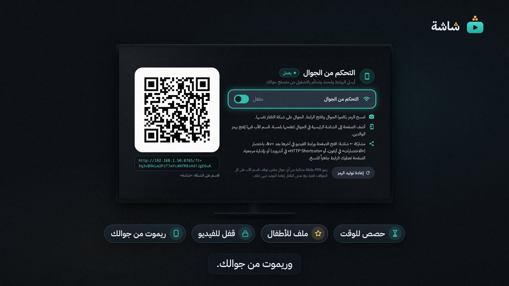

<p align="center">
  <picture>
    <source media="(prefers-color-scheme: dark)" srcset="branding/exports/logo-lockup-1024.png">
    
  </picture>
</p>

# شاشة (Shasha)

«شاشة» تطبيق يوتيوب خاص بشاشة TCL بنظام Google TV في بيتنا: بلا إعلانات ولا خوارزمية ولا تسجيل دخول، مع ملفات للأطفال بقوائم سماح، وحصص للوقت، وقفل للفيديو، وتحكم من الجوال. واجهته عربية بالكامل، ومصممة للريموت.

> [!CAUTION]
> **«شاشة» يخالف شروط خدمة يوتيوب، وهو للاستخدام الشخصي في هذا البيت فقط.** لا تنشره، ولا تبعه، ولا تعطِ ملف APK لأحد، وأبقِ المستودع خاصاً.
>
> **والقفل أفضل جهد، وليس منيعاً.** القفل داخل التطبيق مضمون، أما «الحارس» الذي يعيد التطبيق إلى المقدمة فيمكن تجاوزه، ومن ذلك:
>
> - تبديل مصدر الشاشة (زر Input أو مدخل HDMI) إلى جهاز آخر موصول بها؛
> - فصل الكهرباء أو إعادة تشغيل الشاشة: يعود الحارس بعد اكتمال الإقلاع، لا فوراً؛
> - إعادة ضبط المصنع: تمسح التطبيق وكل بياناته؛
> - أوامر ADB من حاسوب مأذون له: إيقاف التطبيق أو إزالته أو سحب صلاحياته؛
> - تغيير التاريخ والوقت يدوياً إن أُطفئ ضبطهما التلقائي: يغيّر الحصص والجداول؛
> - الثانية أو الثانيتان قبل أن يغطي الحارس تطبيقاً آخر.
>
> منع ذلك كله يحتاج وضع «مالك الجهاز» (Device Owner)، وقد استُبعد عمداً. التفاصيل في [الحارس وحدوده](#الحارس-وحدوده).

## ابدأ من هنا

**التثبيت ملف واحد:** في هذه الصفحة اضغط [`Shasha-Setup.zip`](Shasha-Setup.zip) ثم زر التنزيل **Download**، وفك ضغطه، وشغّل المثبّت الذي بداخله. لا شيء آخر يُنزَّل: أداة `adb` من Google مرفقة فيه.

- **[دليل التثبيت خطوة بخطوة](docs/install-guide.md)**: تسع خطوات بالصور، من تنزيل الملف إلى أول تشغيل، وحلول المشكلات الشائعة. وهو نفسه ملف «اقرأني - طريقة التثبيت.pdf» داخل الحقيبة.
- **[كتيّب التعليمات](docs/manual/README.md)**: كل ما يفعله التطبيق، شاشة شاشة. وللطباعة: [الكتيّب PDF](docs/Shasha-Catalog.pdf).
- **[فيديو الشرح](docs/video/shasha-explainer.mp4)**: التثبيت والاستخدام بالخطوات نفسها. اضغط الصورة لتشاهده:

  <a href="docs/video/shasha-explainer.mp4"></a>

## المحتويات

1. [ابدأ من هنا](#ابدأ-من-هنا)
2. [ما هي «شاشة» وما ليست](#ما-هي-شاشة-وما-ليست)
3. [المتطلبات](#المتطلبات)
4. [التثبيت](#التثبيت)
5. [أول تشغيل](#أول-تشغيل)
6. [الجوال ريموتاً](#الجوال-ريموتاً)
7. [استيراد الاشتراكات من Google Takeout](#استيراد-الاشتراكات-من-google-takeout)
8. [الصفحة الرئيسية وتحديثها](#الصفحة-الرئيسية-وتحديثها)
9. [تخطي المقاطع مع SponsorBlock](#تخطي-المقاطع-مع-sponsorblock)
10. [فيديوهات «للأطفال»](#فيديوهات-للأطفال)
11. [الحارس وحدوده](#الحارس-وحدوده)
12. [عندما يتعطل يوتيوب](#عندما-يتعطل-يوتيوب)
13. [التحديث](#التحديث)
14. [إعداد GitHub (مرة واحدة)](#إعداد-github-مرة-واحدة)
15. [كيف تُنتَج الإصدارات](#كيف-تُنتَج-الإصدارات)
16. [البناء على حاسوبك](#البناء-على-حاسوبك)
17. [بنية المشروع](#بنية-المشروع)
18. [الرخص والنسب](#الرخص-والنسب)
19. [مستندات أخرى](#مستندات-أخرى)

## ما هي «شاشة» وما ليست

**هي:**

- تطبيق Android TV أصلي، عربي من اليمين إلى اليسار، يُدار كله بأسهم الريموت، وداكن افتراضياً.
- يوتيوب بلا إعلانات: بحث، وصفحات القنوات، وقوائم التشغيل، والبث المباشر، والترجمة، والجودة (تلقائية حتى 1080p افتراضياً، وتهبط وحدها حين تضعف الشبكة)، وسرعة التشغيل، والاستكمال من حيث توقفت، و«السجل»، و«شاهد لاحقاً».
- «الرئيسية» فيها أحدث ما نشرته قنواتك فقط، من الأحدث إلى الأقدم. اشتراكاتك محلية، تنقلها مرة واحدة من Google Takeout.
- ملفات: ملف الكبار يُفتح برمز الوالدين، وملفات للأطفال يدخلها الطفل بلا رمز ويخرج منها بالرمز، ولا يرى فيها إلا القنوات وقوائم التشغيل التي تسمح بها، بلا بحث ولا كتابة.
- حصة يومية وأوقات مشاهدة لكل ملف مع تنبيه هادئ قبل النهاية بخمس دقائق، وقائمة حظر (قنوات وكلمات في العنوان) لكل الملفات، وإخفاء المقاطع القصيرة، وإحصائيات بلا نقاط ولا أوسمة.
- قفل للفيديو داخل التطبيق، و«حارس» خارجه يعيد التطبيق إلى المقدمة.
- الجوال ريموت: صفحة ويب على شبكة البيت تفتحها بمسح رمز QR.
- تخطٍّ تلقائي للإعلانات المموَّلة داخل الفيديوهات ببيانات SponsorBlock.
- كل البيانات على الشاشة نفسها، مع نسخة احتياطية JSON يدوية. لا يتصل بالإنترنت إلا ليوتيوب وSponsorBlock وإصدارات GitHub.

**ليست:**

- لا تسجيل دخول بحساب غوغل إطلاقاً: هذا مخالف للشروط، وسبب رئيسي لتعطّل العملاء غير الرسمية وتسريب الرموز.
- لا «مقترح لك» ولا «شائع» ولا فيديوهات ذات صلة ولا تعليقات، ولا تشغيل تلقائي إلا داخل قائمة تشغيل.
- لا تحميل، ولا تشغيل في الخلفية، ولا مزامنة بين أجهزة، ولا منصات غير يوتيوب.
- لا خادم ولا حسابات ولا تحليلات ولا تتبع ولا خدمات مدفوعة.
- ليس في Google Play، ولا يُوزَّع.
- ليس محصناً من تغييرات يوتيوب: يوتيوب يكسر العملاء غير الرسمية كل شهر إلى ثلاثة أشهر، فسيتعطل «شاشة» أحياناً حتى يصدر إصلاح (انظر [عندما يتعطل يوتيوب](#عندما-يتعطل-يوتيوب)).

## المتطلبات

| المطلوب | التفاصيل |
|---|---|
| الشاشة | TCL بنظام Google TV (Android TV 12). يعمل التطبيق من Android 9 فما فوق، لكنه جُرّب لهذه الشاشة وحدها. |
| الشبكة | الشاشة والحاسوب والجوال على شبكة البيت نفسها. |
| حاسوب | ويندوز أو ماك أو لينكس: مرة للتثبيت ومنح الصلاحيات، ثم للطوارئ فقط. |
| حقيبة التثبيت | [`Shasha-Setup.zip`](Shasha-Setup.zip) من هذا المستودع (المستودع خاص: سجّل الدخول إلى GitHub أولاً)، ومصدرها مجلد [`Shasha-Setup/`](Shasha-Setup/): المثبّتان، وملف التطبيق `shasha-<الإصدار>-<رقم البناء>.apk`، وأداة `adb` من حزمة Platform-Tools من Google، والدليل PDF. الإصدارات الأحدث في صفحة [Releases](https://github.com/Ahmad-Nayfeh/shasha/releases). |
| الجوال (اختياري) | أي متصفح حديث على شبكة البيت. |

## التثبيت

**اتبع [دليل التثبيت خطوة بخطوة](docs/install-guide.md)**: بالصور، ولغير المتخصصين، ومعه «مشكلات شائعة وحلولها». وهو نفسه ملف «اقرأني - طريقة التثبيت.pdf» داخل الحقيبة. باختصار:

1. **التنزيل (الحاسوب):** في صفحة المستودع اضغط `Shasha-Setup.zip` ← **Download**، ثم فك الضغط (ويندوز: بالزر الأيمن ← **Extract All**؛ ماك: انقره مرتين). لا شيء آخر يُنزَّل.
2. **خيارات المطوّر (الشاشة):** Settings ← System ← About ← اضغط OK على «Android TV OS build» سبع مرات.
3. **تصحيح الأخطاء (الشاشة):** Settings ← System ← Developer options ← فعّل «USB debugging» (و«Network debugging» إن وُجد).
4. **عنوان الشاشة (الشاشة):** Settings ← Network & Internet ← شبكتك ← «IP address»، مثل `192.168.1.50`. نصيحة: احجزه للشاشة في إعدادات الراوتر (DHCP reservation)، فلا يتغير.
5. **المثبّت (الحاسوب):** ويندوز: انقر `Windows - ثبّت شاشة.bat` مرتين (SmartScreen ← More info ← Run anyway). ماك: بالزر الأيمن على `Mac - ثبّت شاشة.command` ← Open ← Open. يسأل «اكتب عنوان IP للشاشة».
6. **السماح (الشاشة):** «Allow USB debugging?» ← فعّل «Always allow from this computer» ← OK، خلال 60 ثانية. إن رفضت الشاشة الاتصال ولم يكن فيها إلا «Wireless debugging»، يعرض المثبّت الإقران برمز.
7. **الباقي تلقائي (الحاسوب):** يثبّت ويمنح الصلاحيات، ويسأل عن تعطيل يوتيوب الرسمي (y/n)، ويفتح «شاشة»، ويطبع ملخصاً.
8. **أول تشغيل (الشاشة):** انظر [أول تشغيل](#أول-تشغيل).
9. **الجوال (اختياري):** انظر [الجوال ريموتاً](#الجوال-ريموتاً).

### ماذا يفعل المثبّت

المثبّتان (`Windows - ثبّت شاشة.bat`، و`Mac - ثبّت شاشة.command` الذي يشغّله `install-linux.sh` أيضاً) يفعلان الشيء نفسه، وتفاصيلهما في [`Shasha-Setup/README.md`](Shasha-Setup/README.md):

1. **يستخدم `adb` المرفق** في `Shasha-Setup/tools/` (أو الموجود في PATH)، ويسأل عن العنوان إن لم يُكتب بعد اسمه.
2. **يتصل بالشاشة** على المنفذ 5555 (أو المنفذ المكتوب بعد العنوان، مثل `192.168.1.50:5555`) وينتظر موافقتك حتى 60 ثانية. وإن رفضت الشاشة الاتصال عرض الإقران برمز: عنوان الإقران والرمز من 6 أرقام (`adb pair`)، ثم عنوان الاتصال (يجده وحده عبر mDNS أو يسألك عنه).
3. **يثبّت التطبيق** (أحدث `shasha-*.apk` بجانبه)، أو يحدّثه فوق النسخة الموجودة دون مسح بياناتها.
4. **يمنح ثلاث صلاحيات لا تُمنح إلا عبر ADB** (بأوامر `appops set`):

   | الصلاحية | الاسم التقني | لماذا |
   |---|---|---|
   | العرض فوق التطبيقات | `SYSTEM_ALERT_WINDOW` | ليغطي الحارس أي تطبيق آخر ويعيد «شاشة» إلى المقدمة |
   | الوصول إلى بيانات الاستخدام | `GET_USAGE_STATS` | ليعرف الحارس أي تطبيق في المقدمة |
   | تثبيت التطبيقات | `REQUEST_INSTALL_PACKAGES` | ليفتح زر «فحص التحديثات» مثبّت النظام |

5. **يسألك عن يوتيوب الرسمي:** `Disable YouTube? [y/N]`. الافتراضي «لا». إن أجبت `y` عطّله بالأمر `pm disable-user --user 0 com.google.android.youtube.tv`، فلا يفتحه زر YouTube في الريموت. يعود بـ `--undo` أو بالأمر `adb shell pm enable com.google.android.youtube.tv`.
6. **يشغّل «شاشة» ويتحقق:** يطبع `[OK]` أمام كل صلاحية، وحالة خدمة الحارس، ثم ملخصاً و«تمّ!». وللتأكد من داخل التطبيق: الإعدادات ← «حالة الحماية».

لا يحذف المثبّت شيئاً من تلقاء نفسه. إن كانت النسخة المثبّتة **موقّعة بمفتاح آخر** قال كيف تحذفها فقط، لأن الحذف يمسح بيانات التطبيق كلها؛ صدّر نسخة احتياطية أولاً (انظر [MAINTENANCE.md](MAINTENANCE.md#النسخ-الاحتياطي-والاستعادة)). وإن كانت النسخة على الشاشة **أحدث** من الملف، أو كان الملف **غير موقّع**، قال ذلك وتوقف.

### من سطر الأوامر والتراجع

```sh
bash "Shasha-Setup/Mac - ثبّت شاشة.command" 192.168.1.50            # ماك (أو install-linux.sh في لينكس)
bash Shasha-Setup/install-linux.sh 192.168.1.50 shasha-1.0.1-1024.apk   # بملف APK آخر
bash Shasha-Setup/install-linux.sh 192.168.1.50:41234                   # عنوان Wireless debugging لحاسوب مقترن من قبل
bash Shasha-Setup/install-linux.sh --undo 192.168.1.50                  # التراجع
```

وفي ويندوز: `"Windows - ثبّت شاشة.bat" 192.168.1.50` أو `"Windows - ثبّت شاشة.bat" --undo 192.168.1.50`، ويمكن سحب ملف APK وإفلاته فوق المثبّت. دون عنوان يسأل المثبّت عنه.

**`--undo`** يعيد تفعيل يوتيوب الرسمي، ويرجع الصلاحيات الثلاث إلى وضعها الافتراضي ويسحب صلاحيتي الحارس، ثم يوقف «شاشة» فيتوقف الحارس فوراً، ويتحقق من ذلك كله. يبقى التطبيق مثبّتاً ببياناته؛ ولإزالته (يمسح بياناته): Settings ← Apps ← شاشة ← Uninstall، أو `adb uninstall com.ahmadnayfeh.shasha`.

### بعد التثبيت: هل تُبقي تصحيح الأخطاء مفعّلاً؟

الصلاحيات تبقى ولو أطفأت «تصحيح أخطاء USB» بعد الانتهاء. إبقاؤه مفعّلاً يترك لك [مخرج طوارئ](#مخرج-الطوارئ) من الحاسوب، لكن أي حاسوب على شبكة البيت يستطيع حينها طلب الإذن، وتظهر نافذة السماح على الشاشة فيقبلها من يمسك الريموت. القرار لك.

## أول تشغيل

عند فتح «شاشة» أول مرة يمر بك بخطوات قصيرة، كلها بالريموت:

1. **«أهلاً بك في شاشة»** ← «لنبدأ».
2. **«اختر رمز الوالدين»:** من 4 إلى 8 أرقام، بلوحة الأرقام على الشاشة أو بأزرار الأرقام في الريموت، ثم تعيد إدخاله للتأكد. هذا الرمز يفتح ملفك وإعدادات الرقابة، ويُخرج الأطفال من ملفاتهم، ويمنح وقتاً إضافياً. كل خمس محاولات خاطئة متتالية توقفه: 5 دقائق أول مرة، ثم 15 دقيقة، ثم ساعة، ثم 4 ساعات، حتى يُدخَل الرمز الصحيح. ولا تنهي إعادة التشغيل ولا تغيير الساعة هذه المهلة.
3. **«ملفك»:** اسمك وصورتك. ملفك (ملف الكبار) لا يُفتح إلا بالرمز.
4. **«ملف لطفلك» (اختياري):** اسم الطفل ← «إضافة الملف»، أو «لاحقاً». يبدأ ملف الطفل بساعة يومياً بين 7 صباحاً و10 مساءً، وبلا مقاطع قصيرة، وبقائمة سماح فارغة تملؤها أنت. يمكنك إضافة أكثر من ملف طفل لاحقاً.
5. **«تحكّم من جوالك»:** رمز QR لصفحة الجوال (انظر [الجوال ريموتاً](#الجوال-ريموتاً)) ← «تم».

### الملفات والتبديل بينها

- إن وُجد ملف طفل ظهرت عند كل تشغيل شاشة **«من يشاهد الآن؟»**: ملفات الأطفال تُفتح مباشرة، وملف الكبار بالرمز.
- ملف الطفل فيه «الرئيسية» (أحدث فيديوهات قنواته المسموحة وقوائمه) و«القنوات المسموحة» فقط: لا بحث ولا لوحة مفاتيح ولا إعدادات. يخرج منه الطفل بزر «خروج» في القائمة الجانبية ورمز الوالدين. وما دام مفتوحاً يعيد الحارس «شاشة» إلى المقدمة إن ظهر تطبيق آخر (انظر [الحارس وحدوده](#الحارس-وحدوده)).
- في ملف الكبار: «تبديل الملف» في القائمة الجانبية. وإن غبت عن «شاشة» أكثر من 15 ثانية وأنت في ملف الكبار، ووُجد ملف طفل، طُلب الرمز عند العودة.

### خريطة الإعدادات (ملف الكبار)

في القائمة الجانبية «الإعدادات»: القائمة على اليمين، ولوحة العنصر المختار بجانبها. السهمان للأعلى والأسفل يتنقلان بين العناصر، وOK أو اليسار يدخل اللوحة، واليمين أو «رجوع» يعيدك إلى القائمة. عناصر «الرقابة الأبوية» تُفتح بـ «فتح برمز الوالدين» وتبقى مفتوحة خمس دقائق.

| المجموعة | العناصر |
|---|---|
| الرقابة الأبوية | «الملفات ورمز الوالدين»، «قوائم السماح والحظر»، «الحصص والجداول»، «الإحصائيات» |
| المشاهدة | «فئات SponsorBlock»، «الجودة الافتراضية» |
| الشاشة والجوال | «حالة الحماية»، «الخادم المحلي»، «الاستيراد والتصدير» |
| التطبيق | «فحص التحديثات»، «تشخيص»، «حول» |

### قائمة سماح الطفل

الطفل لا يرى إلا ما في قائمة سماحه: قنوات وقوائم تشغيل تختارها أنت. أربع طرق للإضافة:

1. الإعدادات ← «قوائم السماح والحظر» ← «قائمة سماح <اسم الطفل>» ← «من اشتراكاتي» لتختار من قنواتك.
2. اضغط مطوّلاً على OK (أو زر القائمة في الريموت) فوق بطاقة قناة أو قائمة تشغيل ← «أضف إلى قائمة سماح <اسم الطفل>» (يطلب الرمز).
3. زر «الرقابة» في صفحة القناة أو قائمة التشغيل.
4. من الجوال: «الأب» ← «قائمة السماح» ← «إضافة إلى قائمة السماح» برابط القناة (مثل `youtube.com/@name`) أو رابط قائمة التشغيل.

### الحصص والجداول والحظر

- **الحصص والجداول:** الإعدادات ← «الحصص والجداول»: لكل ملف «الحصة اليومية» (بالدقائق، أو «بلا حد») و«أوقات المشاهدة» (من ساعة إلى ساعة، ويجوز أن تعبر منتصف الليل، أو «طوال اليوم»).
- قبل نهاية الوقت بخمس دقائق يظهر تنبيه هادئ. وعند النهاية تظهر شاشة **«انتهى الوقت»** أو **«خارج أوقات المشاهدة»** فوق كل شيء، ولا تُفتح إلا بالرمز: «فتح بالرمز» ← «كم تضيف؟» (+15، +30، +60 دقيقة، أو «بقية اليوم»)، أو من الجوال: «الأب» ← «الوقت» ← «فتح الوقت الآن». وتُحسب الدقائق ما دامت شاشات الملف ظاهرة فقط، فلا تستهلكها شاشة «انتهى الوقت» ولا شاشة اختيار الملف.
- **الحظر:** الإعدادات ← «قوائم السماح والحظر» ← «قائمة الحظر»: قنوات وكلمات في العنوان، تُخفى من كل الملفات. وتُحظر القناة أيضاً من قائمة بطاقتها (ضغطة OK مطوّلة) ← «حظر القناة».
- **المقاطع القصيرة:** الإعدادات ← «الملفات ورمز الوالدين» ← «إدارة الملفات» ← الملف ← «إخفاء المقاطع القصيرة». المقطع القصير عند «شاشة»: مدته 3 دقائق أو أقل، أو رابطه `/shorts/`، أو يعلّمه يوتيوب مقطعاً قصيراً.
- **الإحصائيات:** دقائق كل ملف يوماً بيوم لآخر 7 أيام، وأكثر القنوات مشاهدة، ومقارنة بالأسبوع الماضي، و«الاستسلام».

### قفل الفيديو داخل التطبيق

كل فيديو (أو قائمة تشغيل) يبدأ مقفولاً حتى ينتهي، ويبقى القفل بعد إعادة تشغيل الشاشة:

- **في ملف الطفل:** زر «رجوع» لا يُخرج من الفيديو، بل يطلب رمز الوالدين («الخروج يحتاج رمز الوالدين»). النهاية الطبيعية تحرّر القفل وتعيده إلى رئيسيته، أما التقديم إلى النهاية فلا يُحسب مشاهدة.
- **في ملف الكبار:** للخروج قبل نهاية الفيديو اضغط مطوّلاً على «رجوع» أو OK عشر ثوانٍ، ثم اكتب الجملة الظاهرة بلوحة مفاتيح «شاشة» نفسها. يُسجَّل ذلك «استسلاماً» في الإحصائيات.
- ويفك الأب أي قفل من الجوال: «الأب» ← «الفيديو» ← «فك قفل الفيديو».

## الجوال ريموتاً

### الاقتران برمز QR

1. الجوال على شبكة Wi-Fi نفسها التي عليها الشاشة.
2. على الشاشة: الإعدادات ← «الخادم المحلي». تأكد أن «تشغيل الخادم» مفعّل وأن اللوحة تقول «يعمل على <العنوان:المنفذ>»، ثم افتح «رمز الاقتران QR» (يطلب رمز الوالدين). الرمز نفسه يظهر في آخر خطوة من أول تشغيل.
3. امسح الرمز بكاميرا الجوال وافتح الرابط، وهو بالشكل `http://<IP>:<المنفذ>/?t=<رمز الاقتران>` (المنفذ 8765 عادةً).

كل طلب من الجوال يحتاج رمز الاقتران، والخادم لا يستمع إلا على شبكة البيت. إن أُعيد توليد الرمز قالت الصفحة «امسح رمز QR من جديد»، وإن تغيّر عنوان الشاشة لم تُفتح الصفحة المحفوظة أصلاً: امسح الرمز الجديد في الحالتين.

### ما في الصفحة

| التبويب | ما فيه |
|---|---|
| «الشاشة» | ما يُعرض الآن مع التشغيل والإيقاف والتقديم، و«أرسل رابطاً إلى الشاشة» لأي رابط فيديو أو قائمة تشغيل أو قناة. في ملف الطفل لا يُقبل إلا ما في قائمة سماحه. |
| «بحث» | البحث بالكتابة من الجوال وتشغيل النتيجة على الشاشة. غير متاح في ملف الطفل. |
| «الملف» | «من يشاهد الآن؟»: تبديل ملف الشاشة. ملف الكبار يحتاج الرمز، وتطلبه الشاشة أيضاً قبل فتحه. |
| «الأب» | «قسم الأب» برمز الوالدين (تنتهي الجلسة بعد 30 دقيقة دون استخدام): «الوقت» (فتح الوقت الآن، الحصة اليومية)، «الفيديو» (فك قفل الفيديو)، «قائمة السماح»، «الاشتراكات» (إضافة اشتراك، الاستيراد من Google Takeout)، «نسخة احتياطية». |

**رمز الوالدين من الجوال له عدّاده الخاص:** خمسة رموز خاطئة من الجوال توقف قسم الأب 5 دقائق ثم 15 دقيقة ثم ساعة ثم 4 ساعات، ولا يتأثر به رمز الشاشة؛ فتخمينات طفل على الشاشة لا تقفل جوال الأب أبداً، والعكس صحيح. العدّاد واحد لكل الجوالات المقترنة (تشترك في رمز اقتران واحد). إن أوقفه جوال يخمّن فـ «إعادة توليد الرمز» تنهي ذلك (انظر [MAINTENANCE.md](MAINTENANCE.md#تدوير-رمز-الاقتران)).

### مشاركة ← شاشة

في تبويب «الشاشة» قسم «المشاركة من تطبيق يوتيوب مباشرة» يعطيك رابطاً جاهزاً للنسخ بهذا الشكل:

```text
http://<IP>:<PORT>/?t=<TOKEN>&v=
```

ضع بعد `&v=` أي رابط يوتيوب وافتحه: تُرسله الصفحة إلى الشاشة وحدها. اجعله اختصار «مشاركة» في الجوال، بتطبيق «الاختصارات» (Shortcuts) في آيفون أو تطبيق «HTTP Shortcuts» في أندرويد، أو إشارة مرجعية، فتشارك من تطبيق يوتيوب إلى الشاشة بلمسة. الرابط يحفظ وقت البداية (`&t=`) إن كان فيه.

### إضافة الصفحة إلى الشاشة الرئيسية للجوال

- **آيفون (Safari):** زر المشاركة ← «إضافة إلى الشاشة الرئيسية» (Add to Home Screen).
- **أندرويد (Chrome):** القائمة ⋮ ← «إضافة إلى الشاشة الرئيسية» (Add to Home screen).

تظهر أيقونة «شاشة» وتفتح الصفحة بلمسة؛ والصفحة تحفظ رمز الاقتران. إن أُعيد توليد الرمز فامسح QR من جديد وأعد إضافتها.

## استيراد الاشتراكات من Google Takeout

«شاشة» لا يسجّل الدخول، فاشتراكاتك تنتقل مرة واحدة من ملف تصدّره من Google:

1. افتح <https://takeout.google.com> بحساب غوغل الذي فيه اشتراكاتك (من الحاسوب أو الجوال).
2. اضغط «إلغاء تحديد الكل» (Deselect all).
3. انزل إلى «YouTube and YouTube Music» وحدّده.
4. اضغط زر «All YouTube data included» تحته، وأزل التحديد عن كل شيء إلا «الاشتراكات» (subscriptions)، ثم OK.
5. انزل إلى آخر الصفحة واضغط Next step، واختر التصدير مرة واحدة (Export once) بملف zip، ثم Create export. يصلك بريد برابط التنزيل.
6. في الملف المضغوط: `Takeout/YouTube and YouTube Music/subscriptions/subscriptions.csv` (قد تظهر أسماء المجلدات بلغة حسابك).

ثم استورده بإحدى ثلاث طرق:

- **من الجوال (الأسهل):** «الأب» ← «الاشتراكات» ← «استيراد من Google Takeout» ← «اختر الملف (zip أو csv)». ارفع الملف المضغوط كما هو، أو `subscriptions.csv` وحده.
- **من ملف على الشاشة:** الإعدادات ← «الاستيراد والتصدير» ← «استيراد الاشتراكات من Takeout» ← «من ملف على الشاشة» ← «اختيار ملف» (إن كان في الشاشة متصفح ملفات).
- **من الحاسوب عبر ADB:** افتح شاشة «استيراد الاشتراكات» على التلفاز (من الإعدادات كما سبق، أو زر «استيراد الاشتراكات» في «الرئيسية» الفارغة، أو «استيراد» في «الاشتراكات») **واتركها مفتوحة**، ثم نفّذ من الحاسوب (`adb` هنا هو المرفق في `Shasha-Setup/tools/`: `tools/mac/adb` في ماك، و`tools\windows\adb.exe` في ويندوز، و`tools/linux/adb` في لينكس، أو أي `adb` آخر):

  ```sh
  adb connect 192.168.1.50
  adb push subscriptions.csv /sdcard/Android/data/com.ahmadnayfeh.shasha/files/import/subscriptions.csv
  ```

  تعرض الشاشة الأمر نفسه تحت «من حاسوبك عبر ADB»، وتلتقط الملف وحدها وتستورده ثم تحذفه. إن كان اسم الملف بلغة أخرى فسمّه `subscriptions.csv` قبل الأمر.

النتيجة: «تم الاستيراد» مع عدد القنوات المضافة، و«مضافة من قبل»، و«أسطر غير صالحة»، وتصل الفيديوهات إلى «الرئيسية» خلال دقائق. إعادة الاستيراد آمنة. ولقناة واحدة: ابحث عنها واضغط «اشتراك»، أو من الجوال «الأب» ← «الاشتراكات» ← «إضافة اشتراك» برابطها.

## الصفحة الرئيسية وتحديثها

- «الرئيسية» هي أحدث فيديوهات قنوات اشتراكك مرتبة من الأحدث، من خلاصة RSS التي تنشرها يوتيوب لكل قناة (`https://www.youtube.com/feeds/videos.xml?channel_id=UC…`، آخر 15 فيديو).
- **تتحدّث وحدها كل ساعتين** عند وجود إنترنت، وبزر «تحديث» في أعلاها.
- **لا تُجلب أكثر من 3 قنوات في وقت واحد**، على خيوط منخفضة الأولوية، **ولا يبدأ التحديث أثناء تشغيل فيديو**: إن بدأ فيديو أثناءه أكمل القنوات الجارية فقط وأجّل الباقي ربع ساعة. هذا ما يمنع تقطيع الفيديو على معالج الشاشة الضعيف.
- إن فشلت خلاصة RSS لقناة (حدثت فترات أعطال 404 متقطعة في 2025 و2026) جُلبت فيديوهاتها من تبويب «الفيديوهات» في صفحتها بدلاً منها.
- القناة التي حُدّثت بنجاح في آخر 30 دقيقة لا تُجلب ثانية. يُحفظ لكل قناة أحدث 30 فيديو، ولا شيء أقدم من 90 يوماً.
- إن تعذّر تحديث قنوات كثيرة ظهرت رسالة «تعذّر تحديث N من القنوات» مع اسم الخطأ وإصدار المكتبة، كما في شاشة الخطأ الموحدة.
- المقاطع القصيرة تُخفى حسب إعداد الملف. وملف الطفل له رئيسيته: أحدث فيديوهات قنواته المسموحة وقوائمه فقط.

## تخطي المقاطع مع SponsorBlock

- عند بدء أي فيديو تسأل «شاشة» خدمة SponsorBlock مرة واحدة عن مقاطعه. يُرسَل **أول 4 أحرف فقط من بصمة sha256 لمعرّف الفيديو**، وتُصفّى النتيجة على الشاشة، فلا يعرف الخادم أي فيديو تشاهد. تُحفظ الإجابة 24 ساعة (وساعة واحدة إن لم يكن للفيديو مقاطع).
- **الفئات** من الإعدادات ← «فئات SponsorBlock»، وتسري على كل الملفات. المفعّل افتراضياً خمس: «إعلان مموَّل» (sponsor)، و«ترويج ذاتي» (selfpromo)، و«تذكير بالتفاعل» (interaction)، و«المقدمة» (intro)، و«الخاتمة» (outro). ويمكن تفعيل «معاينة أو تلخيص»، و«تحية أو تشويق»، و«استطراد»، و«جزء غير موسيقي». «العودة إلى الاختيار الافتراضي» يرجع الخمس الأولى. وإن أطفأتها كلها لا تسأل «شاشة» SponsorBlock أبداً.
- **التخطي تلقائي** مع رسالة صغيرة «تم تخطي: <الفئة>». وفي ملف الكبار وحده يظهر «تراجع عن التخطي» خمس ثوانٍ: OK يعيدك إلى بداية المقطع، ولا يُتخطى ثانية في هذه المشاهدة. لا تخطي في البث المباشر، والتخطي التلقائي لا يُحسب تقديماً في قفل الفيديو.
- **النسبة والرخصة:** بيانات التخطي من SponsorBlock (<https://sponsor.ajay.app>)، يساهم بها مجتمعه، ومرخّصة بموجب CC BY-NC-SA 4.0 (نسب المصدر، وغير تجاري، والمشاركة بالمثل). يظهر ذلك في «حول» وفي «فئات SponsorBlock» بنص المشروع نفسه: `Uses SponsorBlock data licensed used under CC BY-NC-SA 4.0 from https://sponsor.ajay.app/.`

## فيديوهات «للأطفال»

يعامل يوتيوب الفيديوهات المصنّفة «للأطفال» (made for kids) معاملة خاصة، ومكتبة الاستخراج الحالية (NewPipeExtractor v0.26.5) **لا تستخرج لها إلا نسخة مدمجة واحدة بدقة 360p**، بلا الجودات الأعلى. هذا ثابت مهما كانت الشبكة.

وهل تعمل حتى نسخة 360p من شبكة البيت؟ **لم يُعرف بعد:** رُفضت التجربة (403) من خادم التطوير، لكن الخادم نفسه كان مرفوضاً لمعظم الفيديوهات العادية أيضاً، فالنتيجة لا تُثبت شيئاً. جرّبها على الشاشة كما في [docs/acceptance.md](docs/acceptance.md). وهذا ما يفعله التطبيق (قرار صاحب البيت):

| الحالة | في ملف الطفل | في ملف الكبار |
|---|---|---|
| لا يتاح إلا 360p | يُشغَّل بدقة 360p مع شارة ظاهرة «جودة منخفضة: 360p» | شاشة الخطأ الموحدة («360p فقط») مع زر إضافي «شغّل بجودة 360p على أي حال» |
| يوتيوب يرفض حتى 360p | شاشة الخطأ الموحدة | شاشة الخطأ الموحدة |

الحل الكامل ينتظر دعم بروتوكول SABR في NewPipeExtractor. التفاصيل والأدلة في [MAINTENANCE.md](MAINTENANCE.md#فيديوهات-للأطفال-القيد-والأدلة).

## الحارس وحدوده

### كيف يعمل

بعد منح صلاحيتي ADB تعمل خدمة «الحماية» في الخلفية بإشعار دائم «الحماية تعمل»: من أول تشغيل للتطبيق، وبعد كل إعادة تشغيل للشاشة أو تحديث للتطبيق، وتتوقف وحدها إن سُحبت إحدى الصلاحيتين. كل ثانية تعرف أي تطبيق في المقدمة؛ وحين يجب أن تتدخل ويظهر تطبيق آخر، تغطيه فوراً بشاشة «لحظة… نعود إلى «شاشة»» وتعيد «شاشة» إلى المقدمة، وتقيس زمن كل عودة (المطلوب ثانيتان على الأكثر). وفي ملف الطفل تقول التغطية أيضاً: «في ملف الطفل تبقى «شاشة» في المقدمة. الخروج منه برمز الوالدين.»

**متى يتدخل (قرار صاحب البيت):**

- **ما دام ملف طفل هو الملف الحالي**، في أي شاشة من شاشاته، لا أثناء الفيديو المقفول فقط. لاستخدام تطبيق آخر (Netflix أو إعدادات الشاشة مثلاً) اخرج من ملف الطفل بـ «خروج» ورمز الوالدين، واختر ملف الكبار.
- وفي أي ملف: أثناء فيديو مقفول، وبعد «انتهى الوقت»، وخارج أوقات المشاهدة.
- أما ملف الكبار فيبقى حراً في غير ذلك.
- ولا يتدخل والشاشة مطفأة أو شاشة التوقف (Screensaver) ظاهرة.

**«حالة الحماية»** (الإعدادات ← «حالة الحماية» ← «التفاصيل وأوامر ADB») تعرض كل صلاحية ناقصة والأمر الدقيق الذي يمنحها، وحالة خدمة الحارس، و«تثبيت التحديثات»، وحالة يوتيوب الرسمي، و«الوقت التلقائي»، و«سرعة العودة» المقيسة (ولوحتها في الإعدادات تعرض «آخر عودة إلى «شاشة» بعد Home»)، و«حدود الحماية».

### ما لا يستطيع منعه

القفل داخل التطبيق مضمون؛ أما الحارس فأفضل جهد، ومنع ما يلي يحتاج وضع «مالك الجهاز» (Device Owner) الذي استُبعد عمداً (وكذلك تثبيت الشاشة Screen pinning، لأنه يُلغى بضغطة):

- **الأزرار لا تُمنع:** Home، وأزرار التطبيقات في الريموت، والأوامر الصوتية، والبث من الجوال، وزر المصدر. يُغطّى ما يظهر وتعود «شاشة» خلال ثانية أو اثنتين. وقد لا يظهر مصدر HDMI تطبيقاً في بيانات الاستخدام فتتأخر العودة نحو 3 ثوانٍ، وقد تتحكم الشاشة في مداخلها خارج أندرويد أصلاً؛ جرّبه على شاشتك.
- **فصل الكهرباء أو إعادة التشغيل:** يعود الحارس وحده بعد اكتمال الإقلاع، لا من اللحظة الأولى.
- **في ملف الكبار** يصل من يمسك الريموت إلى إعدادات الشاشة: «فرض الإيقاف» (Force stop) يوقف الحارس حتى يُفتح التطبيق من جديد، ولا تعيده إعادة تشغيل الشاشة؛ ومسح البيانات يعيد التطبيق إلى أول تشغيل؛ وكذلك إزالته، أو سحب صلاحيتيه، أو إعادة يوتيوب المعطَّل. لذلك لا تترك ملف الكبار مفتوحاً للأطفال.
- **التاريخ والوقت:** إن أُطفئ «الضبط التلقائي» يستطيع من يغيّر التاريخ أن يبدأ حصة يوم جديد، ومن يرجع الساعة أن يفتح وقت النوم. «حالة الحماية» تنبّه إلى ذلك. (مهلة الرمز الخاطئ وقفل الفيديو لا يتأثران.)
- **أوامر ADB** من أي حاسوب مأذون له، و**إعادة ضبط المصنع**، و**وضع الإقلاع الآمن** (Safe mode) إن أتاحته الشاشة: كلها تتجاوز الحارس.
- **الأجهزة الأخرى** في البيت خارج نطاق «شاشة» كلياً.

### مخرج الطوارئ

في ملف الطفل، وعند «انتهى الوقت» وخارج أوقات المشاهدة، لا يُخرج من «شاشة» إلا رمز الوالدين: على الشاشة، أو من الجوال (تبديل الملف أو «فتح الوقت الآن» من «قسم الأب»)، ولرمز الجوال عدّاده المستقل. إن قُفل الرمز في الاثنين بعد محاولات خاطئة (من 5 دقائق حتى 4 ساعات) أو نُسي، بقيت الشاشة كلها على «شاشة»، حتى عليك. المخرج الأخير من الحاسوب الذي جهّزها، و«تصحيح أخطاء USB» ما زال مفعّلاً (بأداة `adb` المرفقة في `Shasha-Setup/tools/`):

```sh
adb connect 192.168.1.50
adb shell am force-stop com.ahmadnayfeh.shasha
```

يتوقف الحارس حتى يُفتح التطبيق من جديد. أو شغّل المثبّت بـ `--undo` (انظر [من سطر الأوامر والتراجع](#من-سطر-الأوامر-والتراجع)) ليبقى متوقفاً حتى تُمنح صلاحيتاه من جديد. ولاستعادة رمز منسي انظر [MAINTENANCE.md](MAINTENANCE.md#إن-نسيت-رمز-الوالدين).

## عندما يتعطل يوتيوب

سيحدث هذا: يوتيوب يغيّر طريقة عمله كل شهر إلى ثلاثة أشهر فتتعطل العملاء غير الرسمية، ولذلك صُمّم «شاشة» كي **يظهر العطل بوضوح ولا يحدث صامتاً**:

1. **شاشة الخطأ الموحدة:** أي فشل في الاستخراج أو التشغيل (403، «Sign in to confirm you're not a bot»، فيديو غير متاح، قناة مغلقة، 360p فقط…) يعرض شاشة واحدة عنوانها «يوتيوب غيّر شيئاً. حدّث التطبيق.» (أو «لا يوجد اتصال بالإنترنت» إن كانت الشبكة هي المشكلة)، مع سطر يشرح النوع، و«اسم الخطأ»، و«إصدار المكتبة»، وزري «فحص التحديثات» و«رجوع» (و«إعادة المحاولة» لأخطاء الشبكة). والجوال يتلقى الرسالة نفسها.
2. **«تشخيص»:** الإعدادات ← «تشخيص» ← «فيديوهات تجريبية»: خمسة فيديوهات ثابتة (عادي، بث مباشر، للأطفال، محذوف، فيه إعلان يتخطاه SponsorBlock) تعرف منها في ثوانٍ ما الذي تعطّل، مع «معلومات للتشخيص»: إصدار التطبيق والمكتبة، والشاشة، وحالة تحديث الاشتراكات وآخر خطأ.
3. **الإنذار المبكر:** مهمة «YouTube canary» في GitHub Actions تختبر الاستخراج على يوتيوب الحقيقي مرتين أسبوعياً، ويصلك بريد إن فشلت، غالباً قبل أن ترى العطل على الشاشة.
4. **الإصلاح:** إصدار أحدث من مكتبة NewPipeExtractor. يفتح Dependabot طلب دمج حين يصدر، فتختبره وتدمجه، فيصدر إصدار جديد تثبّته بـ «فحص التحديثات». الخطوات كاملة في **[MAINTENANCE.md](MAINTENANCE.md)**.

## التحديث

### من التطبيق

الإعدادات ← «فحص التحديثات»: اللوحة تعرض الإصدار المثبّت («شاشة <الإصدار>» و«رقم البناء <N> · مكتبة الاستخراج <الإصدار>»)، وزر «فحص التحديثات» يفتح شاشة المحدِّث (والزر نفسه موجود في شاشة الخطأ الموحدة):

1. «جارٍ البحث عن تحديث…»: يقرأ آخر إصدار منشور («الأحدث») في GitHub Releases لهذا المستودع، ويتجاهل المسودات والإصدارات التجريبية.
2. إن لم يجد أحدث من المثبّت قال «لديك آخر إصدار». وإلا قال «يتوفر إصدار جديد» مع الإصدارين «المثبّت» و«الأحدث»، و«ملاحظات الإصدار».
3. «تنزيل وتثبيت»: ينزّل ملف APK، ويتحقق قبل أي شيء أنه «شاشة» نفسها، وأحدث من المثبّت، وموقّع بالمفتاح نفسه.
4. «أكّد التحديث في نافذة النظام»: أندرويد يسأل قبل كل تحديث، فلا تحديث صامت. أكّد بالريموت.
5. بعد التثبيت تُغلق «شاشة»؛ افتحها من جديد.

يحتاج ذلك أمرين، وتشرح شاشة المحدِّث ما ينقص منهما:

- صلاحية «تثبيت التحديثات»، ويمنحها المثبّت في `Shasha-Setup` (تراها في «حالة الحماية»). بدونها تقول الشاشة «تثبيت التحديثات غير مسموح بعد» وتعرض الأمر الذي يمنحها.
- **رمز قراءة من GitHub داخل البناء:** المستودع خاص، فلا تُقرأ إصداراته دون رمز. يضعه CI في التطبيق من السر `UPDATE_TOKEN` (انظر [إعداد GitHub](#إعداد-github-مرة-واحدة)). بناءٌ بلا رمز تقول فيه الشاشة «فحص التحديثات يحتاج رمز قراءة»، ورمزٌ انتهى أو أُلغي تقول فيه «رمز القراءة مرفوض»: حدّث حينها بالمثبّت في `Shasha-Setup`.

والتحديث من ملف الكبار وحده؛ ملف الطفل لا يصل إلى المحدِّث.

### من الحاسوب

ضع ملف `shasha-<الإصدار>-<رقم البناء>.apk` الأحدث من صفحة Releases في مجلد `Shasha-Setup`، وشغّل المثبّت كما في [دليل التثبيت](docs/install-guide.md#التحديث-لاحقاً): يأخذ أحدث ملف بجانبه. أو من سطر الأوامر: `bash Shasha-Setup/install-linux.sh 192.168.1.50 shasha-<الإصدار>-<رقم البناء>.apk`. يثبّته فوق القديم ويحتفظ بالبيانات ويعيد منح الصلاحيات.

### لا تغيّر مفتاح التوقيع أبداً

أندرويد لا يثبّت تحديثاً إلا إن كان موقّعاً بمفتاح النسخة المثبّتة نفسه. بمفتاح آخر يُرفض التحديث (يقول المحدِّث «مفتاح التوقيع مختلف»، ويقول adb «signatures do not match»)، ولا حل إلا حذف التطبيق، وهذا يمسح كل بياناته. لذلك:

- احفظ ملف المفتاح وكلمات سره في مكانين آمنين (مثلاً مدير كلمات سر ونسخة غير متصلة بالإنترنت).
- كل إصدار يذكر في ملاحظاته «Signing certificate SHA-256»، وCI يتحقق أن كل APK موقّع فعلاً بالمفتاح الذي في الأسرار. يجب أن تبقى هذه البصمة نفسها في كل الإصدارات؛ إن تغيّرت فقد تغيّر المفتاح، فلا تثبّت ذلك الإصدار.
- إن ضاع المفتاح فاتبع [MAINTENANCE.md](MAINTENANCE.md#توقيع-ci-وماذا-لو-ضاع-المفتاح).

التحديث يحتفظ بالملفات والرمز والاشتراكات والسجل والإعدادات والاقتران، ويعود الحارس وخادم الجوال وحدهما بعده.

## إعداد GitHub (مرة واحدة)

### 1. أنشئ مفتاح التوقيع

على حاسوبك، وتحتاج `keytool` من أي JDK (مثل Temurin 21، أو JDK المرفق مع Android Studio):

```sh
keytool -genkeypair -v -keystore shasha-release.jks -alias shasha -keyalg RSA -keysize 4096 -validity 10000
```

يسألك عن كلمة سر (مرتين) وعن اسمك ومكانك (أي قيم تصلح). الصيغة الافتراضية للمخزن PKCS12، وفيها كلمة سر المفتاح هي نفسها كلمة سر المخزن. `-validity 10000` تعني نحو 27 سنة. لا ترفع ملف `.jks` إلى المستودع أبداً (`.gitignore` يمنعه)، واحفظه مع كلمة سره في مكانين آمنين.

### 2. حوّل الملف إلى base64

الناتج سطر واحد تنسخه إلى السر في الخطوة التالية. في لينكس (انسخ ما يطبعه):

```sh
base64 -w0 shasha-release.jks
```

في ماك (ينسخه إلى الحافظة):

```sh
base64 -i shasha-release.jks | pbcopy
```

في ويندوز، من PowerShell داخل مجلد الملف (ينسخه إلى الحافظة):

```powershell
[Convert]::ToBase64String([IO.File]::ReadAllBytes("$PWD\shasha-release.jks")) | Set-Clipboard
```

### 3. أضف أسرار المستودع

في GitHub: المستودع ← Settings ← Secrets and variables ← Actions ← New repository secret. الأسماء كما هي تماماً:

| السر | ما فيه | إلزامي؟ |
|---|---|---|
| `SIGNING_KEYSTORE_BASE64` | ملف `shasha-release.jks` بترميز base64 في سطر واحد | نعم |
| `SIGNING_KEYSTORE_PASSWORD` | كلمة سر المخزن | نعم |
| `SIGNING_KEY_ALIAS` | اسم المفتاح: `shasha` في الأمر أعلاه | نعم |
| `SIGNING_KEY_PASSWORD` | كلمة سر المفتاح (في PKCS12 هي كلمة سر المخزن نفسها) | نعم |
| `UPDATE_TOKEN` | رمز GitHub للقراءة فقط، للمحدِّث داخل التطبيق (الخطوة 4) | اختياري |

أو بأداة `gh` (تسألك عن القيمة إن لم تمررها):

```sh
base64 -w0 shasha-release.jks | gh secret set SIGNING_KEYSTORE_BASE64 --repo Ahmad-Nayfeh/shasha
gh secret set SIGNING_KEYSTORE_PASSWORD --repo Ahmad-Nayfeh/shasha
gh secret set SIGNING_KEY_ALIAS --repo Ahmad-Nayfeh/shasha --body shasha
gh secret set SIGNING_KEY_PASSWORD --repo Ahmad-Nayfeh/shasha
gh secret set UPDATE_TOKEN --repo Ahmad-Nayfeh/shasha
```

بناءات `main` **تفشل عمداً** دون الأسرار الأربعة `SIGNING_*`، لأن APK موقّعاً بمفتاح آخر لا يُثبَّت فوق السابق. أما الفروع الأخرى وطلبات Dependabot فتبني بلاها نسخة Debug للاختبار فقط، وتنبّه إلى ذلك.

### 4. رمز القراءة للمحدِّث (`UPDATE_TOKEN`)

المحدِّث داخل التطبيق يقرأ إصدارات هذا المستودع الخاص، فيحتاج رمزاً دقيق الصلاحيات (fine-grained) للقراءة فقط:

1. في GitHub: صورتك ← Settings ← Developer settings ← Personal access tokens ← Fine-grained tokens ← Generate new token.
2. **الاسم:** مثل `shasha-updater`. **مدة الصلاحية:** حدّدها (سنة مثلاً)، وضع تذكيراً قبل انتهائها.
3. **المالك (Resource owner):** حسابك `Ahmad-Nayfeh`. **الوصول إلى المستودعات:** Only select repositories ← `Ahmad-Nayfeh/shasha` وحده.
4. **الصلاحيات:** Repository permissions ← Contents: **Read-only** فقط (تُضاف Metadata للقراءة تلقائياً). لا شيء غيرها.
5. أنشئ الرمز وانسخه، وضعه في السر `UPDATE_TOKEN`. يمرّره CI إلى البناء باسم `SHASHA_UPDATE_TOKEN`.

> [!IMPORTANT]
> الرمز يُحفظ **داخل ملف APK**، فكل من معه الملف يستطيع استخراجه. لذلك: قراءة فقط، ولهذا المستودع وحده، وبمدة محددة، ولا تعطِ ملف APK لأحد. وحين ينتهي تقول شاشة المحدِّث «رمز القراءة مرفوض»: أنشئ رمزاً جديداً، وحدّث السر، ثم ثبّت الإصدار التالي بالمثبّت في `Shasha-Setup`، لأن النسخة المثبّتة ما زالت تحمل الرمز القديم.

### 5. أول إصدار

الإصدارات تُنشر من الفرع `main`: ادمج فيه العمل (طلب الدمج من فرع التطوير)، فيبني CI ويُصدر أول Release. أو شغّله يدوياً: Actions ← Android ← Run workflow ← `main`.

إن انتهى كل تشغيل في Actions بالفشل خلال ثوانٍ بلا سجلات، فالمهمة لم تبدأ أصلاً (وهذا حال هذا المستودع منذ 2026-09-29 حتى كتابة هذا الدليل، انظر [docs/acceptance.md](docs/acceptance.md)): افتح صفحة التشغيل واقرأ السبب المكتوب فيها، وراجع إعدادات الفوترة وحدود الإنفاق في حسابك على GitHub، فدقائق Actions في المستودعات الخاصة محدودة.

## كيف تُنتَج الإصدارات

| المُطلِق | ما يحدث |
|---|---|
| دفع (push) إلى `main` | اختبارات، ثم بناء موقّع، ثم GitHub Release جديد. الدفع الذي لا يغيّر إلا ملفات `.md` أو `docs/` أو `Shasha-Setup/` أو `Shasha-Setup.zip` أو `tools/` أو `branding/` لا يبني شيئاً. |
| أسبوعياً، الجمعة 03:17 UTC | يعيد بناء `main` للتأكد أنه ما زال يُبنى، ولا ينشر إصداراً إن كان هذا الـ commit منشوراً من قبل (فلا تعرض الشاشة «تحديثاً» لا يغيّر شيئاً). |
| يدوياً: Actions ← Android ← Run workflow | على `main`: إصدار جديد. على فرع آخر: APK موقّع يُرفع كملف (Artifact) لمدة 14 يوماً للتجربة على الشاشة، بلا إصدار. |

خطوات مهمة «Android» (`.github/workflows/android.yml`):

1. مهمة **Unit tests**: اختبارات `:policy` و`:youtube` و`:remote` و`:app`، ومعها مطابقة لقطات الشاشة المرجعية.
2. مهمة **Release APK**: تفك المفتاح وتتحقق منه، وتبني نسخة Release مع R8، وتتأكد أن R8 لم يغيّر أسماء الاستثناءات (تظهر في شاشة الخطأ)، وتحفظ ملف mapping لتسعين يوماً، وتتحقق من اسم الحزمة ورقم البناء وبصمة شهادة التوقيع.
3. مهمة **GitHub Release**: تنشر الإصدار بوسم `v<versionName>-<versionCode>` وملف `shasha-<versionName>-<versionCode>.apk`، وفي ملاحظاته إصدار NewPipeExtractor والـ commit ورابط البناء وبصمة الشهادة وأمر التثبيت، وتعلّمه «الأحدث» (وهو ما يقرؤه المحدِّث).

رقم البناء `versionCode` = 1000 + رقم التشغيل، فيزيد دائماً. و`versionName` مكتوب في `app/build.gradle.kts`. وإلى جانبها مهمة «YouTube canary» (`.github/workflows/youtube-canary.yml`): الثلاثاء والجمعة 04:41 UTC، ويدوياً، وعلى كل طلب دمج يغيّر `gradle/libs.versions.toml` أو `youtube/`. وDependabot يفتح طلبات التحديث كل خميس (`.github/dependabot.yml`).

## البناء على حاسوبك

**المتطلبات:** JDK 21، وAndroid SDK فيه `platforms;android-37.0` و`build-tools;37.0.0` (من Android Studio أو `sdkmanager`)، ومتغير `ANDROID_HOME` أو ملف `local.properties` فيه `sdk.dir=<مسار SDK>`. أداة Gradle تنزّل نفسها (`gradlew`)، وفي ويندوز استخدم `gradlew.bat`.

الاختبارات نفسها التي يشغّلها CI:

```sh
./gradlew --continue :policy:test :youtube:testDebugUnitTest :remote:testDebugUnitTest :app:verifyRoborazziDebug
```

البناء:

```sh
./gradlew :app:assembleDebug
./gradlew :app:assembleRelease
```

- الناتج في `app/build/outputs/apk/debug/` و`app/build/outputs/apk/release/`.
- نسخة **Debug** موقّعة بمفتاح حاسوبك، فلا تُثبَّت فوق نسخة Releases على الشاشة؛ جرّبها على جهاز آخر فقط.
- نسخة **Release** بلا متغيرات التوقيع تُبنى غير موقّعة (تثبت أن R8 يعمل، ولا تُثبَّت). للتوقيع بالمفتاح نفسه عرّف المتغيرات الأربعة معاً (أو لا شيء منها):

  ```sh
  export SHASHA_KEYSTORE_FILE="$PWD/shasha-release.jks"
  export SHASHA_KEYSTORE_PASSWORD='…'
  export SHASHA_KEY_ALIAS=shasha
  export SHASHA_KEY_PASSWORD='…'
  export SHASHA_VERSION_CODE=1024
  ./gradlew :app:assembleRelease
  ```

  اجعل `SHASHA_VERSION_CODE` مساوياً لرقم البناء المثبّت («فحص التحديثات» يعرضه) أو أكبر منه بواحد. لا تقفز بعيداً عن أرقام CI، وإلا رفضت الشاشة إصدارات CI التالية لأنها «أقدم» حتى يتجاوزها العدّاد. `SHASHA_UPDATE_TOKEN` اختياري.

- لقطات الشاشة المرجعية في `app/src/test/screenshots/`: بعد تغيير مقصود في الواجهة سجّلها من جديد بـ `./gradlew :app:recordRoborazziDebug` وراجع الفرق قبل رفعها.
- الاختبارات على يوتيوب الحقيقي تُتخطى إلا مع `-Dyoutube.realNetwork=true` (انظر [MAINTENANCE.md](MAINTENANCE.md)).

## بنية المشروع

أربع وحدات Gradle، والإصدارات كلها دقيقة في `gradle/libs.versions.toml` (لا «+» ولا نطاقات):

| المسار | ما فيه |
|---|---|
| `app/` | الوحدة `:app`: الواجهة (Compose for TV)، والمشغّل (Media3)، وقواعد الملفات عبر `PolicyGate`، والقفل والحارس (`lock/`)، وخادم الجوال داخل خدمة (`remote/`)، وSponsorBlock (`sponsorblock/`)، والنسخ الاحتياطي (`backup/`)، والإعدادات (`ui/settings/`)، وقاعدة البيانات (`data/db/`). |
| `youtube/` | الوحدة `:youtube`: **كل** ما يخص يوتيوب خلف الواجهة `VideoSource`، و**هي وحدها** تعرف NewPipeExtractor (`newpipe/`)، ومعها بناء مصادر التشغيل وطلبات googlevideo (`playback/`). |
| `policy/` | الوحدة `:policy`: محرك السياسات `PolicyEngine` (الملفات، والسماح والحظر، والمقاطع القصيرة، والحصص والجداول، والقفل، والرموز). Kotlin خالص بلا أندرويد، ومختبَر بالكامل. |
| `remote/` | الوحدة `:remote`: خادم Ktor على شبكة البيت، وصفحة الجوال (`src/main/resources/web/index.html`)، ورمز QR. لا تعرف `:policy` ولا `:youtube`. |
| `Shasha-Setup/` | حقيبة التثبيت التي يُبنى منها `Shasha-Setup.zip`: المثبّتان، وملف التطبيق، وأداة `adb` المرفقة، والدليل PDF (`Shasha-Setup/README.md`). |
| `tools/` | بناء الحقيبة (`make-setup-zip.sh`) والدليل PDF (`make-install-pdf.mjs`). |
| `branding/` | الهوية البصرية وأدوات توليدها (`branding/README.md`). |
| `docs/` | دليل التثبيت، وكتيّب التعليمات وصوره، والفيديو، ومعايير القبول ونتائج الاختبارات الحقيقية. |
| `.github/` | مهمتا Actions و`dependabot.yml`. |

الوحدة `:app` تعتمد على الوحدات الثلاث؛ والتطبيق لا يستورد NewPipeExtractor أبداً، فاستبدال مكتبة الاستخراج تعديلٌ في `:youtube` وحدها (انظر [MAINTENANCE.md](MAINTENANCE.md#استبدال-مكتبة-الاستخراج)).

## الرخص والنسب

- **الرخصة:** المستودع خاص و«شاشة» لا يُوزَّع، فالتزامات GPLv3 (وهي تنشأ عند التوزيع) لا تنطبق الآن. **إن قررت نشره لاحقاً** (الشيفرة أو ملف APK) فرخّصه GPLv3: مكتبة NewPipeExtractor مرخّصة GPL-3.0-or-later، والعمل المجمَّع يتبعها. أضف حينها ملف `LICENSE` بنص GPLv3، وأتح الشيفرة لكل من يحصل على APK. والنشر لا يرفع مخالفة شروط يوتيوب.
- **بيانات SponsorBlock:** مرخّصة CC BY-NC-SA 4.0، ونسبتها معروضة في «حول» و«فئات SponsorBlock» (انظر [أعلاه](#تخطي-المقاطع-مع-sponsorblock)). وهي لغير الأغراض التجارية.
- **أداة adb المرفقة** في `Shasha-Setup/tools/`: من حزمة Android SDK Platform-Tools من Google (الإصدار في `Shasha-Setup/tools/VERSION.txt`)، ومصدرها مفتوح بترخيص Apache-2.0، ومعها ملف `NOTICE.txt` برخص مكوّناتها.
- **الخط:** IBM Plex Sans Arabic، حقوقه لـ IBM، مرخّص SIL Open Font License 1.1 (النص في `branding/fonts/OFL.txt`).
- **المكتبات** (تعرضها «حول» ← «المكتبات ورخصها»):

  | المكتبة | الرخصة |
  |---|---|
  | NewPipeExtractor | GPL-3.0-or-later |
  | AndroidX · Jetpack Compose · Media3 | Apache-2.0 |
  | OkHttp · Ktor · Kotlin · kotlinx · Coil · ZXing · nanojson | Apache-2.0 |
  | Okio · Guava · Typesafe Config · JSpecify | Apache-2.0 |
  | Mozilla Rhino | MPL-2.0 |
  | jsoup · SLF4J | MIT |
  | protobuf-javalite | BSD-3-Clause |
  | desugar_jdk_libs | GPL-2.0 WITH Classpath-exception-2.0 |
  | IBM Plex Sans Arabic | OFL-1.1 |

- **أفكار من مشاريع مفتوحة المصدر، بشيفرة كُتبت من جديد:** SmartTube (MIT) لتجربة الريموت ومزامنة الاشتراكات دون إثقال التشغيل، وtv-app-lock (MIT) للحارس. ودُرس NewPipe وPipePipe (GPLv3) لفهم الاستخراج والتشغيل وSponsorBlock دون نسخ شيفرتهما.
- يوتيوب وGoogle TV علامتان تجاريتان لـ Google، و«شاشة» غير مرتبط بهما.

## مستندات أخرى

| الملف | ما فيه |
|---|---|
| [MAINTENANCE.md](MAINTENANCE.md) | الصيانة: «يوتيوب تعطّل — ماذا أفعل؟»، وDependabot، والنقاط الهشة، والنسخ الاحتياطي، والمفتاح. |
| [docs/acceptance.md](docs/acceptance.md) | معايير القبول، وحالة كل معيار ودليله، وخطوات تجربته على الشاشة. |
| [docs/youtube-test-results.md](docs/youtube-test-results.md) | نتائج اختبارات `:youtube` على يوتيوب الحقيقي. |
| [docs/feed-sync-results.md](docs/feed-sync-results.md) | نتائج بناء «الرئيسية» من 20 قناة حقيقية. |
| [docs/install-guide.md](docs/install-guide.md) | دليل التثبيت خطوة بخطوة (وفي الحقيبة: «اقرأني - طريقة التثبيت.pdf»). |
| [docs/manual/README.md](docs/manual/README.md) | كتيّب التعليمات، ونسخته للطباعة [docs/Shasha-Catalog.pdf](docs/Shasha-Catalog.pdf). |
| [docs/video/shasha-explainer.mp4](docs/video/shasha-explainer.mp4) | فيديو الشرح. |
| [Shasha-Setup/README.md](Shasha-Setup/README.md) | حقيبة التثبيت والمثبّتان: ما يفعلانه، وسطر الأوامر، والتراجع، وتحديث `adb` المرفق. |
| [branding/README.md](branding/README.md) | الهوية البصرية وإعادة توليدها. |
| [SPEC.md](SPEC.md) | المواصفات الأصلية. |
