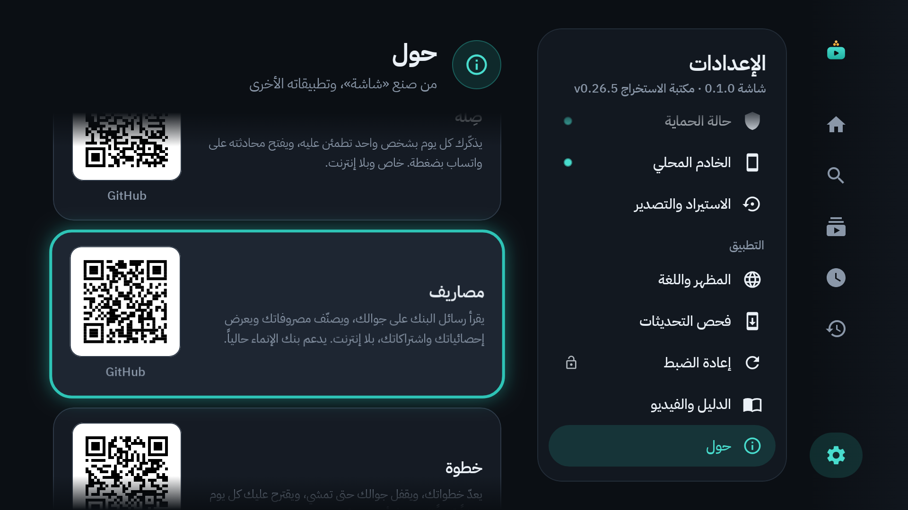

<div align="center">

<picture>
  <source media="(prefers-color-scheme: dark)" srcset="branding/exports/logo-lockup-1024.png">
  
</picture>

### يوتيوب هادئ لتلفاز البيت: بلا إعلانات، وبحماية كاملة للأطفال


*A calm YouTube app for the family TV: no ads, no algorithm, kids' profiles with allowed channels, and your phone as a remote.*

<a href="docs/video/shasha-explainer.mp4"></a>

**[▶ شاهد فيديو الشرح كاملاً بالصوت (٦ دقائق)](docs/video/shasha-explainer.mp4)**

</div>

<div dir="rtl">

## ✨ ما هو «شاشة»؟

تطبيق يوتيوب خاص بتلفاز البيت (أندرويد تي في وجوجل تي في): **بلا إعلانات ولا اقتراحات ولا تسجيل دخول**. لكل طفل ملف لا يرى فيه إلا القنوات التي تسمح بها، بوقت يومي ومواعيد محددة. ويُدار كله بالريموت أو من جوالك.

## 🚀 ابدأ من هنا

| | الخطوة |
|:-:|---|
| **١** | **نزّل** [`Shasha-Setup.zip`](Shasha-Setup.zip): اضغط الملف، ثم زر التنزيل، ثم فك ضغطه. |
| **٢** | **افتح «دليل شاشة.pdf»** الذي في المجلد، واتبع خطوات التثبيت بالصور (نحو ١٠ دقائق). |
| **٣** | **شغّل المثبّت** واكتب عنوان الشاشة، ثم وافق على الرسالة التي تظهر في التلفاز. تمّ! |

> 💡 **للتحديث لاحقاً:** من داخل التطبيق: «الإعدادات ← فحص التحديثات»، أو شغّل المثبّت من مجلد أحدث. تبقى بياناتك وإعداداتك كما هي.

## 🌟 المزايا

| 👨‍👩‍👧 للعائلة | 🛡️ للوالدين |
|---|---|
| بلا إعلانات ولا خوارزمية ولا تسجيل دخول | ملف لكل طفل بقنواته المسموحة فقط |
| 🎙️ بحث بالصوت بالعربية أو الإنجليزية، واقتراحات أثناء الكتابة | ⏱️ وقت يومي ومواعيد مشاهدة، وتنبيه قبل انتهاء الوقت |
| ⏭️ تخطّي المقاطع الدعائية داخل الفيديو تلقائياً | 🔒 «الوضع الجاد»: الفيديو الذي يبدأ يُكمل حتى نهايته |
| ⚡ سرعة تشغيل حتى ٤ أضعاف | 🔑 رمز للوالدين، وإعداد لكل سلوك مع زر «إرجاع الأصل» |
| 🌐 واجهة عربية أو إنجليزية، ومظهر داكن أو فاتح | 📱 تحكم كامل من الجوال: الوقت والقوائم والإعدادات |

## 🖼️ لقطات من التطبيق

<table>
  <tr>
    <td align="center"><br><sub>الرئيسية</sub></td>
    <td align="center"><br><sub>ملف الطفل</sub></td>
  </tr>
  <tr>
    <td align="center"><br><sub>البحث والاقتراحات</sub></td>
    <td align="center"><br><sub>إعدادات «الوضع الجاد»</sub></td>
  </tr>
  <tr>
    <td align="center"><br><sub>التحكم من الجوال</sub></td>
    <td align="center"><br><sub>صفحة «حول»</sub></td>
  </tr>
</table>

## 📚 الدليل والفيديو

| | |
|---|---|
| 📘 **دليل شاشة** (عربي) | [docs/دليل-شاشة.pdf](docs/دليل-شاشة.pdf) — التثبيت، والاستخدام، والوالدين، والإعدادات، وحل المشاكل |
| 📗 **Shasha Guide** (English) | [docs/Shasha-Guide.pdf](docs/Shasha-Guide.pdf) |
| 🎬 **فيديو الشرح** | [docs/video/shasha-explainer.mp4](docs/video/shasha-explainer.mp4) |

> الدليل والفيديو موجودان أيضاً داخل التطبيق: «الإعدادات ← الدليل والفيديو».

<details>
<summary><b>🛠️ للمطوّر</b></summary>

<br>

| الملف | ماذا فيه |
|---|---|
| [docs/dev/MAINTENANCE.md](docs/dev/MAINTENANCE.md) | الصيانة: البناء، والتوقيع، والإصدارات، وإصلاح الاستخراج حين يتغيّر يوتيوب |
| [docs/dev/ARCHITECTURE.md](docs/dev/ARCHITECTURE.md) | خريطة الكود: الوحدات الأربع وما في كل منها |
| [docs/dev/SPEC.md](docs/dev/SPEC.md) | المواصفات الأصلية |
| [docs/dev/phone-tv-scenarios.md](docs/dev/phone-tv-scenarios.md) | جدول حالات الجوال والشاشة |

```bash
./gradlew :policy:test :youtube:testDebugUnitTest :remote:testDebugUnitTest :app:verifyRoborazziDebug
./gradlew :app:assembleRelease
```

</details>

---

<p align="center">
  من صنع <b>احمد نايفه</b> · صُنع بحب لعائلتي 🤍
</p>

</div>
