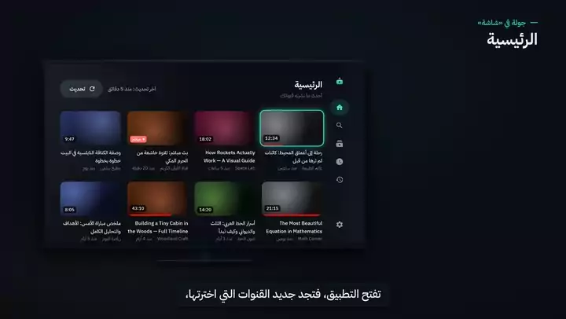
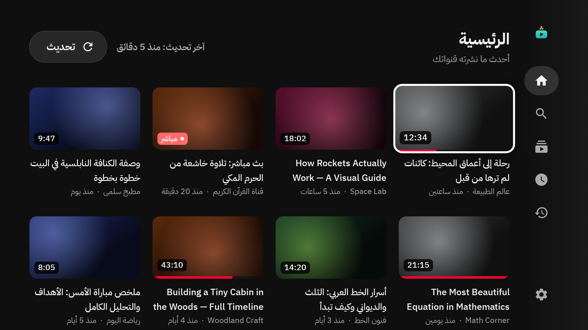
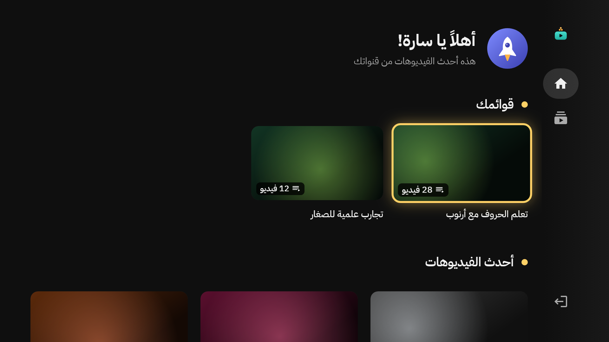
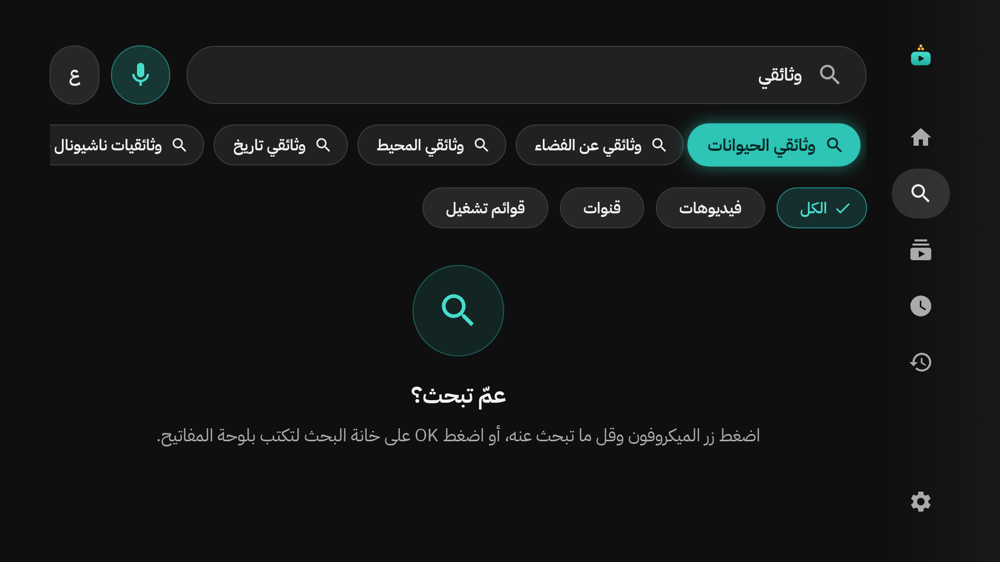
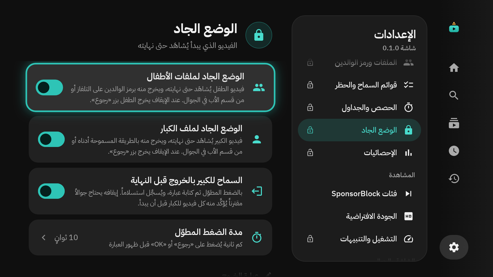
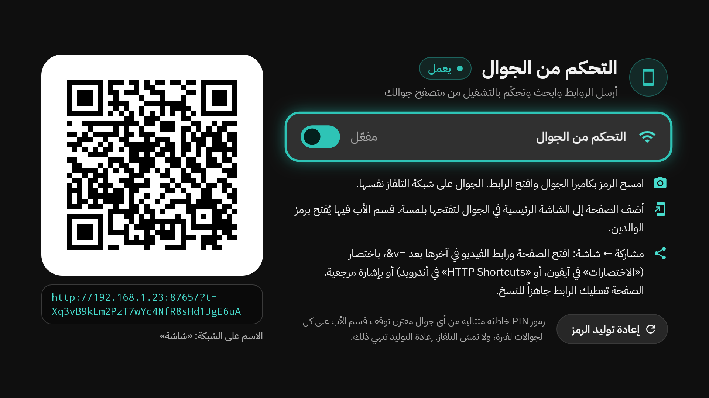
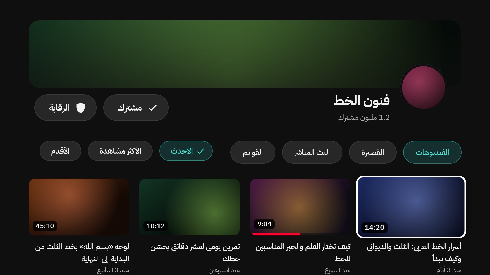

<div align="center">

<picture>
  <source media="(prefers-color-scheme: dark)" srcset="branding/exports/logo-lockup-1024.png">
  
</picture>

### يوتيوب هادئ لتلفاز البيت: بلا إعلانات، وبحماية كاملة للأطفال


*A calm YouTube app for the family TV (Android TV, Google TV, Fire TV): no ads, no sign-in, kids' profiles with allowed channels, your phone as a remote, and a phone app with downloads.*

<a href="docs/video/shasha-explainer.mp4"></a>

**[▶ شاهد فيديو الشرح كاملاً بالصوت (٦ دقائق)](docs/video/shasha-explainer.mp4)** · **[📱 فيديو تطبيق الجوال (دقيقتان)](docs/video/shasha-mobile.mp4)**

🇬🇧 **English:** [TV explainer (5 min)](docs/video/shasha-explainer-en.mp4) · [Phone app video (under 2 min)](docs/video/shasha-mobile-en.mp4)

</div>

<div dir="rtl">

## ✨ ما هو «شاشة»؟

تطبيق يوتيوب خاص بتلفاز البيت: **بلا إعلانات ولا تسجيل دخول**، والفيديوهات المقترحة والقصيرة تظهر أو تختفي بقرارك. لكل طفل ملف لا يرى فيه إلا القنوات التي تسمح بها، بوقت يومي ومواعيد محددة. ويُدار كله بالريموت أو من جوالك.

- 📺 **يعمل على:** شاشات أندرويد تي في وجوجل تي في (سوني، TCL، هايسنس، فيليبس، شاومي…) وأجهزة Amazon Fire TV. ولشاشات سامسونج وإل جي وغيرها: جهاز أندرويد تي في صغير يوصل بمنفذ HDMI (التفاصيل في الدليل).
- 📱 **وتطبيق للجوال (أندرويد):** يوتيوب بلا إعلانات، مع تنزيل الفيديو أو الصوت، والتشغيل في الخلفية، والنافذة الصغيرة.

## 🚀 ابدأ من هنا

| | الخطوة |
|:-:|---|
| **١** | **نزّل** [`Shasha-Setup.zip`](Shasha-Setup.zip): اضغط الملف، ثم زر التنزيل، ثم فك ضغطه. (تطبيق الجوال في مجلد `Phone` داخله.) |
| **٢** | **افتح «دليل شاشة.pdf»** الذي في المجلد، واتبع خطوات التثبيت بالصور (نحو ١٠ دقائق). |
| **٣** | **شغّل المثبّت** واكتب عنوان الشاشة، ثم وافق على الرسالة التي تظهر في التلفاز. تمّ! |

> 🌐 **صفحة التنزيل:** [ahmad-nayfeh.github.io/shasha](https://ahmad-nayfeh.github.io/shasha/): حقيبة التثبيت، وتطبيق التلفاز، وتطبيق الجوال، والدليل.

> 💡 **للتحديث لاحقاً:** ضغطة واحدة من داخل التطبيق: «الإعدادات ← فحص التحديثات»؛ ينزّل أحدث إصدار ويثبّته بنفسه، وتبقى بياناتك وإعداداتك كما هي. وتطبيق الجوال يحدّث نفسه بالطريقة نفسها.

## 🌟 المزايا

| 👨‍👩‍👧 للعائلة | 🛡️ للوالدين |
|---|---|
| بلا إعلانات ولا تسجيل دخول، والمقترحات اختيارية | ملف لكل طفل بقنواته المسموحة فقط |
| 🎙️ بحث بالصوت بالعربية أو الإنجليزية، واقتراحات أثناء الكتابة | ⏱️ وقت يومي ومواعيد مشاهدة، وتنبيه قبل انتهاء الوقت |
| ⏭️ تخطّي المقاطع الدعائية داخل الفيديو تلقائياً | 🔒 «الوضع الجاد»: الفيديو الذي يبدأ يُكمل حتى نهايته |
| ⚡ سرعة تشغيل حتى ٤ أضعاف | 🔑 رمز للوالدين، وإعداد لكل سلوك مع زر «إرجاع الأصل» |
| 🌐 واجهة عربية أو إنجليزية، ومظهر داكن أو فاتح | 📱 تحكم كامل من الجوال: الوقت والقوائم والإعدادات |
| 📂 أقسام القناة (الفيديوهات، القصيرة، البث المباشر، القوائم) وترتيبها: الأحدث، الأكثر مشاهدة، الأقدم | ✅ ما يُرسل من الجوال ينتظر «قبول / رفض» على الشاشة |
| 🔁 إن تعذّر تشغيل فيديو على الشاشة أعاد المحاولة وحده بجودة آمنة | 🚫 فلتر مدمج يحجب البحث والنتائج غير اللائقة، في كل الملفات وفي التطبيقين |
| 📱 مشغّل خاص للمقاطع القصيرة (Shorts): عمودي، وزر الأسفل للتالي والأعلى للسابق | 🏠 «مقترحة لك» في الرئيسية من سجل المشاهدة، والأحدث أثقل وزناً |
| 📱 الجوال: ترجمة داخل الفيديو، وصورة المشهد عند تحريك الشريط، وحفظ قوائم يوتيوب في المكتبة | 📱 الجوال: تشغيل في الخلفية لا ينقطع، ونافذة صغيرة ثابتة، وShorts في الرئيسية |
| 📱 الجوال: مشغّل مصغّر يبقى يعمل وأنت تتصفح التطبيق | 💬 الجوال: التعليقات مع عدد الإعجابات والردود، مرتبة بالأحدث أو الأهم |
| 🔎 بحث بلا حدّ: النتائج تتوالى، والمقاطع القصيرة في صف خاص | 📂 في تطبيق الجوال: قوائم حفظ خاصة بك، والتكبير بإصبعين |
| 📺 الشاشة: حفظ قوائم يوتيوب لكل ملف | ⌨️ الشاشة: لوحة المفاتيح لا تظهر إلا بالضغط على خانة الكتابة |
| 🧭 «مقترحة لك» ثابتة أثناء التنقل، وتتجدد بزر «تحديث» أو بعد مشاهدة فيديو | 🌐 التنزيل والتحديث من صفحة الموقع، بلا أي مفتاح داخل التطبيق |
| 🌙 الشاشة: مؤقت النوم، وإطفاء الصورة مع بقاء الصوت | ⚡ فتح الفيديو والتقليب بين Shorts أسرع، بواجهة مألوفة لمن يستخدم يوتيوب |

## 🖼️ لقطات من التطبيق

<table>
  <tr>
    <td align="center"><br><sub>الرئيسية</sub></td>
    <td align="center"><br><sub>ملف الطفل</sub></td>
  </tr>
  <tr>
    <td align="center"><br><sub>البحث والاقتراحات</sub></td>
    <td align="center"><br><sub>إعدادات «الوضع الجاد»</sub></td>
  </tr>
  <tr>
    <td align="center"><br><sub>التحكم من الجوال</sub></td>
    <td align="center"><br><sub>صفحة القناة: أقسامها وترتيبها</sub></td>
  </tr>
</table>

## 📚 الدليل والفيديو

| | |
|---|---|
| 📘 **دليل شاشة** (عربي) | [docs/دليل-شاشة.pdf](docs/دليل-شاشة.pdf): الشاشات المدعومة، والتثبيت، والاستخدام، والوالدين، وتطبيق الجوال، والتحديث، وحل المشاكل |
| 📗 **Shasha Guide** (English) | [docs/Shasha-Guide.pdf](docs/Shasha-Guide.pdf) |
| 🎬 **فيديو الشرح** (الشاشة) | [docs/video/shasha-explainer.mp4](docs/video/shasha-explainer.mp4) |
| 📱 **فيديو تطبيق الجوال** | [docs/video/shasha-mobile.mp4](docs/video/shasha-mobile.mp4) |
| 🎬 **Explainer video** (English) | [docs/video/shasha-explainer-en.mp4](docs/video/shasha-explainer-en.mp4) |
| 📱 **Phone app video** (English) | [docs/video/shasha-mobile-en.mp4](docs/video/shasha-mobile-en.mp4) |

> الدليل والفيديو موجودان أيضاً داخل التطبيق: «الإعدادات ← الدليل والفيديو».

<details>
<summary><b>🛠️ للمطوّر</b></summary>

<br>

| الملف | ماذا فيه |
|---|---|
| [docs/dev/MAINTENANCE.md](docs/dev/MAINTENANCE.md) | الصيانة: البناء، والتوقيع، والإصدارات، وإصلاح الاستخراج حين يتغيّر يوتيوب |
| [docs/dev/ARCHITECTURE.md](docs/dev/ARCHITECTURE.md) | خريطة الكود: الوحدات (`app` للشاشة، و`mobile` للجوال، و`youtube` و`policy` و`remote`) |
| [docs/dev/SPEC.md](docs/dev/SPEC.md) | المواصفات الأصلية |
| [docs/dev/phone-tv-scenarios.md](docs/dev/phone-tv-scenarios.md) | جدول حالات الجوال والشاشة |
| [docs/dev/tv-compatibility.md](docs/dev/tv-compatibility.md) | الشاشات والأجهزة المدعومة وخطوات كل نوع |

```bash
./gradlew :policy:test :youtube:testDebugUnitTest :remote:testDebugUnitTest :app:verifyRoborazziDebug :mobile:testDebugUnitTest
./gradlew :app:assembleRelease :mobile:assembleRelease
```

</details>

---

<p align="center">
  من صنع <b>احمد نايفه</b> · صُنع بحب لعائلتي 🤍
</p>

</div>
