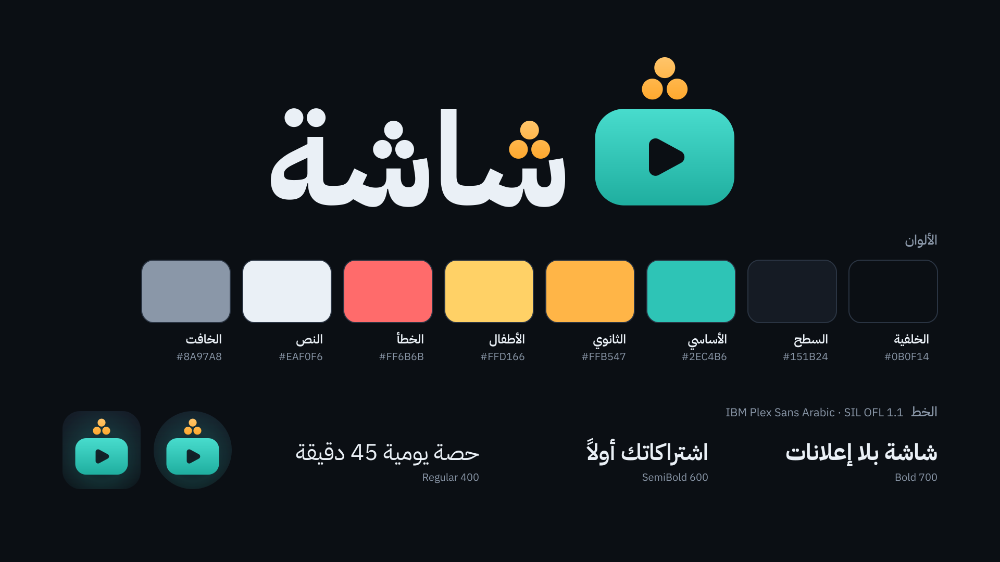
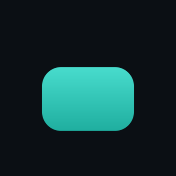

# هوية «شاشة» البصرية



## الفكرة
العلامة شاشة تلفزيون بزوايا مستديرة وفي وسطها مثلث تشغيل. فوقها تطفو **النقاط الثلاث لحرف الشين (ش)**
مرتّبة كما في الخط العربي: نقطة في الأعلى ونقطتان تحتها. هذه النقاط توقيع العلامة: هي أول حرف من الاسم،
وهي كذلك إشارة البث فوق التلفاز. الشاشة باللون الأساسي (الفيروزي) والنقاط بالكهرماني.

في الشعار النصي «شاشة» (IBM Plex Sans Arabic Bold محوَّلاً إلى مسارات) رُسمت نقاط الحروف دوائرَ بنسب
نقاط العلامة نفسها، ونقاط الشين الأولى (بداية القراءة) بالكهرماني لتربط النص بالعلامة.

## الملفات

| الملف | الاستخدام |
|---|---|
| `logo-mark.svg` | العلامة وحدها (مربع 1024، ألوان كاملة) |
| `logo-wordmark.svg` / `logo-wordmark-on-light.svg` | الشعار النصي لخلفية داكنة / فاتحة |
| `logo-lockup.svg` / `logo-lockup-on-light.svg` | الشعار الكامل الأفقي (العلامة يميناً، النص يساراً) |
| `logo-lockup-stacked.svg` | الشعار الكامل العمودي (للشاشات الافتتاحية والملصقات) |
| `logo-mono.svg` / `logo-mono-lockup.svg` | لون واحد (`currentColor`؛ داكن افتراضياً) للطباعة والختم والعلامة المائية |
| `app-icon.svg` | الأيقونة كاملة (الخلفية + العلامة) كما تظهر عبر القناع |
| `banner.svg` | لافتة Android TV الأصلية 1280×720 |
| `exports/*.png` | تصدير كل ملف SVG بعرض 512 و1024، وأيقونة المتجر 512/1024، واللافتة 320×180 و1280×720 |
| `exports/splash-animation.gif` | معاينة حركة شاشة البدء |
| `exports/logo-reveal-1080p60.mp4` | حركة كشف الشعار (3.6 ثانية، 1080p بـ60 إطاراً) للفيديوهات، مع `logo-reveal-poster.png` |
| `fonts/OFL.txt` | رخصة الخط |
| `tools/` | سكربتات التوليد (كل الأصول تُبنى من الكود؛ لا تعدّل الملفات المولَّدة يدوياً) |

## الألوان

| الاسم | HEX | الاستخدام |
|---|---|---|
| الخلفية | `#0B0F14` | خلفية التطبيق وشاشة البدء، ولون مثلث التشغيل المفرَّغ |
| السطح | `#151B24` | البطاقات والقوائم |
| السطح البديل | `#1E2632` | العناصر المرفوعة والحقول |
| الأساسي (فيروزي) | `#2EC4B6` | الشاشة في العلامة، التركيز، الأزرار الأساسية |
| على الأساسي | `#04201D` | النص فوق الأساسي |
| الثانوي (كهرماني) | `#FFB547` | نقاط الشين، التنبيهات والوقت |
| لون الأطفال | `#FFD166` | لمسات ملف الطفل |
| الخطأ | `#FF6B6B` | الأخطاء |
| النص | `#EAF0F6` | النص الأساسي والشعار النصي على الداكن |
| الخافت | `#8A97A8` | النص الثانوي |

**تدرّجات العلامة** (رأسية من الأعلى للأسفل):
- الشاشة: `#48DCCD` ← `#1FAE9F` (متوسطها هو الأساسي `#2EC4B6`).
- النقاط: `#FFC56B` ← `#FFA92E` (متوسطها هو الثانوي `#FFB547`).
- على الخلفيات الفاتحة: الشاشة `#2EC4B6` ← `#16998C`، والنقاط `#FFB547` ← `#F39414`، والنص `#0B0F14`.
- حيث لا تُدعم التدرجات استعمل اللونين المسطّحين `#2EC4B6` و`#FFB547`.

## هندسة العلامة
بوحدات تكون فيها الشاشة بعرض 720:
- الشاشة 720×500، نصف قطر الزوايا 150.
- مثلث التشغيل: ارتفاع 240، عرض 221، زوايا بنصف قطر 34، مُزاح قليلاً لليمين ليبدو متمركزاً بصرياً.
- النقاط: قطر 108، فراغ 20 بين النقاط (مثلث متساوي الأضلاع)، و48 بين النقاط والشاشة.
- الشعار الأفقي: ارتفاع الألف في «شاشة» يساوي ارتفاع الشاشة تماماً، وخط القاعدة على حافة الشاشة السفلى،
  والمسافة بين النص والعلامة = 1.25 × قطر النقطة.

## المساحة الآمنة والحد الأدنى للحجم
- **المساحة الآمنة**: اترك حول العلامة أو الشعار من كل الجهات فراغاً لا يقل عن **قطر نقطة واحدة** من نقاط العلامة
  (≈ 15% من عرض الشاشة). لا يدخل هذا الفراغ نص ولا صورة ولا حافة.
- **الحد الأدنى**: عرض العلامة نفسها (بلا هوامش) 24px؛ تحت ذلك تندمج النقاط الثلاث في كتلة واحدة وإن بقيت
  العلامة معروفة. الشعار الأفقي 120px عرضاً على الأقل، وتحته استعمل العلامة وحدها.

## الاستخدام
- استعمل الملفات كما هي؛ لا تمدّ الشعار ولا تضغطه ولا تدوّره.
- لا تغيّر الألوان ولا ترتيب النقاط ولا شكلها (دوائر، واحدة فوق اثنتين).
- لا تكتب «شاشة» بخط آخر بجانب العلامة؛ استعمل `logo-lockup*.svg`.
- لا تضع العلامة الملوّنة على خلفيات مزدحمة أو صور؛ استعمل النسخة أحادية اللون أو خلفية `#0B0F14`.
- لا تضف ظلالاً أو حدوداً أو توهجاً غير الموجود في الملفات.
- في الواجهة: الشعار الأفقي على الخلفية الداكنة فقط (`logo-lockup.svg`)، ونسخة `-on-light` للخلفيات الفاتحة.
- لا تستعمل شعار يوتيوب أو ألوانه (الأحمر) مع هوية «شاشة».

## الخط
**IBM Plex Sans Arabic** — حقوق IBM Corp. مرخّص بـ **SIL Open Font License 1.1** (النص كاملاً في `fonts/OFL.txt`).
- مضمّن في التطبيق بأربعة أوزان: `res/font/plex_arabic_regular.ttf` (400)، `plex_arabic_medium.ttf` (500)،
  `plex_arabic_semibold.ttf` (600)، `plex_arabic_bold.ttf` (700)، وعائلة `res/font/plex_arabic.xml`.
- المصدر: `https://github.com/google/fonts/tree/main/ofl/ibmplexsansarabic` (ملفات TTF غير معدّلة).
- الرخصة تسمح بالتضمين في التطبيق وتوزيعه مجاناً، ويجب أن تبقى الرخصة مرفقة، ولا يُباع الخط وحده.
  «Plex» اسم محجوز: أي نسخة معدّلة من ملف الخط نفسه لا تحمل هذا الاسم (نحن لا نعدّل الملفات).
- الشعار النصي مسارات (outlines) مرسومة من الخط؛ هذا عمل فني مسموح ولا يحتاج الخط ليُعرض.
- اذكر الخط ورخصته في شاشة «حول».

## موارد أندرويد
كلها مولَّدة من `tools/build_brand.py`:

| المورد | الوصف |
|---|---|
| `@mipmap/ic_launcher`, `@mipmap/ic_launcher_round` | أيقونة تكيّفية (`mipmap-anydpi-v26`) + PNG احتياطية من mdpi إلى xxxhdpi |
| `@drawable/ic_launcher_foreground` | طبقة العلامة (108dp، داخل دائرة الأمان 66dp) |
| `@drawable/ic_launcher_background` | خلفية داكنة متدرجة مع توهج فيروزي خفيف |
| `@drawable/ic_launcher_monochrome` | طبقة الأيقونات الملوّنة بالسمة (Android 13+) |
| `@drawable/banner` | لافتة Android TV (`drawable-xhdpi` 320×180 و`drawable-xxhdpi` 480×270) |
| `@drawable/splash_logo` | أيقونة شاشة البدء الثابتة (240dp، العلامة داخل الدائرة المركزية 160dp) |
| `@drawable/splash_logo_animated` | نفس الأيقونة متحركة، 880ms |
| `@drawable/splash_wordmark` | الشعار النصي 200×80dp (`windowSplashScreenBrandingImage`، أو شعار داخل التطبيق) |
| `@drawable/splash_lockup` | الشعار الأفقي بارتفاع 48dp لرؤوس الشاشات وشاشة «حول» (على خلفية داكنة) |
| `@color/ic_launcher_background`, `@color/brand_splash_background` | `#0B0F14` |
| `@font/plex_arabic` + الأوزان الأربعة | الخط |

ربطها (مسؤولية هيكل التطبيق):
```xml
<!-- AndroidManifest.xml -->
<application android:icon="@mipmap/ic_launcher" android:roundIcon="@mipmap/ic_launcher_round"
    android:banner="@drawable/banner" ...>

<!-- themes: Theme.SplashScreen من androidx.core:core-splashscreen -->
<style name="Theme.Shasha.Starting" parent="Theme.SplashScreen">
    <item name="windowSplashScreenBackground">@color/brand_splash_background</item>
    <item name="windowSplashScreenAnimatedIcon">@drawable/splash_logo</item>
    <item name="postSplashScreenTheme">@style/Theme.Shasha</item>
</style>
<!-- values-v31: الحركة تعمل على Android 12+ فقط -->
<item name="windowSplashScreenAnimatedIcon">@drawable/splash_logo_animated</item>
<item name="windowSplashScreenAnimationDuration">880</item>
```
الحالة الثابتة لـ`splash_logo_animated` هي الإطار الأخير، فلا تظهر فارغة إن لم تعمل الحركة.

### حركة شاشة البدء (880ms)
| الزمن | الحدث |
|---|---|
| 0–300ms | النقطة السفلى اليمنى تهبط وتظهر (ارتداد خفيف) |
| 120–420ms | النقطة السفلى اليسرى |
| 240–540ms | النقطة العليا |
| 520–880ms | مثلث التشغيل يظهر ويكبر من 55% إلى 100% |



## إعادة التوليد
```bash
python3 -m pip install -r branding/tools/requirements.txt
python3 branding/tools/build_brand.py     # SVG + PNG + موارد أندرويد + لوحة الهوية + GIF
python3 branding/tools/logo_reveal.py     # فيديو كشف الشعار MP4 (اختياري، يحتاج imageio-ffmpeg)
```
- `tools/brandgeo.py`: الألوان والهندسة (مصدر واحد لكل الأصول).
- `tools/brandtype.py`: تشكيل النص العربي بـHarfBuzz وتحويله إلى مسارات من ملفات الخط المضمّنة،
  فلا تعتمد التصديرات على خطوط الجهاز.
