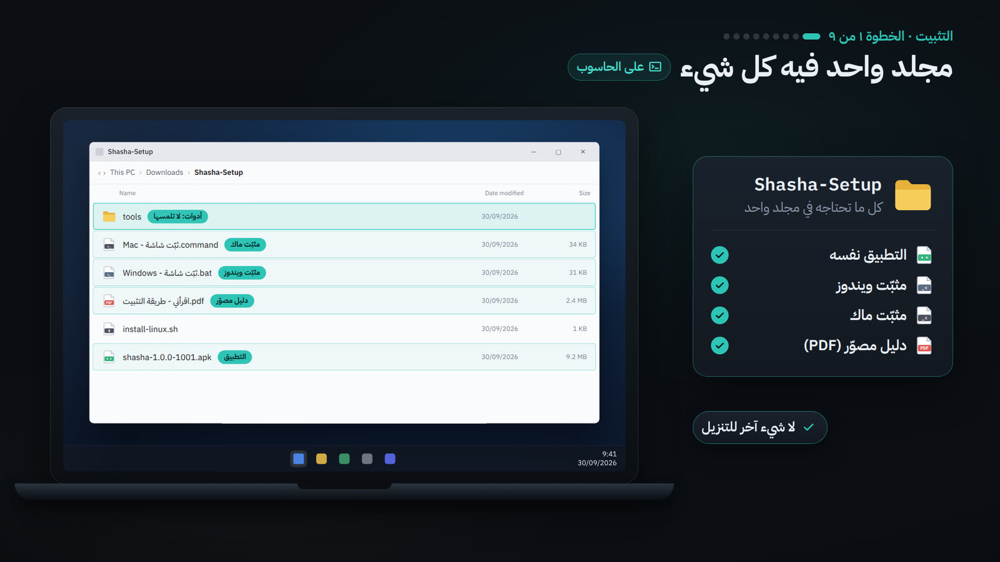
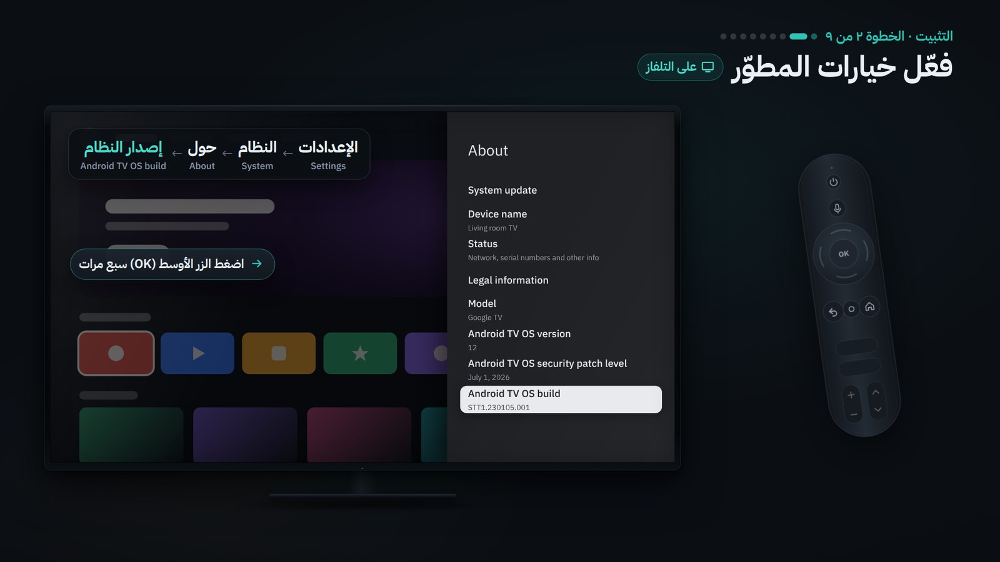
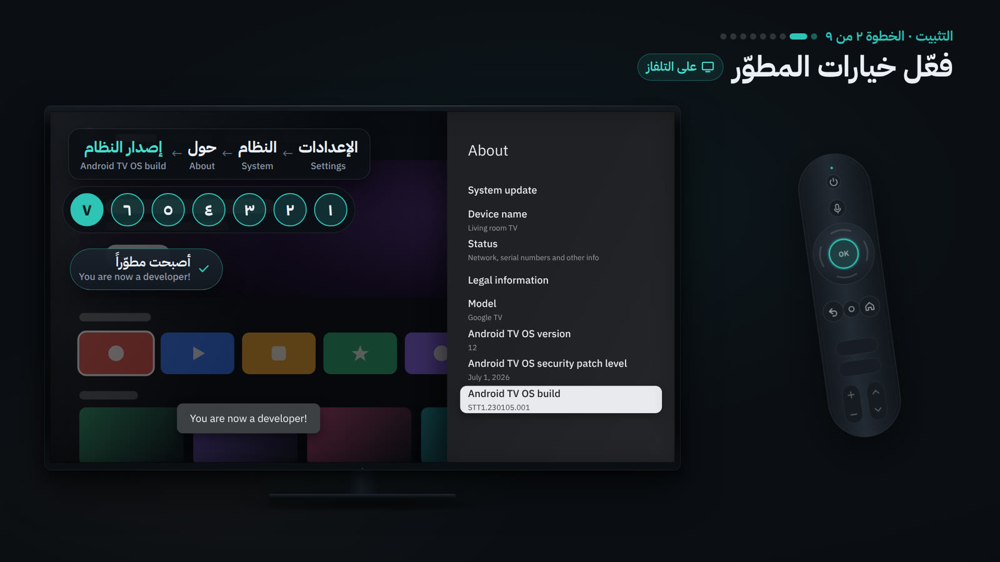
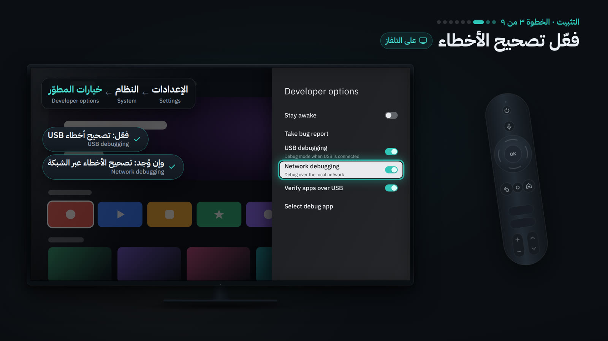
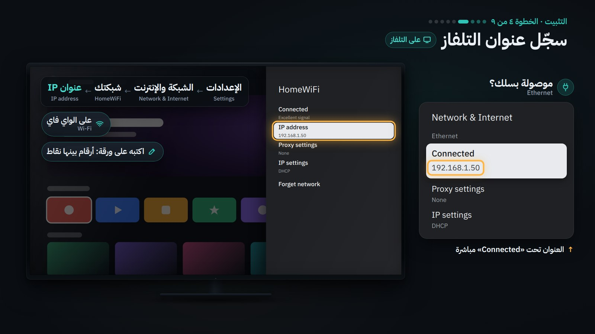
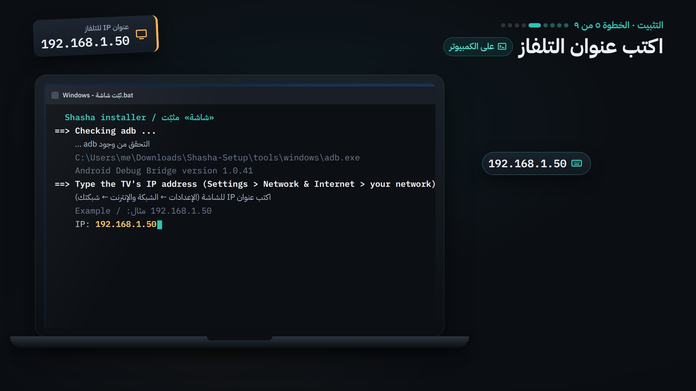
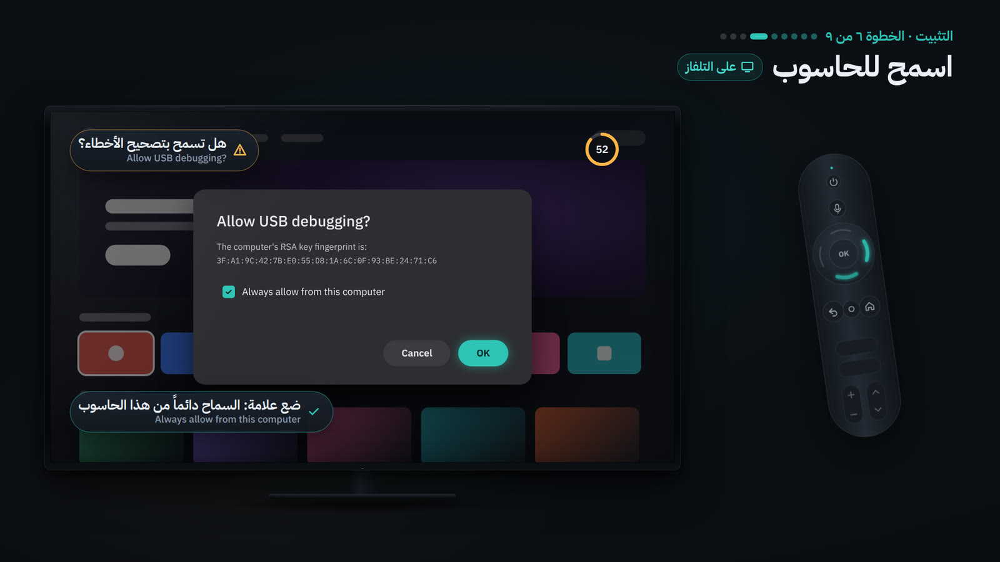
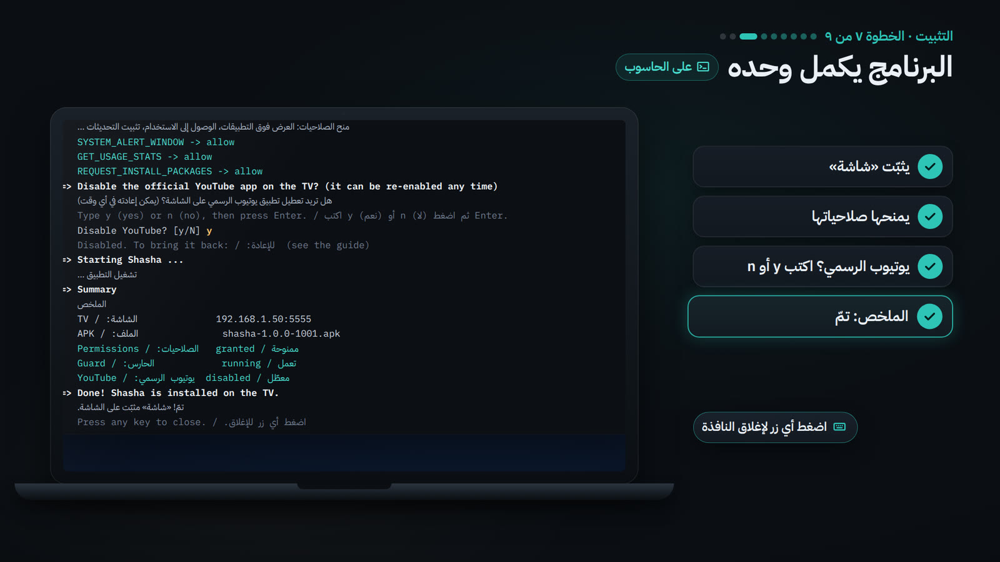
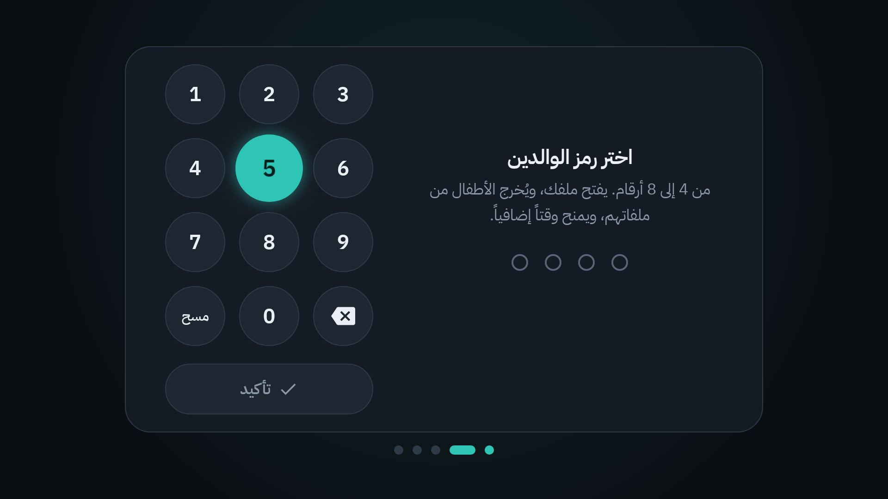
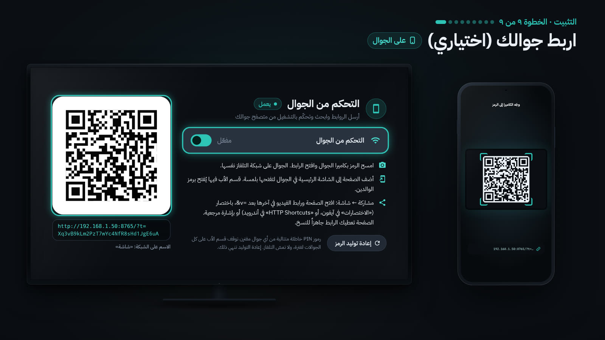

# دليل التثبيت خطوة بخطوة

هذا الدليل يثبّت تطبيق «شاشة» على شاشة TCL (بنظام Google TV) في بيتك. لا تحتاج أي خبرة تقنية: اتبع الخطوات بالترتيب، خطوة بعد خطوة. يستغرق الأمر نحو 15 دقيقة، مرة واحدة فقط.

> [!TIP]
> تفضّل المشاهدة؟ [فيديو الشرح](video/shasha-explainer.mp4) يعرض الخطوات نفسها. وبعد التثبيت تجد كل ما يفعله التطبيق في [كتيّب التعليمات](manual/README.md).

## ما تحتاجه

- **شاشة TCL بنظام Google TV** والريموت الخاص بها.
- **حاسوب شخصي بنظام ويندوز أو ماك**، متصل بشبكة Wi-Fi نفسها التي عليها الشاشة. حاسوب العمل الذي يمنع تشغيل البرامج لا يصلح.
- **نحو 15 دقيقة**، مرة واحدة فقط.
- جوالك (اختياري)، للخطوة الأخيرة.

لا تحتاج تنزيل أي شيء آخر: الملف الذي تنزّله في الخطوة 1 فيه كل ما يلزم.

## الخطوات باختصار

| الخطوة | ماذا تفعل | أين |
|---|---|---|
| [1](#الخطوة-1-نزّل-ملف-التثبيت-الحاسوب) | نزّل ملف التثبيت وفك ضغطه | الحاسوب |
| [2](#الخطوة-2-فعّل-خيارات-المطوّر-الشاشة) | فعّل خيارات المطوّر | الشاشة |
| [3](#الخطوة-3-فعّل-تصحيح-الأخطاء-الشاشة) | فعّل تصحيح الأخطاء | الشاشة |
| [4](#الخطوة-4-اعرف-عنوان-الشاشة-الشاشة) | اعرف عنوان الشاشة | الشاشة |
| [5](#الخطوة-5-شغّل-المثبّت-الحاسوب) | شغّل المثبّت واكتب العنوان | الحاسوب |
| [6](#الخطوة-6-اسمح-للحاسوب-الشاشة) | اسمح للحاسوب | الشاشة |
| [7](#الخطوة-7-المثبّت-يكمل-وحده-الحاسوب) | انتظر حتى ينتهي المثبّت | الحاسوب |
| [8](#الخطوة-8-أول-تشغيل-للتطبيق-الشاشة) | أول تشغيل لـ«شاشة» | الشاشة |
| [9](#الخطوة-9-اربط-جوالك-اختياري) | اربط جوالك (اختياري) | الجوال |

## الخطوة 1: نزّل ملف التثبيت (الحاسوب)



1. افتح [صفحة المستودع على GitHub](https://github.com/Ahmad-Nayfeh/shasha) (سجّل الدخول أولاً، فالمستودع خاص)، واضغط الملف **Shasha-Setup.zip**، ثم زر التنزيل **Download** (السهم المتجه إلى الأسفل).
2. فك الضغط. في ويندوز: انقر الملف بالزر الأيمن ← **Extract All** ← **Extract**. في ماك: انقره مرتين.
3. يظهر مجلد اسمه `Shasha-Setup` فيه كل شيء. لا تنقل أي ملف منه إلى مكان آخر: المثبّت يحتاج ما بجانبه.

```text
Shasha-Setup/
├── اقرأني - طريقة التثبيت.pdf    ← هذا الدليل للطباعة
├── Windows - ثبّت شاشة.bat        ← المثبّت لويندوز
├── Mac - ثبّت شاشة.command        ← المثبّت لماك
├── install-linux.sh               ← المثبّت للينكس
├── shasha-1.0.0-1001.apk          ← التطبيق نفسه
└── tools/                         ← أداة adb من Google، لا تلمسها
    ├── windows/
    ├── mac/
    └── linux/
```

## الخطوة 2: فعّل خيارات المطوّر (الشاشة)



1. بالريموت افتح **Settings** (الإعدادات، رمز الترس أعلى الشاشة الرئيسية) ← **System** (النظام) ← **About** (حول).
2. انزل إلى **Android TV OS build** واضغط زر **OK** سبع مرات متتالية.
3. تظهر رسالة **You are now a developer!** (أصبحت مطوّراً).



## الخطوة 3: فعّل تصحيح الأخطاء (الشاشة)



1. ارجع إلى **Settings** ← **System** ← **Developer options** (خيارات المطوّر)، وفعّل **USB debugging**.
2. إن وجدت أيضاً **Network debugging** (أو **ADB over network**) ففعّله كذلك.
3. إن لم تجد فيها إلا **Wireless debugging**، فلا بأس: المثبّت يتولى ذلك في الخطوة 6.

## الخطوة 4: اعرف عنوان الشاشة (الشاشة)



1. افتح **Settings** ← **Network & Internet** (الشبكة والإنترنت) ← اسم شبكة Wi-Fi المتصلة بها الشاشة (أو **Ethernet** إن كانت موصولة بسلك).
2. انزل إلى **IP address**: ستجد رقماً مثل `192.168.1.50`. اكتبه على ورقة.

## الخطوة 5: شغّل المثبّت (الحاسوب)



### على ويندوز

1. افتح مجلد `Shasha-Setup` وانقر مرتين على **Windows - ثبّت شاشة** (ملف `.bat`).
2. إن ظهرت نافذة زرقاء **Windows protected your PC**، فاضغط **More info** ثم **Run anyway**. وإن سألك **Do you want to run this file?** فاضغط **Run**.
3. تُفتح نافذة سوداء هي المثبّت.

### على ماك

1. افتح مجلد `Shasha-Setup`، وانقر بالزر الأيمن (أو اضغط Control مع النقر) على **Mac - ثبّت شاشة** (ملف `.command`)، ثم اختر **Open**، ثم **Open** مرة أخرى في النافذة التي تسأل.
2. إن لم تجد زر **Open** (في macOS 15 وما بعده): اضغط **Done**، ثم افتح **System Settings** ← **Privacy & Security**، وانزل إلى الأسفل واضغط **Open Anyway** بجانب اسم الملف، ثم **Open Anyway** مرة أخرى.
3. تُفتح نافذة **Terminal** هي المثبّت.

### ثم في الحالتين

يسألك المثبّت:

```text
اكتب عنوان IP للشاشة (الإعدادات ← الشبكة والإنترنت ← شبكتك)
Example / مثال: 192.168.1.50
IP:
```

اكتب العنوان من الخطوة 4 (مثل `192.168.1.50`) ثم اضغط **Enter**. الأرقام العربية مثل ١٩٢ تُقبل أيضاً.

## الخطوة 6: اسمح للحاسوب (الشاشة)



1. تظهر على الشاشة نافذة **Allow USB debugging?**. بالريموت فعّل **Always allow from this computer**، ثم اضغط **OK**. لديك 60 ثانية.
2. هذه النافذة لا تظهر إلا أول مرة: بعدها يتذكر التلفاز حاسوبك.

**إن قال المثبّت «رفضت الشاشة الاتصال»:** تأكد أولاً أن **USB debugging** مفعّل (الخطوة 3). فإن لم يكن في شاشتك إلا **Wireless debugging**، فاكتب `y` عندما يسألك المثبّت «هل تريد الإقران برمز الآن؟»، ثم:

1. في الشاشة: **Settings** ← **System** ← **Developer options** ← **Wireless debugging**: فعّله، ثم اختر **Pair device with pairing code**. تعرض الشاشة رمزاً من 6 أرقام وتحته عنواناً مثل `192.168.1.50:37215`.
2. في الحاسوب: اكتب هذا العنوان، ثم الرمز، واضغط **Enter** بعد كل منهما.
3. يجد المثبّت بعدها عنوان الاتصال وحده غالباً. وإن سألك عنه فاكتب العنوان الظاهر في شاشة **Wireless debugging** نفسها تحت **IP address & Port** (مثل `192.168.1.50:41234`).

## الخطوة 7: المثبّت يكمل وحده (الحاسوب)



1. يثبّت «شاشة» على الشاشة ويمنحه صلاحياته. انتظر دقيقة.
2. ثم يسألك: «هل تريد تعطيل تطبيق يوتيوب الرسمي على الشاشة؟ (يمكن إعادته في أي وقت)». اكتب `y` (نعم) أو `n` (لا) ثم **Enter**. زر **Enter** وحده يعني «لا».
3. يفتح «شاشة» على الشاشة، ويطبع ملخصاً ينتهي بـ **تمّ! «شاشة» مثبّت على الشاشة.** اضغط أي زر لإغلاق النافذة.

### ماذا يطبع المثبّت في النهاية

```text
==> Summary
    الملخص
    TV / الشاشة:              192.168.1.50:5555
    APK / الملف:               shasha-1.0.0-1001.apk
    Permissions / الصلاحيات:   granted / ممنوحة
    Guard / الحارس:            running / تعمل
    YouTube / يوتيوب الرسمي:  disabled / معطّل

==> Done! Shasha is installed on the TV.
    تمّ! «شاشة» مثبّت على الشاشة.
    Now continue on the TV: create the parent PIN and the profiles.
    تابع الآن على الشاشة: أنشئ رمز الوالدين والملفات.

    Press any key to close.
    اضغط أي زر للإغلاق.
```

- **الصلاحيات «ممنوحة»** و**الحارس «تعمل»**: كل شيء كما يجب. فوقهما ثلاثة أسطر تبدأ بـ `[OK]`، سطر لكل صلاحية.
- **يوتيوب الرسمي**: «معطّل» إن أجبت `y`، و«مفعّل» إن أجبت `n`.
- إن رأيت **«ناقصة»** أو رسالة تبدأ بـ `!!`، فاقرأ ما تحتها، ثم انظر [مشكلات شائعة وحلولها](#مشكلات-شائعة-وحلولها).

## الخطوة 8: أول تشغيل للتطبيق (الشاشة)



1. «شاشة» مفتوح الآن على الشاشة: اضغط **لنبدأ**، ثم اختر **رمز الوالدين** (من 4 إلى 8 أرقام) وأعد كتابته للتأكيد. احفظه جيداً.
2. أنشئ **ملفك** (ملف الكبار)، ثم **ملفاً لطفلك**: اسمه، ثم **إضافة الملف**. يبدأ بساعة يومياً بين 7 صباحاً و10 مساءً، وتغيّر ذلك من **الإعدادات** ← **الحصص والجداول**.
3. أضف القنوات المسموحة لطفلك: **الإعدادات** ← **قوائم السماح والحظر**. التفاصيل في [كتيّب التعليمات](manual/README.md).

## الخطوة 9: اربط جوالك (اختياري)



1. في «شاشة»: **الإعدادات** ← **الخادم المحلي** ← **رمز الاقتران QR**، فتظهر شاشة **التحكم من الجوال** وفيها رمز QR. (يظهر الرمز نفسه في آخر خطوة من أول تشغيل.)
2. امسح الرمز بكاميرا الجوال وافتح الرابط. الجوال والشاشة على شبكة Wi-Fi نفسها.
3. أضف الصفحة إلى الشاشة الرئيسية للجوال: في آيفون زر المشاركة ← **Add to Home Screen**، وفي أندرويد القائمة ⋮ ← **Add to Home screen**.

## مشكلات شائعة وحلولها

| ما تراه | الحل |
|---|---|
| «لم يُعثر على أداة adb الخاصة بالمثبّت» | فك ضغط `Shasha-Setup.zip` **كاملاً** (الخطوة 1)، وشغّل المثبّت من داخل المجلد الناتج، لا من داخل الملف المضغوط. ولا تنقل المثبّت وحده بعيداً عن مجلد `tools`. |
| ويندوز: **Windows protected your PC** | هذا تنبيه SmartScreen المعتاد لأي ملف من الإنترنت: اضغط **More info** ← **Run anyway**. |
| ماك: الملف **cannot be opened** أو **Apple could not verify** | انقر المثبّت بالزر الأيمن ← **Open** ← **Open**. وفي macOS 15 وما بعده: **System Settings** ← **Privacy & Security** ← **Open Anyway**. وإن قال المثبّت «تعذّر تشغيل أداة adb»: من المكان نفسه اضغط **Allow Anyway** (أو **Open Anyway**) بجانب **adb**، وأعد تشغيل المثبّت، واضغط **Open** إن سألك. |
| ماك: **you do not have appropriate access privileges** | افتح **Terminal**، واكتب `bash` ثم مسافة، واسحب ملف **Mac - ثبّت شاشة** إلى النافذة، واضغط **Enter**. |
| «لم تسمح الشاشة لهذا الحاسوب بعد» (unauthorized) | شغّل المثبّت من جديد وراقب الشاشة: في نافذة **Allow USB debugging?** فعّل **Always allow from this computer** واضغط **OK** خلال 60 ثانية. إن لم تظهر النافذة: أطفئ **USB debugging** ثم شغّله، وأعد المحاولة. |
| «رفضت الشاشة الاتصال» (connection refused) | فعّل **USB debugging** (و**Network debugging** إن وُجد) كما في الخطوة 3، ثم أعد تشغيل المثبّت. وإن لم يكن في شاشتك إلا **Wireless debugging**، فأجب `y` واتبع الإقران برمز في [الخطوة 6](#الخطوة-6-اسمح-للحاسوب-الشاشة). |
| «النسخة المثبّتة على الشاشة موقّعة بمفتاح آخر» | على الشاشة «شاشة» قديمة أو تجريبية، ولا يمكن التحديث فوقها. احذفها أولاً: **Settings** ← **Apps** ← **شاشة** ← **Uninstall**، ثم شغّل المثبّت من جديد. الحذف يمسح بياناتها (الملفات والاشتراكات والسجل)، فصدّر نسخة احتياطية قبله من «شاشة»: **الإعدادات** ← **الاستيراد والتصدير**. |
| «تعذّر الوصول إلى الشاشة»، أو تغيّر عنوان الشاشة | تأكد أن الشاشة تعمل وأن الحاسوب على شبكة Wi-Fi نفسها. العنوان قد يتغيّر بعد إطفاء الراوتر: اعرف العنوان الجديد (الخطوة 4) واكتبه. وامسح رمز QR للجوال من جديد (الخطوة 9). ولتثبيته: احجز العنوان للشاشة في إعدادات الراوتر (DHCP reservation). |
| «ليس عنوان IP مثل 192.168.1.50» | اكتب العنوان كما يظهر في الشاشة تماماً: أربعة أرقام بينها نقاط، مثل `192.168.1.50`. يسألك المثبّت من جديد. |

## التحديث لاحقاً

- **من «شاشة» نفسه (الأسهل):** **الإعدادات** ← **فحص التحديثات** ← **تنزيل وتثبيت**، ثم أكّد في نافذة النظام. التحديث يحتفظ بكل البيانات.
- **من الحاسوب:** نزّل أحدث ملف `shasha-….apk` من صفحة **Releases** في المستودع، وضعه في مجلد `Shasha-Setup` (المثبّت يأخذ أحدث ملف فيه)، ثم شغّل المثبّت كما في الخطوة 5. لا يُسأل التلفاز عن السماح مرة ثانية، وتبقى بياناتك.

## التراجع وإزالة التطبيق

**التراجع** يعيد يوتيوب الرسمي، ويلغي صلاحيات «شاشة»، ويوقف الحارس، ويترك التطبيق مثبّتاً ببياناته:

- **ويندوز:** اضغط زر Windows واكتب `cmd` ثم **Enter**. اسحب ملف **Windows - ثبّت شاشة** إلى النافذة السوداء، واكتب بعده مسافة ثم `--undo`، واضغط **Enter**.
- **ماك:** افتح **Terminal** (ابحث عنه بـ Spotlight). اكتب `bash` ثم مسافة، واسحب ملف **Mac - ثبّت شاشة** إلى النافذة، واكتب بعده مسافة ثم `--undo`، واضغط **Enter**.

يسألك المثبّت عن عنوان الشاشة كما في الخطوة 5، ثم يتراجع ويطبع ملخصاً. لإعادة كل شيء شغّل المثبّت عادياً من جديد.

**لإزالة «شاشة» نهائياً:** على الشاشة **Settings** ← **Apps** ← **شاشة** ← **Uninstall** (قد تجده تحت **See all apps**). هذا يمسح بياناته كلها. ويمكنك بعدها إطفاء **Developer options** من **Settings** ← **System**.

---

لمستخدمي لينكس ولتشغيل المثبّت من سطر الأوامر: [Shasha-Setup/README.md](../Shasha-Setup/README.md). وللتفاصيل التقنية: [README](../README.md).
