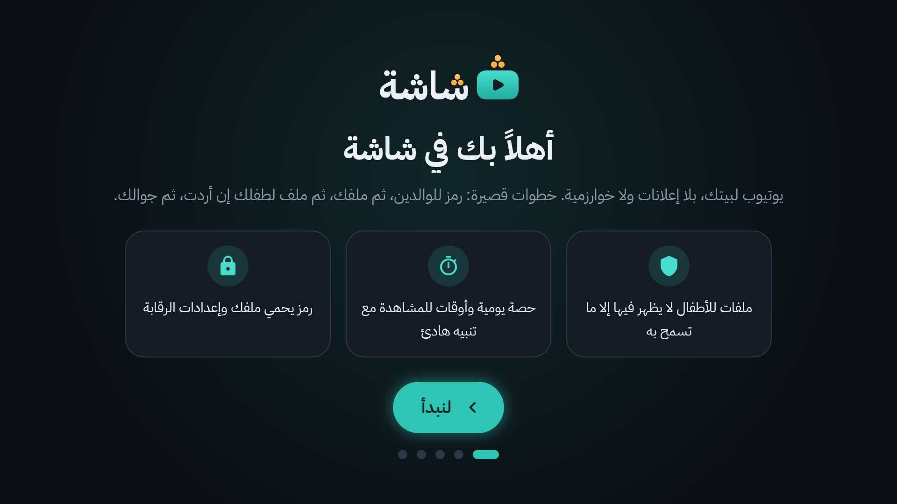
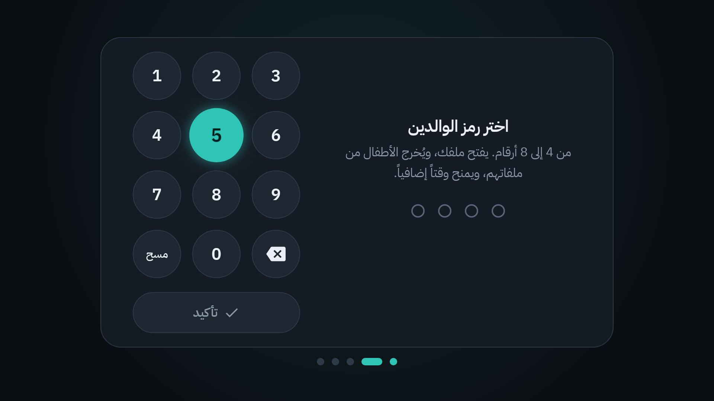
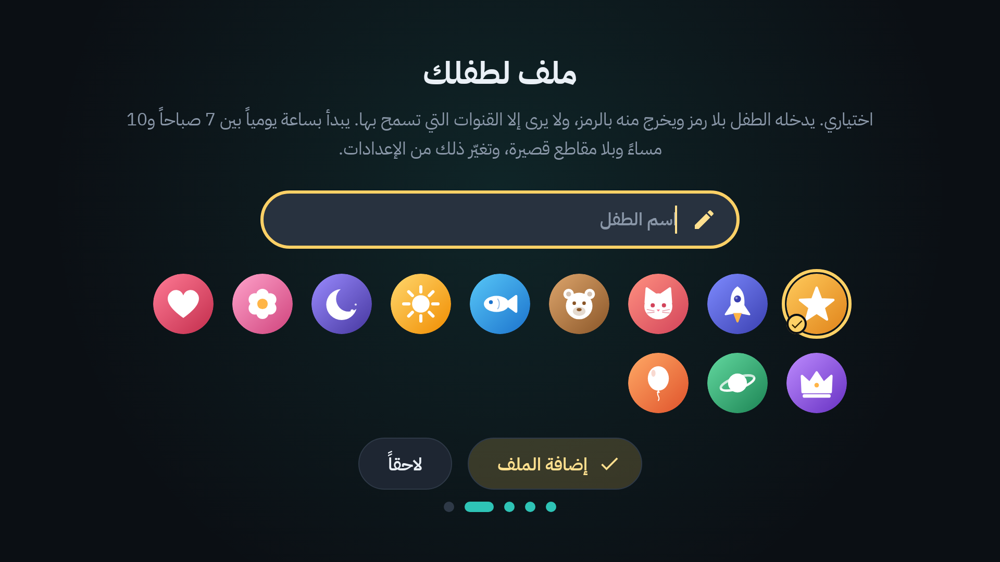
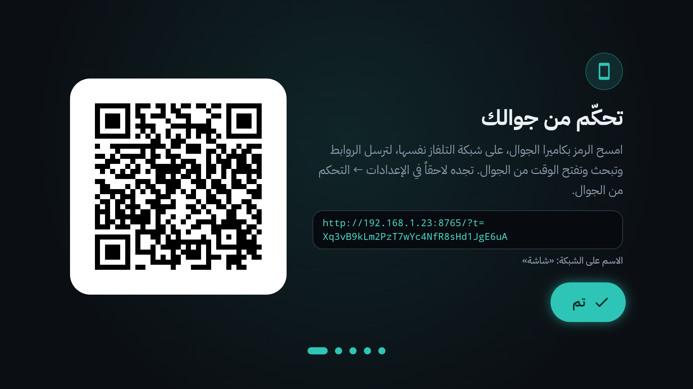
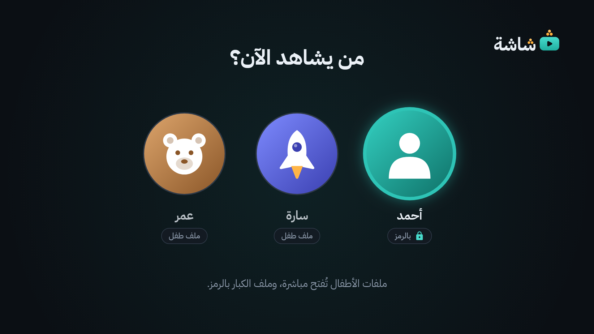

# 1. البداية: التثبيت وأول تشغيل

«شاشة» تطبيق يوتيوب خاص بتلفاز بيتنا (TCL بنظام Google TV). بلا إعلانات، وبلا اقتراحات، وبلا تسجيل دخول. هذا الفصل يشرح كيف يصل التطبيق إلى التلفاز، وماذا ترى حين تفتحه أول مرة.

## التثبيت باختصار

يثبّت «شاشة» شخص واحد، مرة واحدة، من حاسوب شخصي (ويندوز أو ماك)، في نحو ربع ساعة.

**الخطوات كاملة، بالصور، في [دليل التثبيت](../install-guide.md).** وهو موجود أيضاً ملفَّ PDF داخل مجلد التثبيت نفسه باسم «اقرأني - طريقة التثبيت». هذا ملخصه فقط:

1. **نزّل مجلد التثبيت (على الحاسوب):** افتح صفحة مستودع «شاشة» على GitHub، واضغط الملف `Shasha-Setup.zip`، ثم زر التنزيل «Download». فك ضغطه: في ويندوز بزر الفأرة الأيمن، ثم «Extract All». وفي ماك انقر الملف مرتين. في المجلد `Shasha-Setup` كل ما تحتاجه: التطبيق، وبرنامج التثبيت لويندوز ولماك، والأداة التي تكلّم التلفاز، ودليل التثبيت. لا تنزّل أي شيء آخر.
2. **فعّل خيارات المطوّر (على التلفاز):** افتح Settings، ثم System، ثم About. اضغط `OK` سبع مرات على «Android TV OS build».
3. **فعّل تصحيح الأخطاء (على التلفاز):** افتح Settings، ثم System، ثم Developer options، وفعّل «USB debugging» (و«Network debugging» إن وجدته).
4. **اعرف عنوان التلفاز (على التلفاز):** افتح Settings، ثم Network & Internet، ثم اسم شبكتك، واقرأ «IP address»، مثل `192.168.1.50`. اكتبه على ورقة.
5. **شغّل المثبّت (على الحاسوب):** في ويندوز انقر مرتين على ملف ويندوز («Windows - ثبّت شاشة»). وفي ماك انقر بالزر الأيمن على ملف ماك («Mac - ثبّت شاشة»)، ثم «Open»، ثم «Open» مرة ثانية. اكتب عنوان التلفاز حين يسألك.
6. **وافق على التلفاز:** تظهر نافذة «Allow USB debugging?». فعّل «Always allow from this computer»، ثم اضغط «OK» خلال 60 ثانية.
7. **انتظر:** يثبّت المثبّت «شاشة» ويمنحه صلاحياته، ويسألك إن كنت تريد إيقاف تطبيق يوتيوب الرسمي (اختياري: `y` أو `n`)، ثم يفتح «شاشة» على التلفاز ويعرض ملخصاً. اضغط أي مفتاح في الحاسوب لإغلاق نافذته.

> [!NOTE]
> - الحاسوب والتلفاز على شبكة Wi-Fi نفسها. وحاسوب العمل الذي يمنع تشغيل البرامج لا يصلح غالباً: استعمل حاسوباً شخصياً.
> - إن رُفض الاتصال، ولم يكن في التلفاز إلا «Wireless debugging»، فالمثبّت يسألك عن رمز الإقران: الخطوات في [دليل التثبيت](../install-guide.md#الخطوة-6-اسمح-للحاسوب-الشاشة).
> - وللتراجع لاحقاً: المثبّت نفسه بخيار التراجع ([دليل التثبيت](../install-guide.md#التراجع-وإزالة-التطبيق))، أو احذف التطبيق من إعدادات التلفاز ([الأسئلة الشائعة](18-faq.md#كيف-أحذف-شاشة-تماماً)).

بعد التثبيت تكمل على التلفاز: أول تشغيل (أدناه)، ثم اقتران الجوال إن أردت ([الفصل 10](10-phone-remote.md)).

## أول تشغيل

عند فتح «شاشة» أول مرة تمر بخمس خطوات قصيرة. كلها بالريموت.

### الخطوة 1: «أهلاً بك في شاشة»

تعرّفك الشاشة بثلاثة أشياء: ملفات الأطفال، وحصة الوقت، ورمز الوالدين. اضغط `OK` على **لنبدأ**.

### الخطوة 2: «اختر رمز الوالدين»

1. اختر رمزاً من 4 إلى 8 أرقام. اكتبه بلوحة الأرقام على الشاشة (بالأسهم ثم `OK`)، أو بأزرار الأرقام في الريموت.
2. اختر **تأكيد**.
3. تطلب الشاشة «أعد إدخال الرمز». اكتبه مرة ثانية، ثم **تأكيد**.

هذا هو **رمز الوالدين**. هو مفتاح البيت كله:

- يفتح ملف الكبار وإعدادات الرقابة.
- يُخرج الأطفال من ملفاتهم.
- يمنح وقت مشاهدة إضافياً.

احفظه جيداً، ولا تخبر به الأطفال.

> [!IMPORTANT]
> لا يوجد زر «نسيت الرمز» داخل التطبيق، عمداً. إن نسيته فالحل من الحاسوب الذي ثبّت «شاشة» ([الأسئلة الشائعة](18-faq.md#نسيت-رمز-الوالدين)).
>
> وخمس محاولات خاطئة متتالية توقف الرمز: 5 دقائق أول مرة، ثم 15 دقيقة، ثم ساعة، ثم 4 ساعات. لا تنهي إعادة تشغيل التلفاز هذه المهلة.

### الخطوة 3: «ملفك»

اكتب اسمك واختر صورة، ثم **التالي**. هذا **ملف الكبار**، ولا يُفتح إلا برمز الوالدين.

### الخطوة 4: «ملف لطفلك» (اختياري)

1. اكتب اسم الطفل.
2. اختر له صورة من الصور الملوّنة.
3. اختر **إضافة الملف**. أو **لاحقاً** إن لم ترد الآن.

يبدأ ملف الطفل هكذا:

- ساعة مشاهدة واحدة يومياً.
- المشاهدة مسموحة من 7 صباحاً إلى 10 مساءً.
- بلا مقاطع قصيرة (Shorts).
- قائمة سماح فارغة: لا يرى الطفل شيئاً حتى تضيف له قنوات ([الفصل 11](11-allow-and-block-lists.md)).

تغيّر كل ذلك لاحقاً من الإعدادات، وتضيف أطفالاً آخرين متى شئت ([الفصل 6](06-profiles-and-child.md)).

### الخطوة 5: «تحكّم من جوالك»

امسح الرمز بكاميرا جوالك الآن، أو لاحقاً من الإعدادات ([الفصل 10](10-phone-remote.md)). ثم اختر **تم**.

## «من يشاهد الآن؟»

إن كان في «شاشة» ملف طفل، تبدأ كل مرة بهذه الشاشة:

- **ملف الطفل** (تحته «ملف طفل») يُفتح مباشرة بضغطة `OK`.
- **ملف الكبار** (تحته «بالرمز») يطلب رمز الوالدين.

وإن لم يكن هناك ملف طفل، يُفتح ملف الكبار وحده.

## وماذا بعد؟

- تعلّم الريموت في «شاشة»: [الفصل 2](02-remote.md).
- انقل اشتراكاتك من يوتيوب: [الفصل 3](03-home-and-subscriptions.md).
- أضف قنوات لطفلك: [الفصل 11](11-allow-and-block-lists.md).
- اضبط وقت المشاهدة: [الفصل 7](07-time-limits.md).

---

[الفهرس](README.md) · [التالي: الريموت في «شاشة»](02-remote.md)
