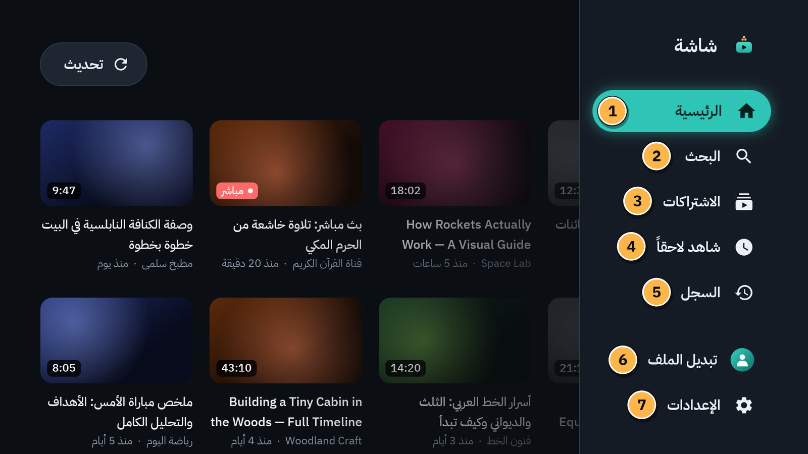
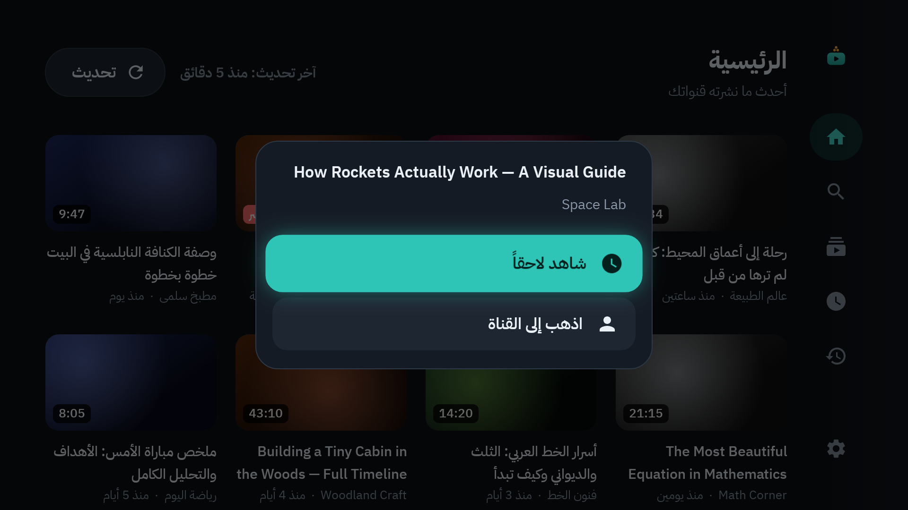
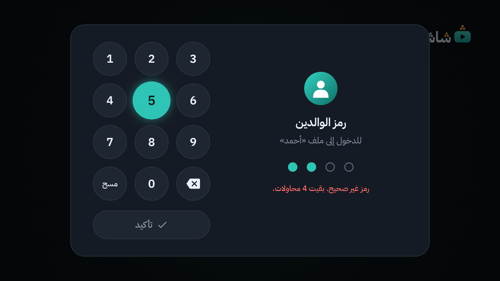

# 2. الريموت في «شاشة»

«شاشة» مصمّم للريموت لا للمس. كل شيء فيه يصل إليه بالأسهم وزر `OK`. هذا الفصل يشرح الأزرار، وكيف تعرف أين أنت، وكيف ترجع.

## الأزرار

| الزر في الريموت | ماذا يفعل في «شاشة» |
|---|---|
| الأسهم `↑` `↓` `←` `→` | تنقل الإطار الملوّن بين البطاقات والأزرار. |
| `OK` (الزر الأوسط) | يختار ما عليه الإطار: يفتح الفيديو، أو يضغط الزر. |
| `OK` مطوّلاً | يفتح **قائمة البطاقة** في ملف الكبار (انظر أدناه). |
| `MENU` (إن كان في ريموتك) | مثل `OK` المطوّل: قائمة البطاقة. وفي المشغّل يُظهر الأدوات. |
| `BACK` | يرجع خطوة إلى الوراء. |
| `HOME` | يخرج إلى واجهة التلفاز. في ملف الطفل يعيد الحارس «شاشة» خلال ثانية أو ثانيتين ([الفصل 9](09-guard-and-protection.md)). |
| أزرار الأرقام `0` إلى `9` | تكتب رمز الوالدين مباشرة. |
| أزرار التشغيل ⏯ ⏪ ⏩ (إن وُجدت) | تشغّل وتوقف وتقدّم في المشغّل، ولو كانت الأدوات مخفية. |

## الإطار: أين أنا الآن؟

العنصر المختار عليه **إطار فيروزي مضيء**. في ملف الطفل يكون الإطار **أصفر**. حرّك الإطار بالأسهم، ثم اضغط `OK`.

والواجهة عربية من اليمين إلى اليسار: البداية على اليمين، والسهم `→` يأخذك نحو القائمة الجانبية.

## القائمة الجانبية

على يمين الشاشة عمود من الأيقونات. اضغط `→` حتى يصل الإطار إليه، فيتسع وتظهر الأسماء:

1. **الرئيسية:** أحدث فيديوهات قنواتك ([الفصل 3](03-home-and-subscriptions.md)).
2. **البحث:** البحث في يوتيوب ([الفصل 4](04-search-channels-playlists.md)).
3. **الاشتراكات:** قنواتك ([الفصل 3](03-home-and-subscriptions.md)).
4. **شاهد لاحقاً:** ما حفظته لوقت آخر ([الفصل 5](05-player.md)).
5. **السجل:** ما شاهدته من قبل ([الفصل 5](05-player.md)).
6. **تبديل الملف:** الانتقال إلى ملف آخر ([الفصل 6](06-profiles-and-child.md)).
7. **الإعدادات:** كل الإعدادات ([الفصل 14](14-settings-map.md)).

كيف تستعملها:

1. اضغط `→` للوصول إلى القائمة.
2. اختر بالسهمين `↑` `↓`.
3. اضغط `OK` لتفتح ما اخترته. (مرور الإطار وحده لا يفتح شيئاً.)
4. اضغط `←` للعودة إلى المحتوى.

في ملف الطفل القائمة أقصر: **الرئيسية**، و**القنوات المسموحة**، و**خروج** ([الفصل 6](06-profiles-and-child.md)).

## الرجوع بزر `BACK`

- من المحتوى: يأخذك `BACK` إلى القائمة الجانبية.
- من القائمة الجانبية: يأخذك إلى **الرئيسية**.
- من **الرئيسية** في القائمة: يخرج من «شاشة» إلى واجهة التلفاز.

إن تهت في أي مكان، فاضغط `BACK` عدة مرات حتى تصل إلى **الرئيسية**.

> [!NOTE]
> أثناء فيديو «مقفول» لا يُخرجك `BACK` من الفيديو. هذا مقصود ([الفصل 8](08-video-lock.md)).

## قائمة البطاقة (ضغطة `OK` المطوّلة)

في ملف الكبار: قف على بطاقة فيديو، واضغط `OK` مطوّلاً (أو `MENU`). تظهر قائمة صغيرة:

- **شاهد لاحقاً:** يحفظ الفيديو لوقت آخر. (وإن كان محفوظاً: **إزالة من «شاهد لاحقاً»**.)
- **اذهب إلى القناة:** يفتح صفحة القناة.
- وتحتهما أزرار الرقابة لقناة الفيديو: **أضف إلى قائمة سماح …** لكل طفل، و**حظر القناة**. عليها قفل صغير: تطلب رمز الوالدين إن لم تُدخله في الدقائق الخمس الأخيرة ([الفصل 11](11-allow-and-block-lists.md)).

ولبطاقات القنوات وقوائم التشغيل قائمة مثلها، فيها أزرار الرقابة فقط. وفي ملف الطفل لا توجد قوائم بطاقات أصلاً.

اضغط `BACK` لتغلق القائمة دون أن تختار شيئاً.

## كتابة رمز الوالدين

«شاشة» لا يفتح لوحة مفاتيح النظام للرمز. تظهر لوحة أرقام خاصة به:

1. اكتب الأرقام بأزرار الريموت مباشرة، أو بالأسهم و`OK` على اللوحة.
2. **حذف رقم** يمسح آخر رقم، و**مسح** يمسح الكل.
3. اختر **تأكيد**.

إن كان الرمز خاطئاً تقول الشاشة كم محاولة بقيت، مثل «رمز غير صحيح. بقيت 4 محاولات.».

## الكتابة بالحروف

- **البحث** في ملف الكبار يستعمل لوحة مفاتيح التلفاز العادية ([الفصل 4](04-search-channels-playlists.md)).
- **ملف الطفل** لا يفتح أي لوحة مفاتيح أبداً.
- **جملة الخروج** من فيديو مقفول في ملف الكبار تُكتب بلوحة «شاشة» العربية الخاصة ([الفصل 8](08-video-lock.md)).

## في المشغّل

- الضغطة الأولى على أي زر تُظهر الأدوات فقط.
- `OK` يشغّل ويوقف مؤقتاً.
- `←` و`→` يرجعان ويقدّمان 10 ثوانٍ. أبقِ إصبعك على السهم ليسرع التقديم.
- `BACK` يغلق القائمة المفتوحة، ثم يخفي الأدوات، ثم يخرج من الفيديو.

التفاصيل في [الفصل 5](05-player.md).

## في الإعدادات

الإعدادات لوحتان: القائمة على اليمين، ولوحة العنصر المختار بجانبها.

- `↑` و`↓` تتنقل بين عناصر القائمة، واللوحة تتبعها.
- `OK` أو `←` يدخل إلى اللوحة.
- `→` أو `BACK` يعيدك إلى القائمة.

التفاصيل في [الفصل 14](14-settings-map.md).

---

[السابق: البداية](01-getting-started.md) · [الفهرس](README.md) · [التالي: الرئيسية والاشتراكات](03-home-and-subscriptions.md)
