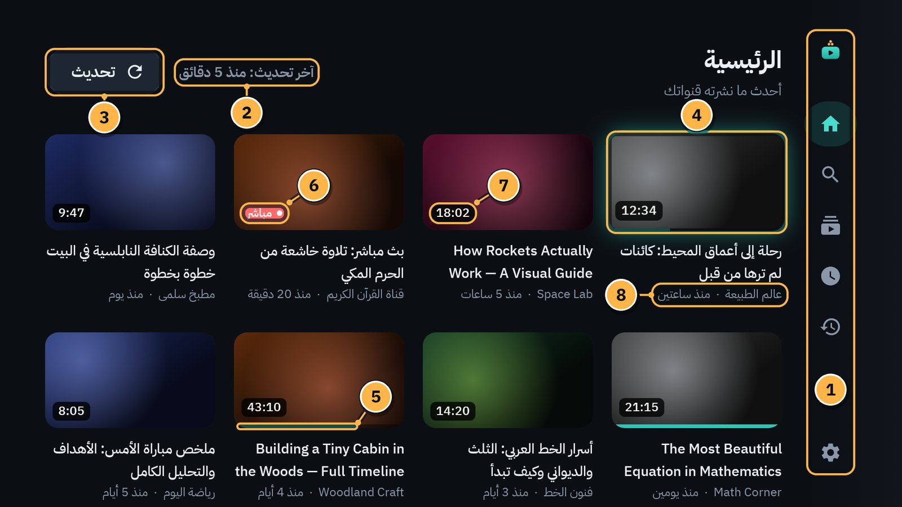
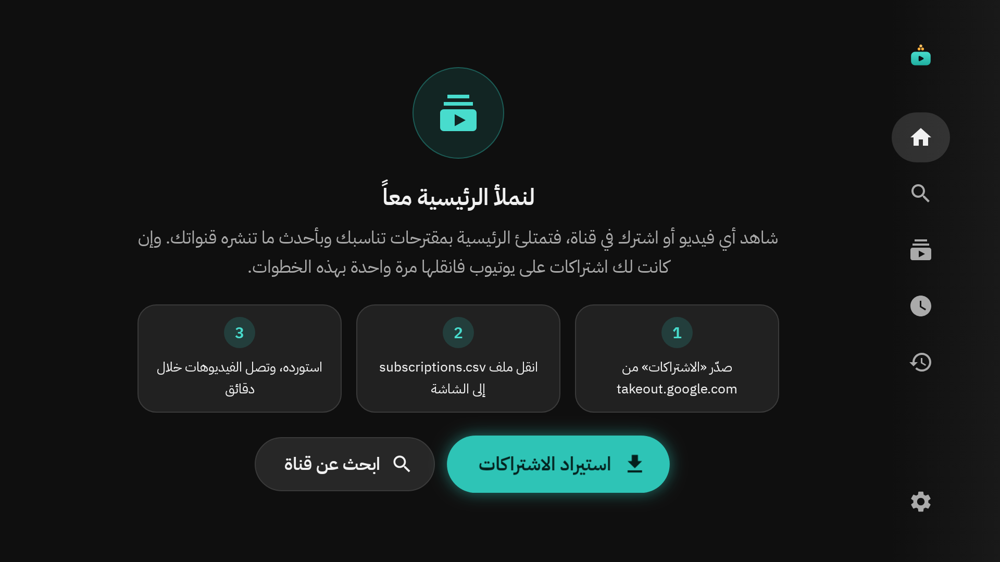
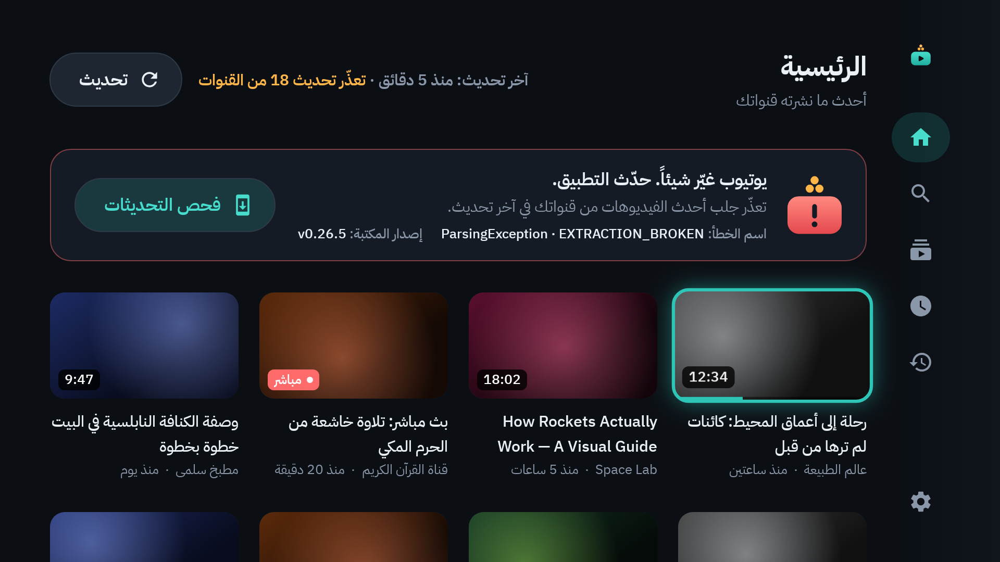
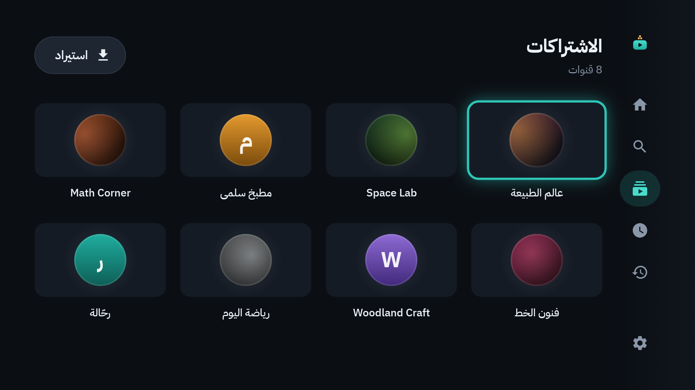
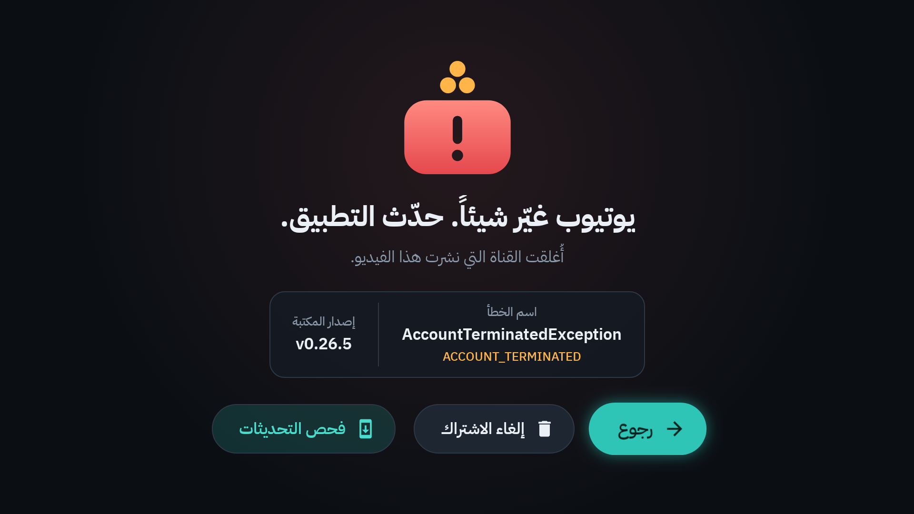
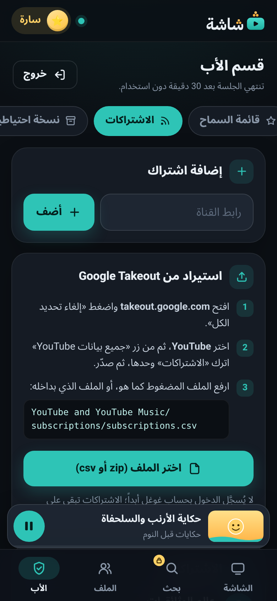
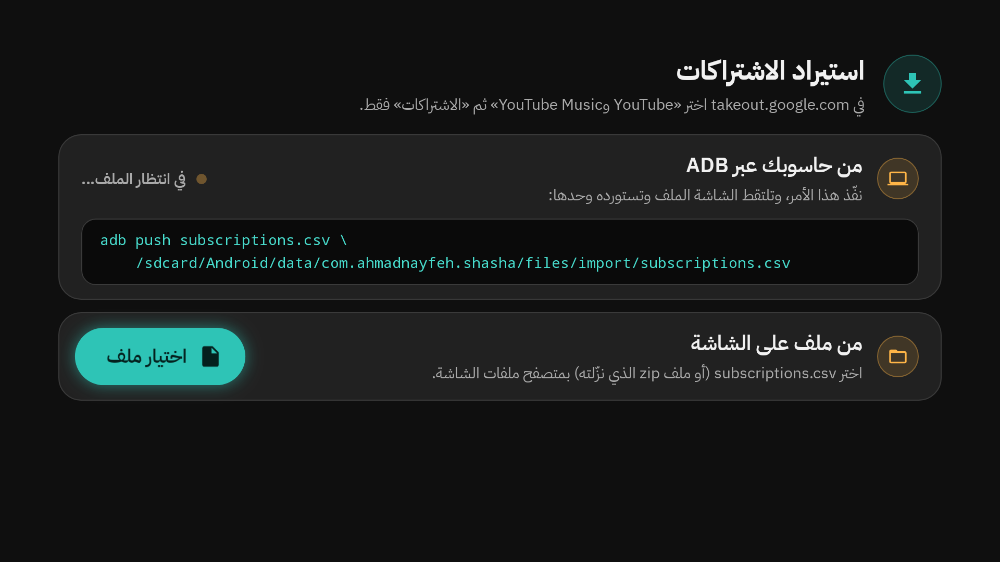
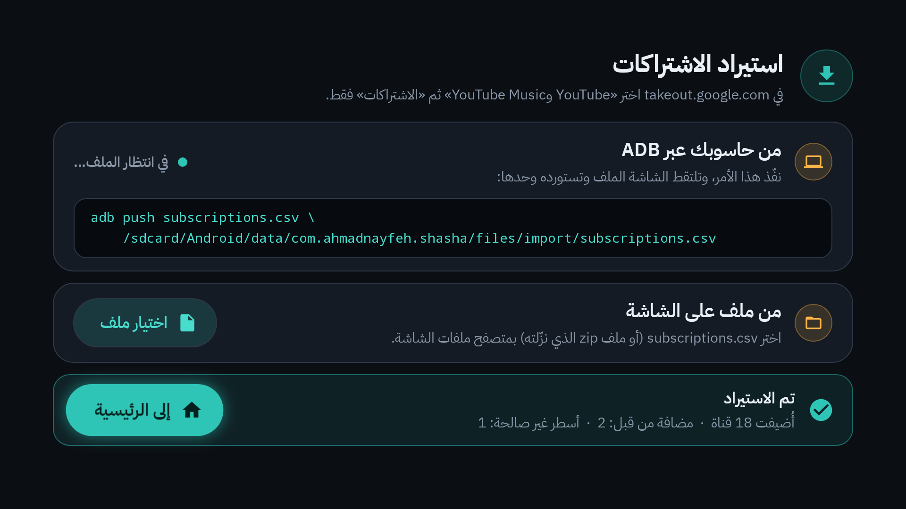

# 3. الرئيسية والاشتراكات

«الرئيسية» في «شاشة» ليست كرئيسية يوتيوب. لا اقتراحات فيها ولا «شائع». فيها **أحدث ما نشرته القنوات التي اشتركت فيها أنت**، من الأحدث إلى الأقدم. فقط.

## ما في «الرئيسية»

1. **القائمة الجانبية:** اضغط `→` لتفتحها ([الفصل 2](02-remote.md)).
2. **«آخر تحديث»:** متى جُلبت أحدث الفيديوهات، مثل «آخر تحديث: منذ 5 دقائق». وأثناء الجلب تقرأ «جارٍ التحديث…».
3. **تحديث:** يجلب أحدث الفيديوهات الآن، دون انتظار.
4. **البطاقة المختارة:** عليها الإطار الملوّن. اضغط `OK` لتشاهدها.
5. **شريط المشاهدة:** الخط الفيروزي أسفل البطاقة يبيّن كم شاهدت من الفيديو.
6. **«مباشر»:** بث مباشر.
7. **مدة الفيديو.**
8. **اسم القناة، ومتى نُشر الفيديو.**

## كيف تتحدّث «الرئيسية»؟

- **وحدها كل ساعتين** ما دام التلفاز متصلاً بالإنترنت.
- **متى شئت** بزر **تحديث** في أعلاها.
- تُجلب القنوات **ثلاثاً ثلاثاً** فقط، ولا يبدأ التحديث **أثناء تشغيل فيديو**. هكذا لا يتقطّع الفيديو على معالج التلفاز. وإن بدأت فيديو أثناء التحديث، يُكمل «شاشة» القنوات الجارية فقط، ويؤجّل الباقي ربع ساعة.
- من كل قناة تأتي آخر 15 فيديو من خلاصتها في يوتيوب (RSS). ويحتفظ «شاشة» بأحدث 30 فيديو لكل قناة، ولا شيء أقدم من 90 يوماً.
- إن تعذّرت خلاصة قناة، يجلب «شاشة» فيديوهاتها من صفحة القناة نفسها بدلاً منها.

ما دام التحديث الأول جارياً ترى: «جارٍ جلب أحدث الفيديوهات». تظهر الفيديوهات فور وصولها.

> [!TIP]
> المقاطع القصيرة (Shorts) تُخفى أو تظهر حسب إعداد كل ملف ([الفصل 6](06-profiles-and-child.md)). وملف الطفل له «رئيسية» خاصة به، فيها قنواته المسموحة فقط.

## «الرئيسية» الفارغة

في البداية تقول «الرئيسية»: «اشتراكاتك تظهر هنا». «شاشة» لا يسجّل الدخول إلى يوتيوب، فاشتراكاتك لا تصل وحدها. عندك طريقتان:

- **استيراد الاشتراكات:** انقل قائمة اشتراكاتك كلها مرة واحدة من Google Takeout (أدناه).
- **ابحث عن قناة:** ابحث عن قناة واحدة واشترك فيها ([الفصل 4](04-search-channels-playlists.md)).

## حين يتعذّر التحديث

إن فشل تحديث قنوات كثيرة، تظهر فوق الفيديوهات رسالة مثل «تعذّر تحديث 18 من القنوات»، مع **اسم الخطأ** و**إصدار المكتبة**، وزر **فحص التحديثات**. الفيديوهات القديمة تبقى كما هي.

وإن انقطع الإنترنت تقول «الرئيسية»: «لا يوجد اتصال بالإنترنت». تأكّد من الشبكة، ثم اضغط **تحديث**.

ماذا تفعل بعدها؟ انظر [الفصل 17: عندما يتعطل يوتيوب](17-when-youtube-breaks.md).

## قائمة «الاشتراكات»

من القائمة الجانبية اختر **الاشتراكات**. هنا كل قنواتك مرتبة بالاسم.

- اضغط `OK` على قناة لتفتح صفحتها.
- زر **استيراد** في الأعلى يفتح شاشة «استيراد الاشتراكات».

## الاشتراك في قناة

1. ابحث عن القناة ([الفصل 4](04-search-channels-playlists.md)).
2. بجانب نتيجة القناة زر **اشتراك**. اضغطه فيصير **مشترك**.
3. أو افتح صفحة القناة واضغط **اشتراك** فيها.

تصل فيديوهات القناة إلى «الرئيسية» خلال دقائق.

ومن الجوال: «الأب» ← «الاشتراكات» ← «إضافة اشتراك»، والصق رابط القناة ([الفصل 10](10-phone-remote.md)).

## إلغاء الاشتراك

1. افتح صفحة القناة (من **الاشتراكات** مثلاً).
2. اضغط الزر **مشترك**. يعود **اشتراك**.

تختفي فيديوهات القناة من «الرئيسية». ومن الجوال: «الأب» ← «الاشتراكات»، ثم أيقونة الحذف بجانب القناة.

وإن أُغلقت قناة أو حُذفت فلن تُفتح صفحتها، بل شاشة الخطأ. فيها زر **إلغاء الاشتراك** لتزيلها من قائمتك:

## استيراد الاشتراكات من Google Takeout

«شاشة» لا يسجّل الدخول، فتنقل اشتراكاتك مرة واحدة بملف تصدّره من Google.

### أولاً: صدّر الملف

من حاسوب أو جوال، بحساب غوغل الذي فيه اشتراكاتك:

1. افتح <https://takeout.google.com>.
2. اضغط «إلغاء تحديد الكل» (Deselect all).
3. انزل إلى «YouTube and YouTube Music» وحدّده.
4. اضغط الزر «All YouTube data included» تحته. أزل التحديد عن كل شيء إلا «الاشتراكات» (subscriptions)، ثم OK.
5. انزل إلى آخر الصفحة: «Next step»، ثم التصدير مرة واحدة (Export once) بملف zip، ثم «Create export».
6. يصلك بريد برابط التنزيل. نزّل الملف المضغوط.

داخل الملف: `Takeout/YouTube and YouTube Music/subscriptions/subscriptions.csv`. (قد تظهر أسماء المجلدات بلغة حسابك.)

### ثانياً: أدخله إلى «شاشة»

**من الجوال (الأسهل):**

1. في صفحة الجوال: «الأب»، ثم رمز الوالدين ([الفصل 10](10-phone-remote.md)).
2. «الاشتراكات» ← «استيراد من Google Takeout».
3. «اختر الملف (zip أو csv)». اختر الملف المضغوط كما هو، أو ملف `subscriptions.csv` وحده.

**من التلفاز:** الإعدادات ← «الاستيراد والتصدير» ← **استيراد الاشتراكات من Takeout**. (أو زر **استيراد الاشتراكات** في «الرئيسية» الفارغة، أو **استيراد** في «الاشتراكات».)

- **من ملف على الشاشة:** زر **اختيار ملف**، إن كان في التلفاز متصفح ملفات.
- **من حاسوبك عبر ADB:** للمتمرّسين. تعرض الشاشة الأمر الذي تنفّذه من الحاسوب. اترك الشاشة مفتوحة: تلتقط الملف وحدها وتستورده.

### النتيجة

تظهر «تم الاستيراد» مع عدد القنوات المضافة، و«مضافة من قبل»، و«أسطر غير صالحة». اختر **إلى الرئيسية**. تصل الفيديوهات خلال دقائق.

إعادة الاستيراد آمنة: القنوات الموجودة لا تتكرر.

---

[السابق: الريموت في «شاشة»](02-remote.md) · [الفهرس](README.md) · [التالي: البحث والقنوات وقوائم التشغيل](04-search-channels-playlists.md)
