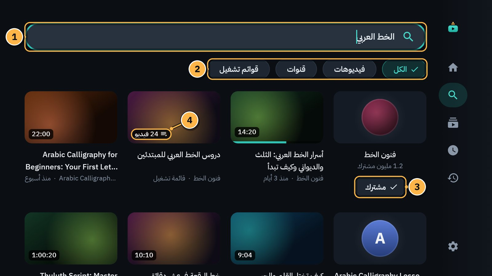
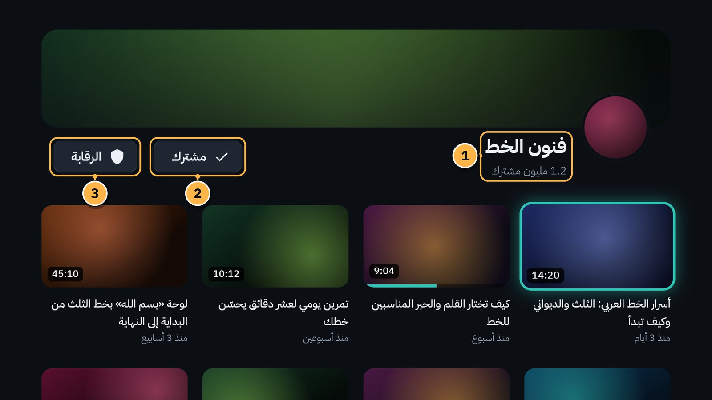
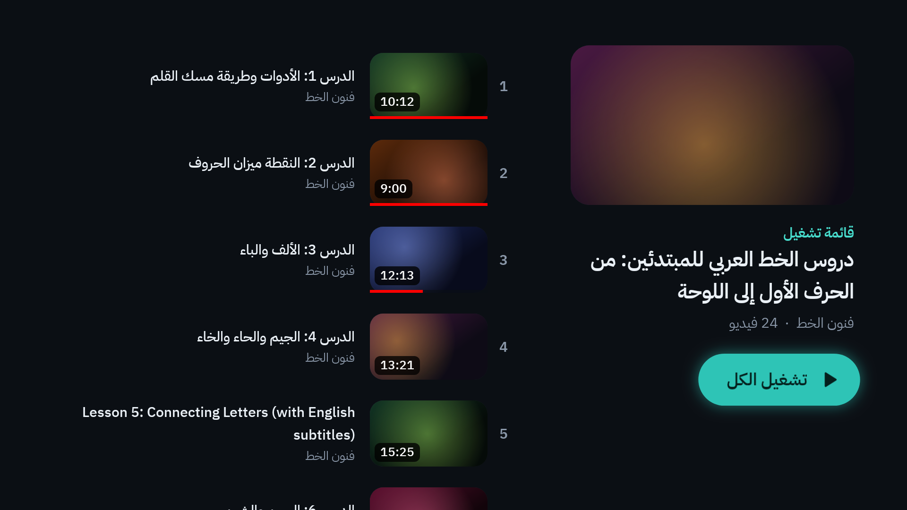
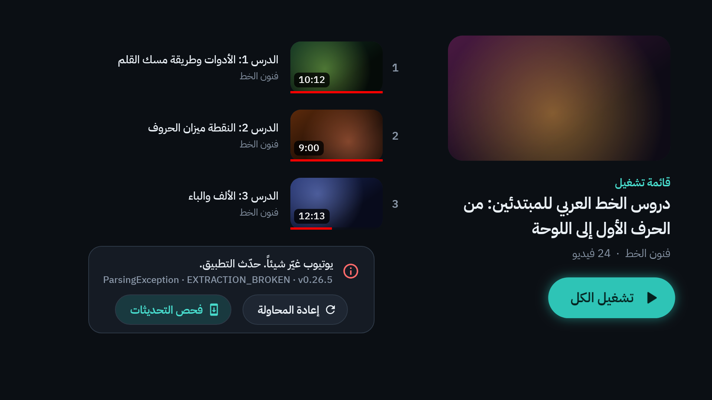

# 4. البحث والقنوات وقوائم التشغيل

البحث موجود في **ملف الكبار** فقط. ملف الطفل لا بحث فيه ولا لوحة مفاتيح، عمداً ([الفصل 6](06-profiles-and-child.md)).

## البحث

1. **خانة البحث:** قف عليها واضغط `OK`. تظهر لوحة مفاتيح التلفاز. اكتب ما تريد، ثم اضغط زر البحث في اللوحة.
2. **نوع النتائج:** **الكل**، أو **فيديوهات**، أو **قنوات**، أو **قوائم تشغيل**. انزل إليها بالسهم `↓` واختر بـ `OK`.
3. **اشتراك / مشترك:** بجانب كل قناة في النتائج. اضغطه لتشترك في القناة أو تلغي اشتراكك.
4. **قائمة تشغيل:** على صورتها عدد فيديوهاتها، مثل «24 فيديو».

كيف تبحث، خطوة خطوة:

1. من القائمة الجانبية اختر **البحث**.
2. اضغط `OK` على الخانة، واكتب كلمات البحث.
3. اضغط زر البحث في لوحة المفاتيح. تظهر «جارٍ البحث…» ثم النتائج.
4. انزل بالسهم `↓` إلى النتائج، واضغط `OK` على ما تريد.
5. انزل أكثر لتظهر نتائج أخرى.

إن لم يجد يوتيوب شيئاً تقول الشاشة «لا نتائج لـ …». جرّب كلمات أخرى، أو نوعاً آخر من النتائج.

> [!TIP]
> الكتابة بالريموت بطيئة؟ ابحث من الجوال: تبويب «بحث» في صفحة الجوال، والنتيجة تُعرض على التلفاز ([الفصل 10](10-phone-remote.md)).

المقاطع المخفية في الملف (مثل المقاطع القصيرة) والقنوات والكلمات المحظورة لا تظهر في النتائج أصلاً ([الفصل 11](11-allow-and-block-lists.md)).

## صفحة القناة

افتح القناة من نتائج البحث، أو من **الاشتراكات**، أو من قائمة بطاقة فيديو ← **اذهب إلى القناة**.

1. **اسم القناة** وعدد مشتركيها.
2. **مشترك / اشتراك:** اضغطه لتلغي الاشتراك أو تشترك.
3. **الرقابة:** يفتح قائمة الرقابة لهذه القناة: **أضف إلى قائمة سماح …** لكل طفل، و**حظر القناة**. يطلب رمز الوالدين ([الفصل 11](11-allow-and-block-lists.md)).

تحت الرأس فيديوهات القناة، الأحدث أولاً. انزل بالسهم `↓` لتُحمَّل فيديوهات أقدم.

## قائمة التشغيل

- على اليمين: اسم القائمة، والقناة، وعدد الفيديوهات، وزر **تشغيل الكل**.
- على اليسار: فيديوهات القائمة بترتيبها.

**تشغيل الكل** يبدأ من أول فيديو. أو اضغط `OK` على أي فيديو لتبدأ منه. بعد كل فيديو يبدأ التالي وحده بعد عدّ تنازلي قصير ([الفصل 5](05-player.md#قوائم-التشغيل-التالي-في-القائمة)).

وفي صفحة القائمة (في ملف الكبار) زر **الرقابة** أيضاً، لتضيف القائمة كلها إلى قائمة سماح طفل.

## ما ليس في «شاشة»، عمداً

- لا «مقترح لك» ولا «شائع» ولا فيديوهات ذات صلة.
- لا تعليقات.
- لا تشغيل تلقائي بعد الفيديو، إلا داخل قائمة تشغيل.
- لا تسجيل دخول بحساب غوغل. فلا تعمل الفيديوهات الخاصة، ولا المقيّدة بالعمر، ولا المدفوعة ([الفصل 17](17-when-youtube-breaks.md)).

## حين يتعذّر التحميل

إن تعذّر تحميل المزيد من الفيديوهات في أسفل صفحة أو قائمة، تظهر رسالة قصيرة مع **إعادة المحاولة** و**فحص التحديثات**:

وإن لم تُفتح الصفحة كلها ظهرت شاشة الخطأ الموحدة ([الفصل 17](17-when-youtube-breaks.md)).

---

[السابق: الرئيسية والاشتراكات](03-home-and-subscriptions.md) · [الفهرس](README.md) · [التالي: المشغّل](05-player.md)
