# 5. المشغّل

اضغط `OK` على أي فيديو. تظهر لحظة «جارٍ تجهيز الفيديو…» ثم يبدأ. تبدأ الجودة تلقائية حتى 1080p، وتهبط وحدها حين تضعف الشبكة.

## أدوات المشغّل

تظهر الأدوات عند أول ضغطة على أي زر، وتختفي بعد ثلاث ثوانٍ دون لمس.

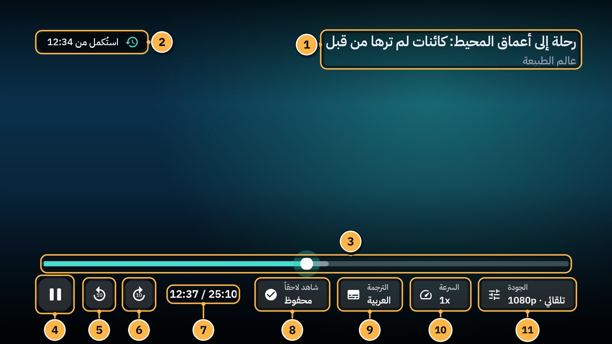

1. **العنوان والقناة.**
2. **«استُكمل من …»:** يظهر ثواني قليلة حين يكمل الفيديو من حيث توقفت (أدناه).
3. **شريط التقدّم:** الإطار عليه عادةً. `→` يقدّم 10 ثوانٍ، و`←` يرجع 10 ثوانٍ. أبقِ إصبعك على السهم فيسرع التقديم، ثم أفلته ليقفز الفيديو. و`OK` هنا يشغّل ويوقف.
4. **تشغيل / إيقاف مؤقت.**
5. **رجوع 10 ثوانٍ.**
6. **تقديم 10 ثوانٍ.**
7. **الوقت:** أين أنت من مدة الفيديو.
8. **شاهد لاحقاً:** يحفظ الفيديو («أضِف») أو يزيله («محفوظ»).
9. **الترجمة:** اختر لغة الترجمة، أو **إيقاف**.
10. **السرعة:** سرعة التشغيل.
11. **الجودة:** «تلقائي»، أو جودة ثابتة.

للوصول إلى الأزرار: من شريط التقدّم اضغط `↓`، ثم تنقّل بـ `←` و`→`، واضغط `OK`.

> [!TIP]
> أزرار التشغيل في الريموت (⏯ ⏪ ⏩)، إن وُجدت، تعمل دائماً، حتى والأدوات مخفية.

## الرجوع والخروج

اضغط `BACK`:

1. إن كانت قائمة مفتوحة (الجودة مثلاً): تُغلق.
2. وإن كانت الأدوات ظاهرة: تختفي.
3. وإلا: تخرج من الفيديو.

كل فيديو يبدأ **مقفولاً** حتى ينتهي. الخروج قبل النهاية يحتاج خطوة خاصة ([الفصل 8](08-video-lock.md)).

## الجودة

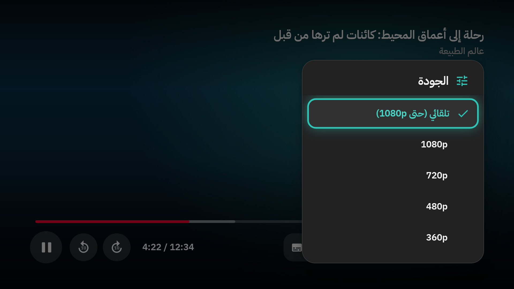

- **تلقائي (حتى 1080p):** الأفضل عادةً. يختار المشغّل أعلى جودة تسمح بها الشبكة، حتى الحد المضبوط في الإعدادات.
- **1080p** أو **720p** أو **480p** أو **360p:** جودة ثابتة لهذا الفيديو.

الحد الأعلى للجودة التلقائية في الإعدادات ← «الجودة الافتراضية» ([الفصل 14](14-settings-map.md)). ويسري من الفيديو التالي.

## السرعة

من **السرعة** اختر: 0.5x، أو 0.75x، أو **عادية** (1x)، أو 1.25x، أو 1.5x، أو 1.75x، أو 2x.

## الترجمة

من **الترجمة** اختر لغة، أو **إيقاف**. الترجمة المولّدة آلياً يُكتب بجانبها «(تلقائية)». تظهر الترجمة أسفل الصورة:

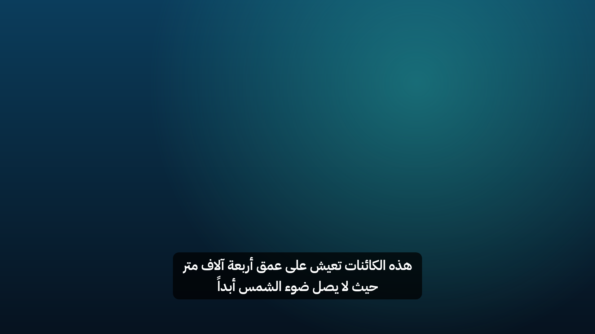

## الاستكمال من حيث توقفت

- يحفظ «شاشة» موضعك في كل فيديو، كل عشر ثوانٍ، وعند الإيقاف والخروج.
- حين تفتح الفيديو من جديد يبدأ من هناك، ويظهر لحظات «استُكمل من 12:34» مثلاً.
- إن كنت قد أنهيته (أو قاربت نهايته)، يبدأ من أوله.

## شاهد لاحقاً

احفظ فيديو لوقت آخر بإحدى طريقتين:

- في المشغّل: زر **شاهد لاحقاً** (يصير «محفوظ»).
- على أي بطاقة: `OK` مطوّلاً ← **شاهد لاحقاً**.

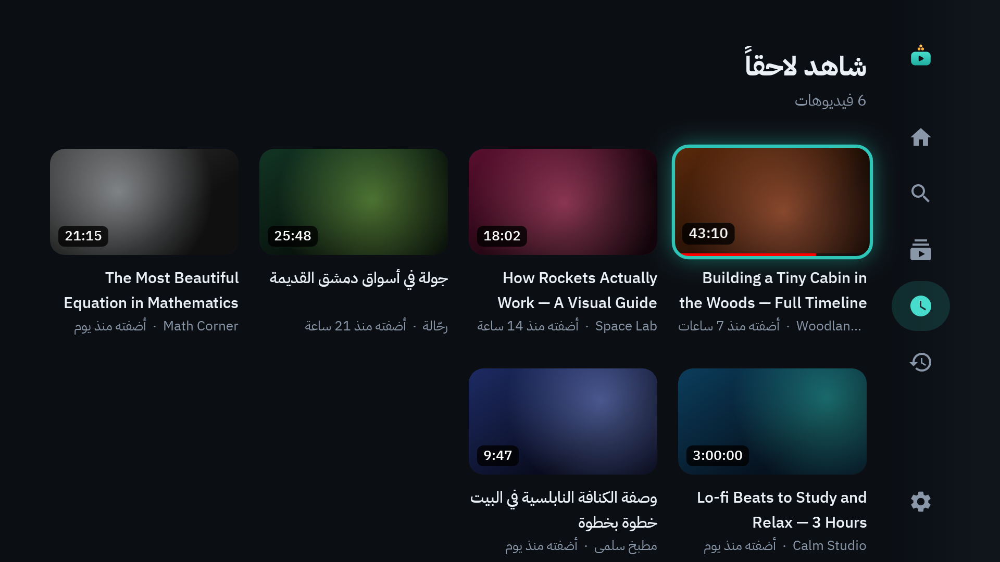

تجد المحفوظ في القائمة الجانبية ← **شاهد لاحقاً**، الأحدث أولاً. ولإزالة فيديو: `OK` مطوّلاً على بطاقته ← **إزالة من «شاهد لاحقاً»**.

## السجل

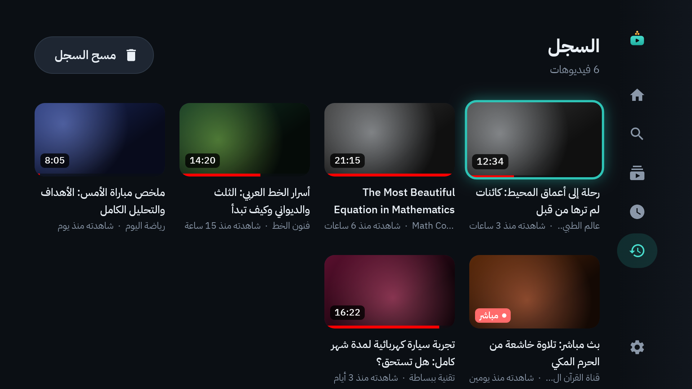

القائمة الجانبية ← **السجل**: كل فيديو شاهدته، الأحدث أولاً، مع متى شاهدته.

لمسحه كله: زر **مسح السجل** في الأعلى، ثم **مسح** للتأكيد. مواضع الاستكمال تبقى كما هي.

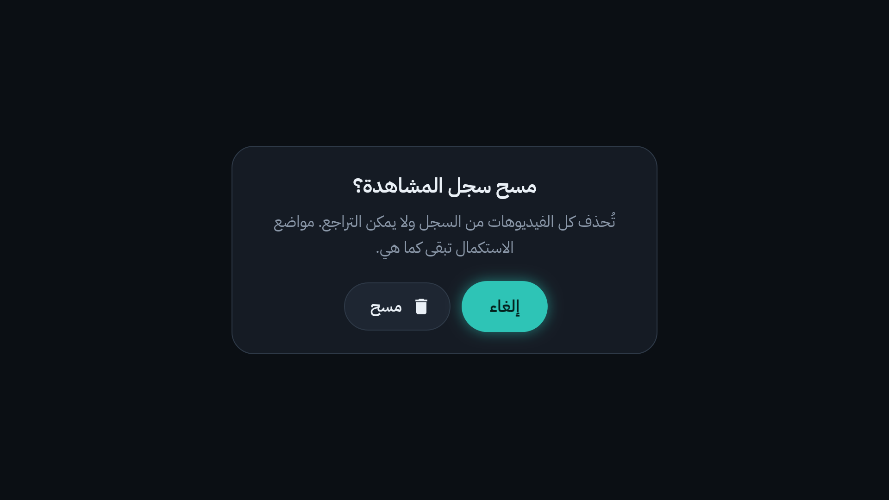

لكل ملف سجله و«شاهد لاحقاً» الخاصان به.

## نهاية الفيديو

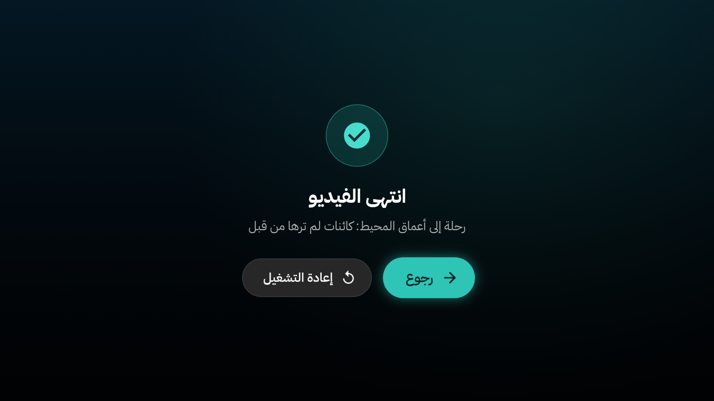

حين ينتهي الفيديو تظهر «انتهى الفيديو»، مع **إعادة التشغيل** و**رجوع**. لا يبدأ فيديو آخر وحده، ولا تظهر اقتراحات.

وفي ملف الطفل تعود الشاشة وحدها إلى «الرئيسية» بعد عشر ثوانٍ ([الفصل 6](06-profiles-and-child.md)):

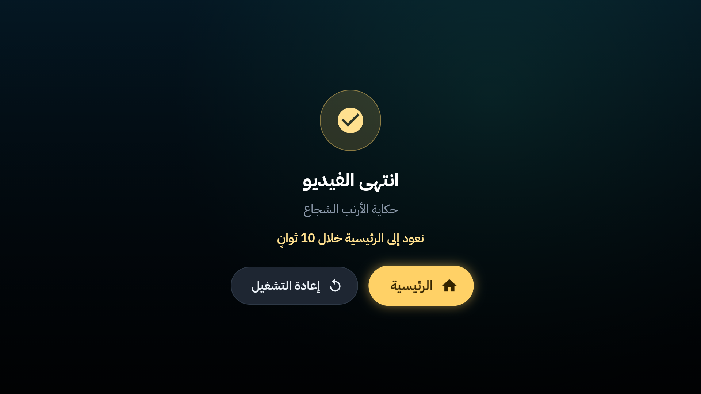

## قوائم التشغيل: «التالي في القائمة»

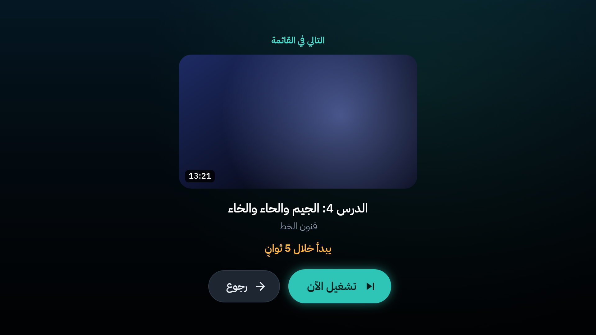

داخل قائمة تشغيل فقط، يبدأ الفيديو التالي وحده بعد عدّ تنازلي: «يبدأ خلال 5 ثوانٍ».

- **تشغيل الآن:** يبدأ التالي فوراً.
- **رجوع:** يوقف القائمة.

بعد آخر فيديو تظهر «انتهت قائمة التشغيل».

## البث المباشر

البث المباشر عليه شارة **«مباشر»** حمراء. يبدأ من اللحظة الحالية للبث. ولا يُحفظ له موضع استكمال.

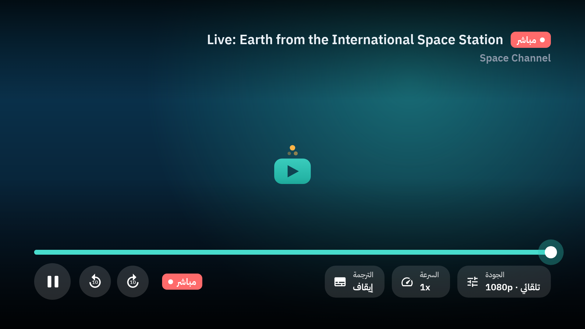

## شارة 360p: فيديوهات «للأطفال»

يعامل يوتيوب الفيديوهات المصنّفة «للأطفال» (made for kids) معاملة خاصة. مكتبة «شاشة» الحالية لا تجد لها إلا نسخة واحدة بجودة **360p**. وهذا ما يحدث:

**في ملف الطفل:** يعمل الفيديو بجودة 360p، مع شارة كهرمانية ظاهرة بجانب الوقت.

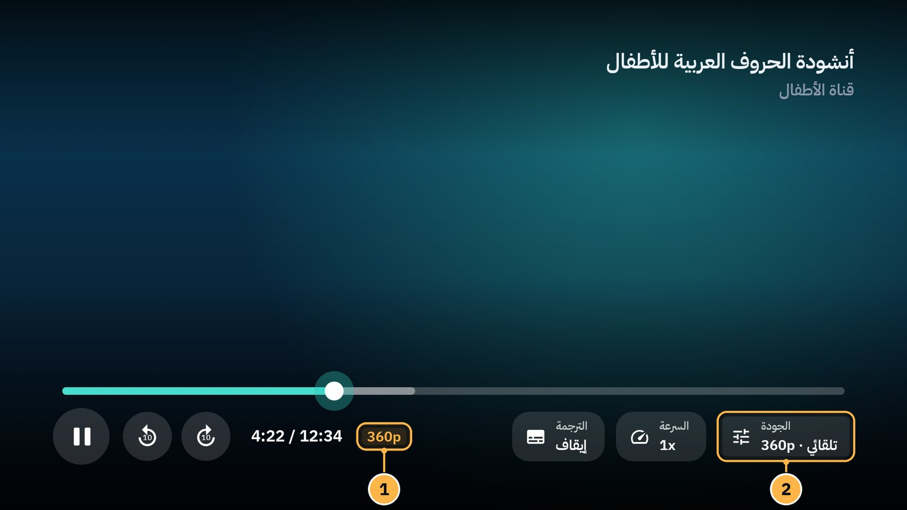

1. **شارة «360p»:** تعني «جودة منخفضة: 360p». الصورة أقل وضوحاً، وهذا متوقع.
2. **الجودة:** تقرأ «تلقائي · 360p».

**في ملف الكبار:** تظهر شاشة الخطأ الموحدة بعنوان «يوتيوب غيّر شيئاً. حدّث التطبيق.»، وتحته: «لم يعطِ يوتيوب إلا جودة 360p أو أقل…»، واسم الخطأ `MuxedOnly360p`. وفيها زر إضافي: **شغّل بجودة 360p على أي حال**. اضغطه إن أردت المشاهدة بهذه الجودة.

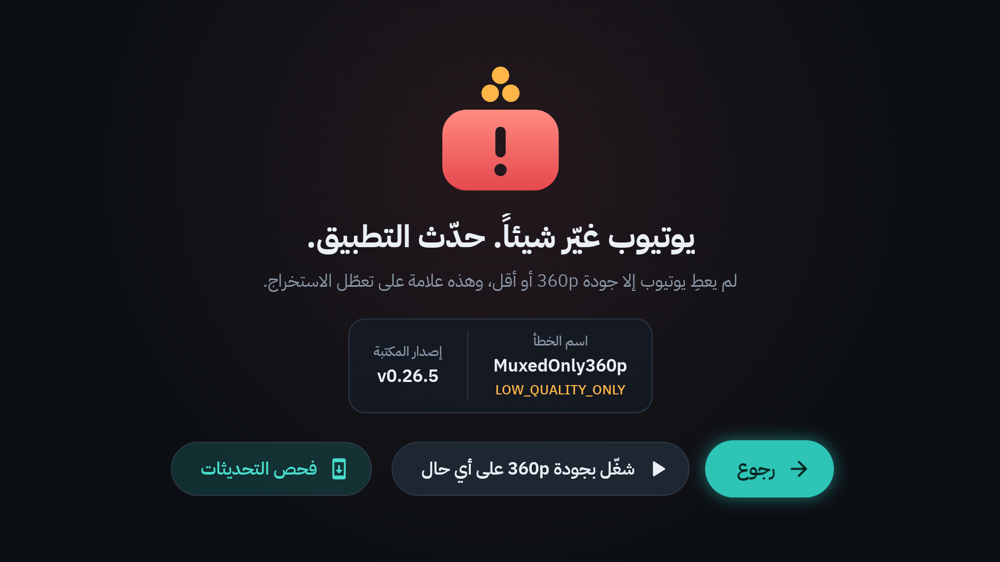

وإن رفض يوتيوب حتى نسخة 360p، تظهر شاشة الخطأ في الملفين ([الفصل 17](17-when-youtube-breaks.md)).

---

[السابق: البحث والقنوات وقوائم التشغيل](04-search-channels-playlists.md) · [الفهرس](README.md) · [التالي: الملفات وملف الطفل](06-profiles-and-child.md)
