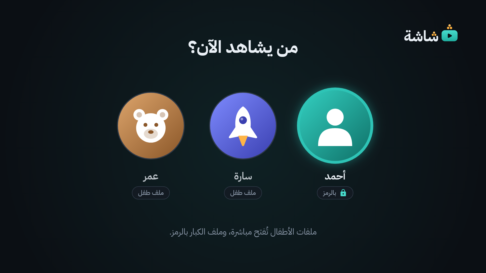
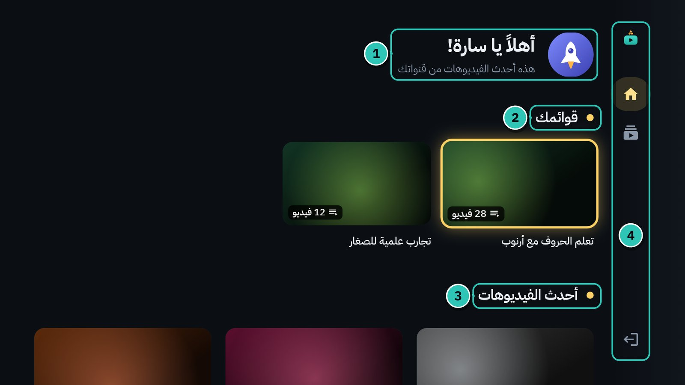
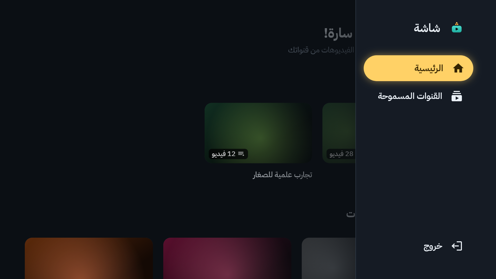
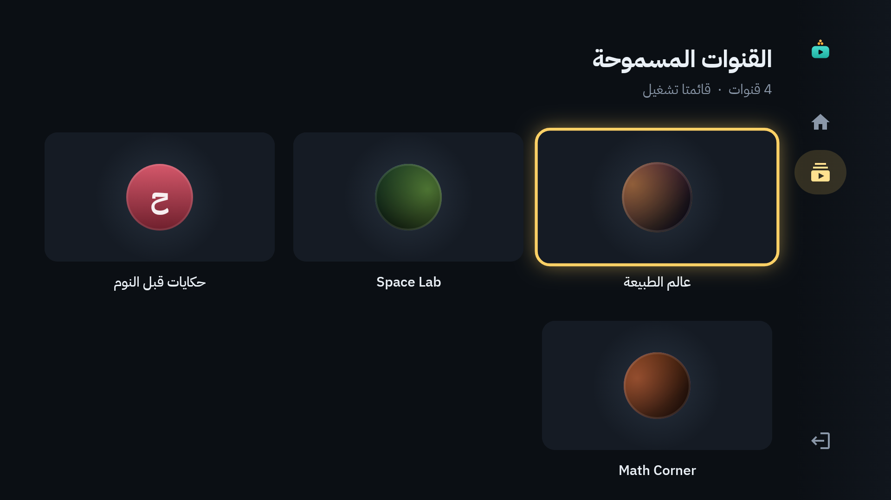
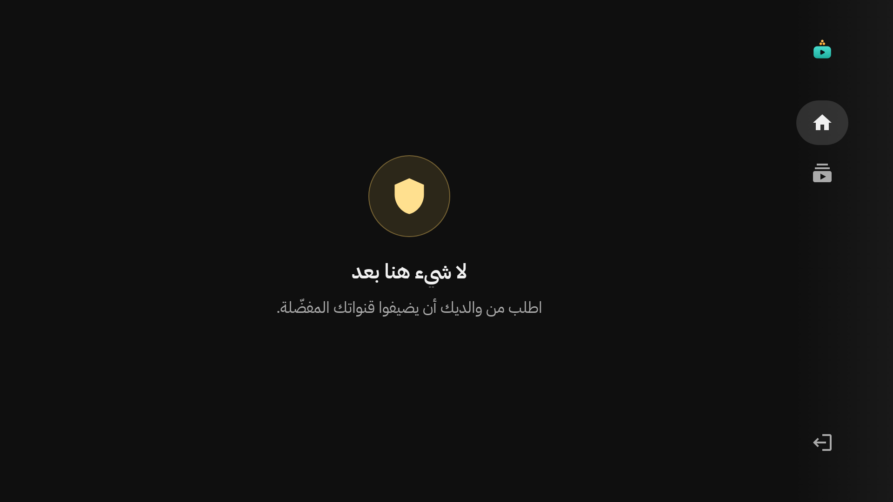
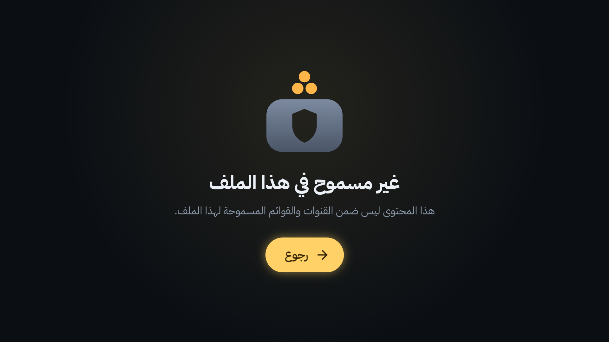
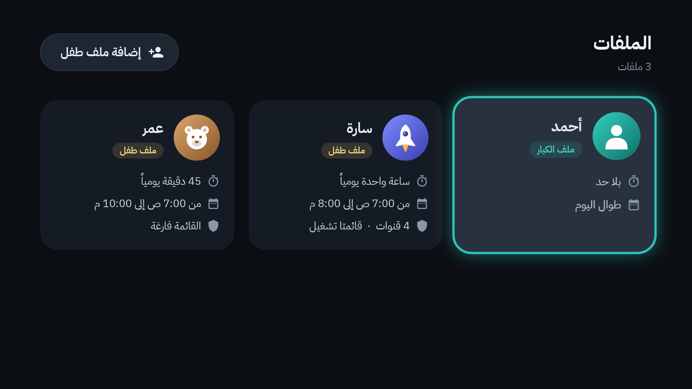
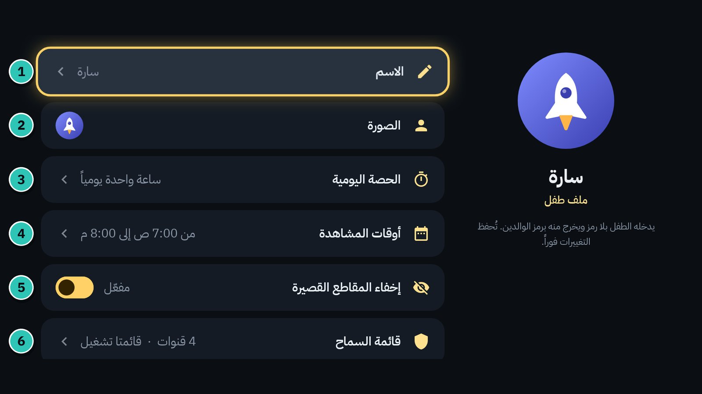

# 6. الملفات وملف الطفل

في «شاشة» نوعان من الملفات:

| | ملف الكبار | ملف الطفل |
|---|---|---|
| الدخول | برمز الوالدين | بلا رمز |
| الخروج | حر | برمز الوالدين |
| ما يُعرض | كل يوتيوب، عدا المحظور | ما في قائمة سماحه فقط |
| البحث ولوحة المفاتيح | نعم | لا |
| الإعدادات | نعم | لا |
| الحارس | فقط أثناء قفل فيديو أو انتهاء الوقت | طوال الوقت ([الفصل 9](09-guard-and-protection.md)) |

ويمكن إضافة **أكثر من ملف طفل**. لكل طفل قائمة سماحه، وحصته اليومية، وأوقات مشاهدته، وإحصائياته.

## «من يشاهد الآن؟»

تظهر هذه الشاشة عند فتح «شاشة» إن كان فيه ملف طفل. ملفات الأطفال تُفتح مباشرة، وملف الكبار بالرمز.

## التبديل بين الملفات

**من ملف الكبار إلى ملف طفل:**

1. القائمة الجانبية ← **تبديل الملف**.
2. تظهر «من يشاهد الآن؟». اختر ملف الطفل واضغط `OK`.

(أو اضغط `BACK` للعودة إلى ملفك.)

**من ملف الطفل إلى ملف آخر:**

1. القائمة الجانبية ← **خروج**.
2. يُطلب رمز الوالدين: «للخروج من ملف …». اكتبه، ثم **تأكيد**.
3. تظهر «من يشاهد الآن؟». اختر ملف الكبار (لا يُطلب الرمز مرة ثانية) أو طفلاً آخر.

إن لم تختر شيئاً خلال دقيقة، تعود الشاشة وحدها إلى ملف الطفل.

> [!NOTE]
> **ملف الكبار يُقفل وحده:** إن غبت عن «شاشة» أكثر من 15 ثانية وأنت في ملف الكبار (زر `HOME` أو تطبيق آخر)، وفي البيت ملف طفل، فعند العودة تظهر «من يشاهد الآن؟» ويُطلب الرمز من جديد. هكذا لا يبقى ملفك مفتوحاً للأطفال.

## ملف الطفل: ماذا يرى الطفل؟

1. **الترحيب:** «أهلاً يا سارة!» مع صورة الطفل.
2. **قوائمك:** قوائم التشغيل المسموحة له.
3. **أحدث الفيديوهات:** أحدث ما نشرته قنواته المسموحة.
4. **قائمته الجانبية:** **الرئيسية**، و**القنوات المسموحة**، و**خروج**. لونها أصفر في ملف الطفل.

و**القنوات المسموحة** تعرض قنواته وقوائمه. اضغط `OK` على قناة لتفتح فيديوهاتها:

إن كانت قائمة السماح فارغة، يقرأ الطفل: «لا شيء هنا بعد. اطلب من والديك أن يضيفوا قنواتك المفضّلة.»

## ما لا يستطيعه ملف الطفل، عمداً

- **لا بحث:** لا زر بحث ولا لوحة مفاتيح في أي مكان.
- **قائمة سماح فقط:** لا يظهر إلا ما اخترته أنت. حتى الرابط المرسل من الجوال يُرفض إن كان خارج القائمة ([الفصل 10](10-phone-remote.md)).
- **لا إعدادات، ولا قوائم بطاقات.** وقائمته الجانبية بلا «البحث» و«الاشتراكات» و«شاهد لاحقاً» و«السجل».
- **لا خروج من فيديو** قبل نهايته إلا برمز الوالدين ([الفصل 8](08-video-lock.md)).
- **لا تطبيقات أخرى:** ما دام ملف الطفل مفتوحاً يعيد الحارس «شاشة» إلى المقدمة إن ظهر تطبيق آخر ([الفصل 9](09-guard-and-protection.md)).

وإن وصل الطفل إلى شيء غير مسموح (من رابط مثلاً)، يرى رسالة هادئة بدل الفيديو:

> [!TIP]
> تريد مشاهدة Netflix أو فتح إعدادات التلفاز؟ اخرج أولاً من ملف الطفل (**خروج** ورمز الوالدين)، واختر ملف الكبار.

## إدارة الملفات

الإعدادات ← **الملفات ورمز الوالدين** ← **فتح برمز الوالدين** ← **إدارة الملفات**.

لكل ملف بطاقة فيها حصته وأوقاته وقائمة سماحه. اضغط `OK` على بطاقة لتعدّلها.

### إضافة ملف طفل

1. في «الملفات» اختر **إضافة ملف طفل**.
2. تظهر «ملف طفل جديد». اكتب الاسم، واختر صورة.
3. اختر **إنشاء**.

يبدأ الملف الجديد بساعة يومياً بين 7 صباحاً و10 مساءً، بلا مقاطع قصيرة، وبقائمة سماح فارغة تملؤها أنت ([الفصل 11](11-allow-and-block-lists.md)).

### تعديل ملف

1. **الاسم.**
2. **الصورة.**
3. **الحصة اليومية:** دقائق المشاهدة في اليوم ([الفصل 7](07-time-limits.md)).
4. **أوقات المشاهدة:** من ساعة إلى ساعة ([الفصل 7](07-time-limits.md)).
5. **إخفاء المقاطع القصيرة:** مفعّل أو متوقف.
6. **قائمة السماح:** القنوات وقوائم التشغيل المسموحة للطفل ([الفصل 11](11-allow-and-block-lists.md)).

تُحفظ التغييرات فوراً. وفي آخر الصفحة **حذف الملف**: يحذف الملف مع سجلّه ومواضع الاستكمال و«شاهد لاحقاً» وإحصائياته، ولا يمكن التراجع. (ملف الكبار الأخير لا يُحذف.)

ملف الكبار فيه العناصر نفسها عدا قائمة السماح. والحصة والأوقات فيه لك أنت، إن أردت.

### ما «المقطع القصير»؟

عند «شاشة» المقطع القصير (Short): مدته 3 دقائق أو أقل، أو رابطه فيه `/shorts/`، أو يعلّمه يوتيوب مقطعاً قصيراً. إن فعّلت **إخفاء المقاطع القصيرة** لملف، فلا تظهر في أي مكان فيه.

## رمز الوالدين

- **تغييره:** الإعدادات ← **الملفات ورمز الوالدين** ← **تغيير رمز الوالدين**. يُطلب الرمز الحالي أولاً، ثم الجديد مرتين.
- **المحاولات الخاطئة:** خمس محاولات خاطئة متتالية توقف الرمز 5 دقائق، ثم 15 دقيقة، ثم ساعة، ثم 4 ساعات، حتى يُدخَل الرمز الصحيح. ولرمز الجوال عدّاد مستقل ([الفصل 10](10-phone-remote.md)).
- **نسيته؟** انظر [الأسئلة الشائعة](18-faq.md#نسيت-رمز-الوالدين).

---

[السابق: المشغّل](05-player.md) · [الفهرس](README.md) · [التالي: الوقت](07-time-limits.md)
