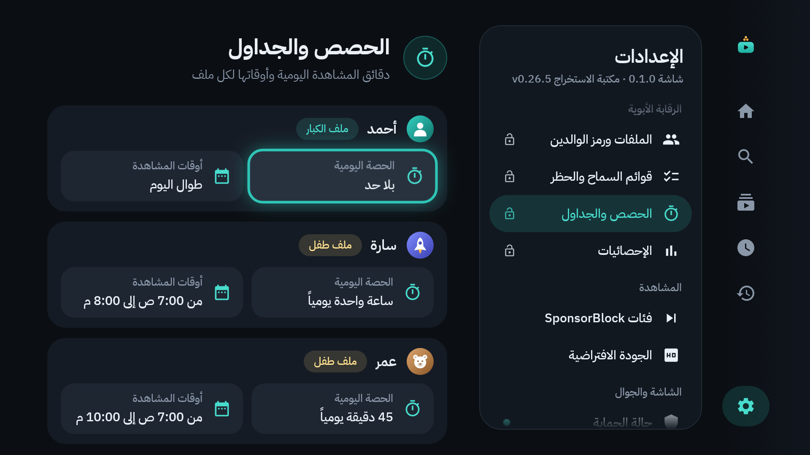
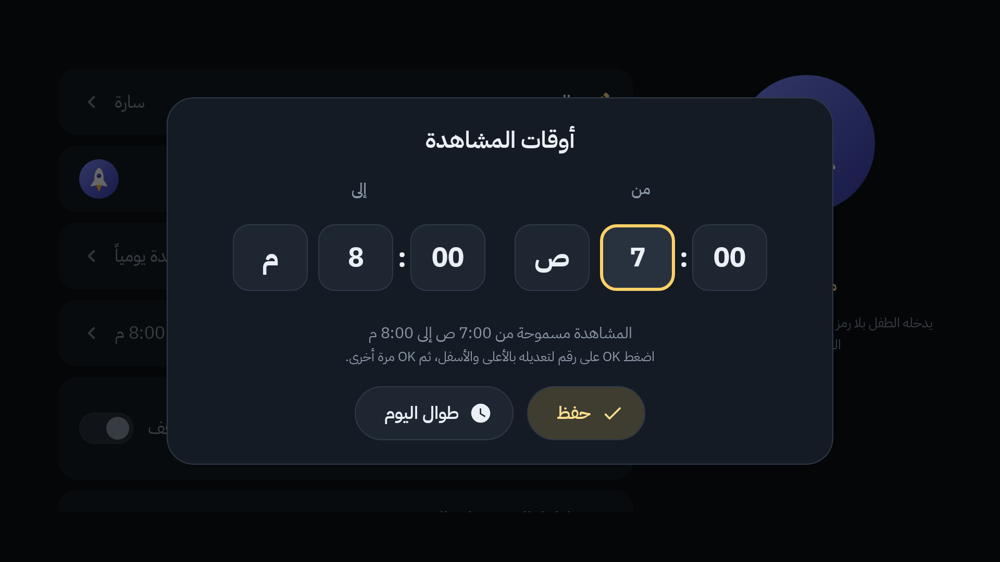
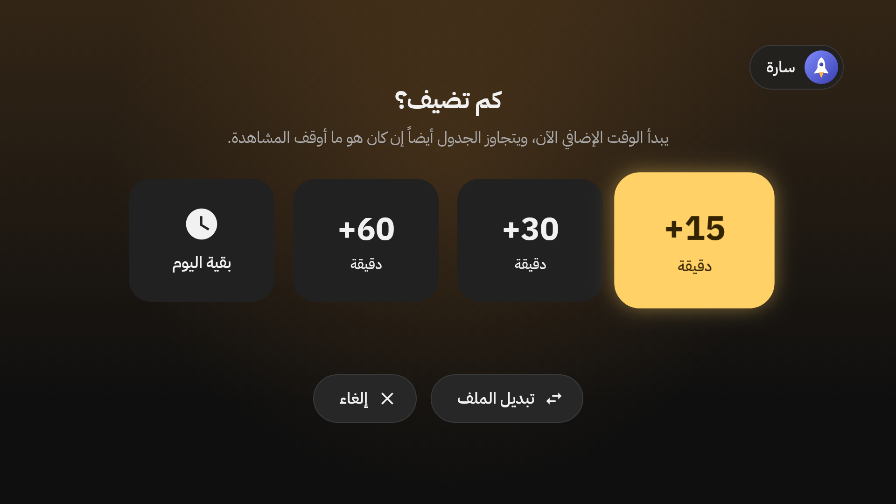

# 7. الوقت: الحصة اليومية وأوقات المشاهدة

لكل ملف شيئان:

- **الحصة اليومية:** كم دقيقة يشاهد في اليوم.
- **أوقات المشاهدة:** من أي ساعة إلى أي ساعة تُسمح المشاهدة.

قبل النهاية بخمس دقائق يظهر تنبيه هادئ. وعند النهاية تتوقف المشاهدة، ولا تُفتح إلا برمز الوالدين.

## أين تضبطها؟

الإعدادات ← **الحصص والجداول** ← **فتح برمز الوالدين**.

لكل ملف بطاقة فيها زرّان: **الحصة اليومية** و**أوقات المشاهدة**. (وتجدهما أيضاً في صفحة تعديل الملف، [الفصل 6](06-profiles-and-child.md).)

### الحصة اليومية

1. قف على **الحصة اليومية** للملف واضغط `OK`.
2. اختر: **بلا حد**، أو 15، أو 30، أو 45، أو 60، أو 90، أو 120، أو 180، أو 240 دقيقة.

### أوقات المشاهدة

1. قف على **أوقات المشاهدة** واضغط `OK`.
2. في جهة **من** وجهة **إلى**: قف على الرقم واضغط `OK`، ثم غيّره بالسهمين `↑` `↓`، ثم `OK` مرة أخرى.
3. اختر **حفظ**. أو **طوال اليوم** لإلغاء الجدول.

يجوز أن يعبر الجدول منتصف الليل، مثل: من 4:00 م إلى 1:00 ص.

## كيف تُحسب الدقائق؟

- تُحسب ما دامت شاشات الملف ظاهرة: التصفّح والمشاهدة.
- لا تُحسب على شاشة «انتهى الوقت»، ولا على «من يشاهد الآن؟».
- تبدأ الحصة من جديد كل يوم.

## التنبيه قبل خمس دقائق

قبل النهاية بخمس دقائق يظهر في أعلى الشاشة: «بقيت 5 دقائق من وقت المشاهدة»، وتحته: «تتوقف المشاهدة بعدها، ويفتحها الوالدان بالرمز.». لا يوقف الفيديو، ويختفي وحده.

## «انتهى الوقت»

حين تنتهي الحصة تظهر هذه الشاشة فوق كل شيء، ويتوقف الفيديو.

1. **الملف:** لمن انتهى الوقت.
2. **متى تعود المشاهدة:** مثل «تعود المشاهدة غداً من الساعة 7:00 ص».
3. **فتح بالرمز:** للوالدين فقط (أدناه).
4. **تذكير:** «ويستطيع الوالدان الفتح من الجوال أيضاً.»

زر `BACK` لا يُخرج من هذه الشاشة. وما دامت ظاهرة يُبقي الحارس «شاشة» في المقدمة ([الفصل 9](09-guard-and-protection.md)).

## «خارج أوقات المشاهدة»

خارج الساعات المسموحة تظهر شاشة مثلها: «خارج أوقات المشاهدة». يقرأ الطفل: «حان وقت الراحة. الشاشة تنتظرك في وقتك المعتاد.»، ومتى تعود المشاهدة.

## فتح الوقت (للوالدين)

**على التلفاز:**

1. اضغط `OK` على **فتح بالرمز**.
2. اكتب رمز الوالدين، ثم **تأكيد**.
3. تظهر «كم تضيف؟»:

- **+15** أو **+30** أو **+60** دقيقة.
- **بقية اليوم:** بلا حد حتى نهاية اليوم.
- **تبديل الملف:** إلى ملف آخر، دون إضافة وقت.
- **إلغاء:** يبقى الوقت منتهياً.

يبدأ الوقت الإضافي الآن. ويتجاوز الجدول أيضاً إن كان هو ما أوقف المشاهدة. وإن تُركت الاختيارات دقيقة كاملة دون لمس، تُغلق ويُنسى الرمز.

**من الجوال:** «الأب» ← «الوقت» ← «فتح الوقت الآن»، ثم +15 أو +30 أو +60 دقيقة، أو «بقية اليوم». يُضاف الوقت إلى الملف المفتوح على التلفاز الآن ([الفصل 10](10-phone-remote.md)). ومن هناك أيضاً تغيّر «الحصة اليومية» لأي ملف.

## تنبيه عن ساعة التلفاز

الحصة والجدول يتبعان ساعة التلفاز. إن كان «الوقت التلقائي» مطفأً في إعدادات التلفاز، فمن يغيّر التاريخ أو الساعة يغيّرهما. «حالة الحماية» تنبّهك إلى ذلك ([الفصل 9](09-guard-and-protection.md)).

---

[السابق: الملفات وملف الطفل](06-profiles-and-child.md) · [الفهرس](README.md) · [التالي: قفل الفيديو](08-video-lock.md)
