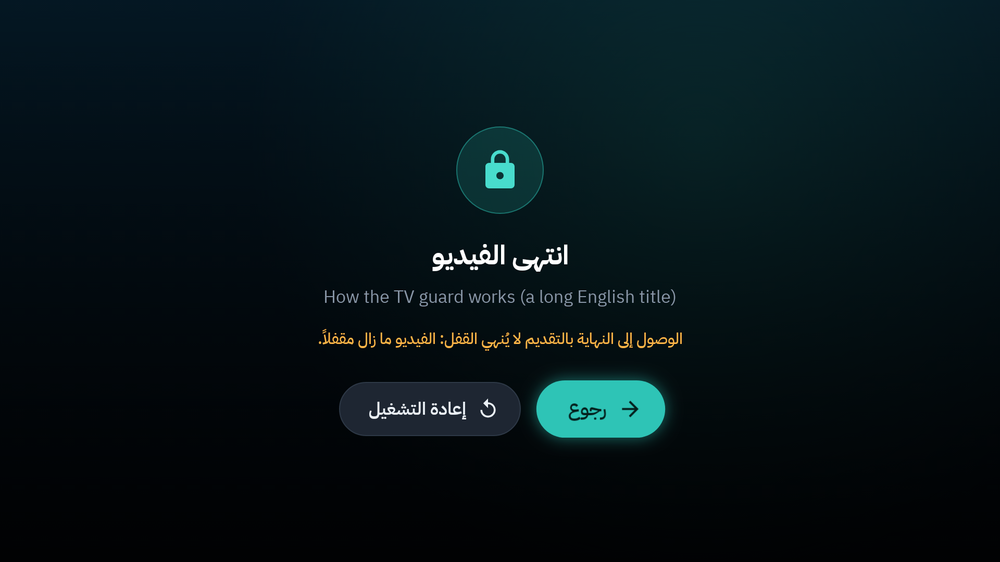
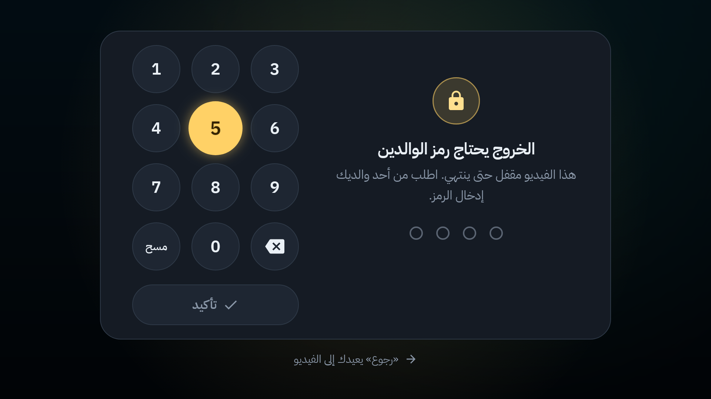
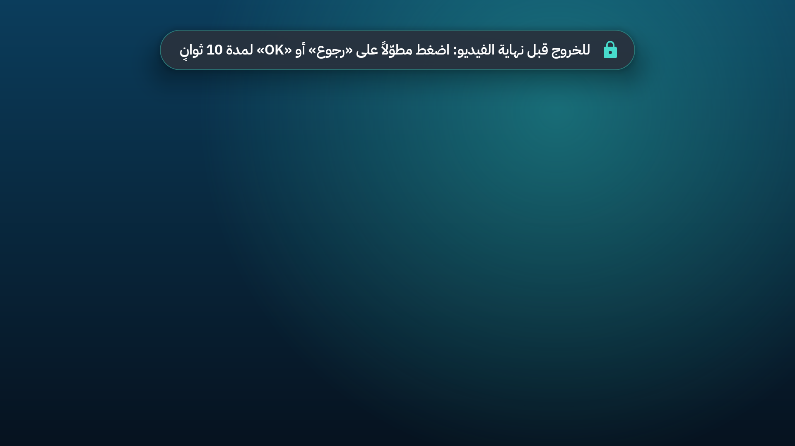
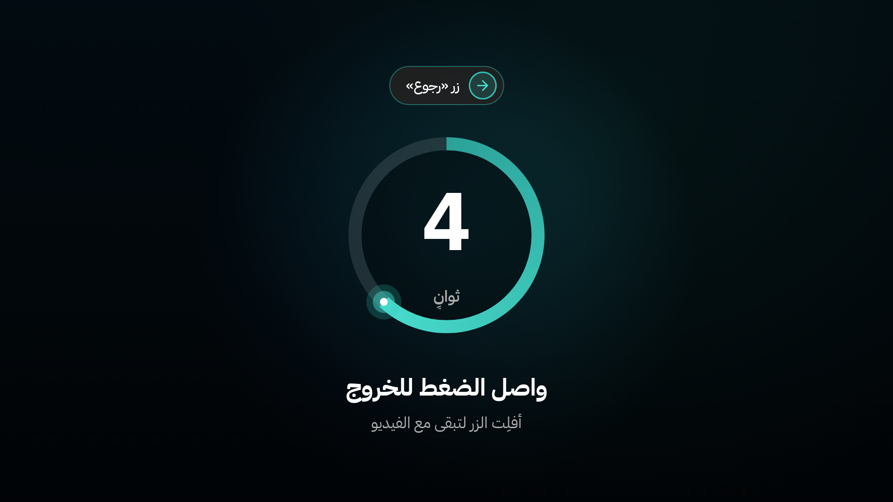
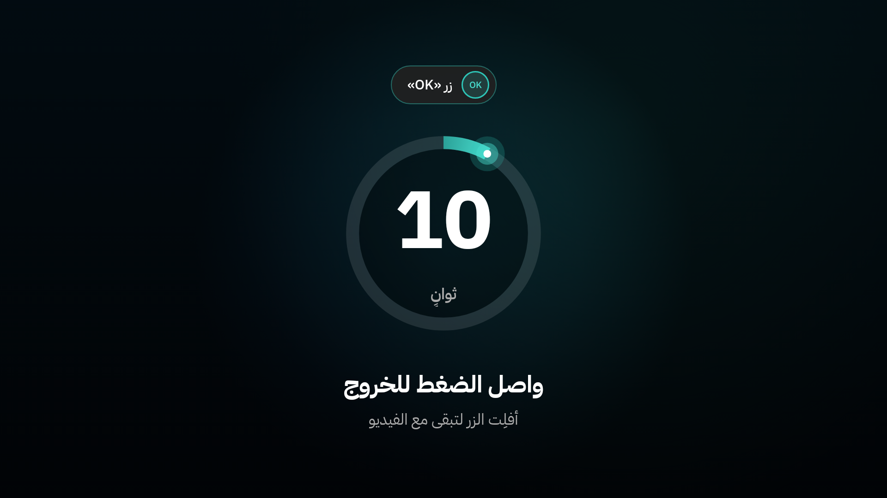
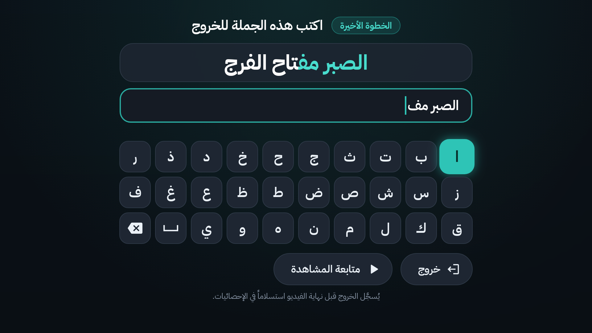
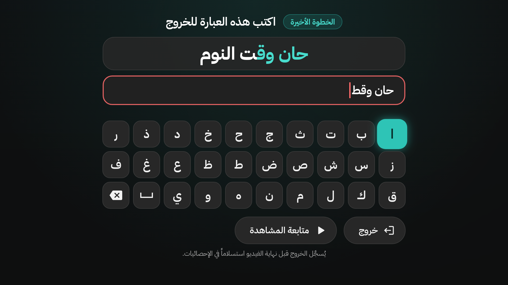

# 8. قفل الفيديو

في «شاشة» **كل فيديو يبدأ مقفولاً حتى ينتهي**، وكذلك قائمة التشغيل. الفكرة: تختار الفيديو بتأنٍّ، ثم تكمله، بدل التنقّل بلا نهاية.

- القفل يبقى ولو أُعيد تشغيل التلفاز: يعود الفيديو المقفول نفسه.
- النهاية الطبيعية للفيديو تفكّ القفل.
- **التقديم إلى النهاية لا يُحسب مشاهدة:** يبقى الفيديو مقفولاً.

والتخطي التلقائي لمقاطع الإعلانات (SponsorBlock) لا يُحسب تقديماً ([الفصل 12](12-sponsorblock.md)).

## في ملف الطفل: الخروج برمز الوالدين

زر `BACK` لا يُخرج الطفل من الفيديو. تظهر بدلاً منه لوحة الرمز:

- يقرأ الطفل: «الخروج يحتاج رمز الوالدين. هذا الفيديو مقفل حتى ينتهي. اطلب من أحد والديك إدخال الرمز.»
- إن أدخل أحد الوالدين الرمز: يخرج الطفل من الفيديو.
- `BACK` مرة أخرى يعيد إلى الفيديو («رجوع» يعيدك إلى الفيديو).

حين ينتهي الفيديو وحده، تظهر «انتهى الفيديو» ويعود الطفل إلى «الرئيسية» بعد عشر ثوانٍ ([الفصل 5](05-player.md)). وداخل قائمة تشغيل ينتقل القفل إلى الفيديو التالي حتى تنتهي القائمة.

## في ملف الكبار: الضغط عشر ثوانٍ ثم كتابة جملة

للخروج قبل نهاية الفيديو في ملف الكبار خطوتان مقصودتان: الغرض أن تتمهّل قبل أن تترك ما بدأته.

**1. ضغطة قصيرة على `BACK`** تُظهر تذكيراً فقط:

«للخروج قبل نهاية الفيديو: اضغط مطوّلاً على «رجوع» أو «OK» لمدة 10 ثوانٍ».

**2. اضغط مطوّلاً على `BACK` أو `OK` عشر ثوانٍ.** تظهر دائرة تعدّ الثواني: «واصل الضغط للخروج».

أفلت الزر قبل النهاية إن غيّرت رأيك: «أفلِت الزر لتبقى مع الفيديو».

**3. اكتب الجملة الظاهرة.** «الخطوة الأخيرة: اكتب هذه الجملة للخروج». تُكتب بلوحة «شاشة» العربية على الشاشة (بالأسهم و`OK`)، لا بلوحة التلفاز:

- الجملة تتغير كل مرة، مثل: «الصبر مفتاح الفرج»، «حان وقت النوم»، «الوقت ثمين».
- في اللوحة أيضاً **مسافة** و**حذف حرف**.
- اكتبها كما تظهر تماماً، ثم اختر **خروج**.
- أو **متابعة المشاهدة** لتعود إلى الفيديو.

إن لم تطابق الجملة تقرأ: «الجملة غير مطابقة. اكتبها كما تظهر تماماً.»

**4. يُسجَّل الخروج «استسلاماً».** تظهر رسالة: «خرجت قبل نهاية الفيديو، وسُجّل ذلك استسلاماً.». ويظهر عدد مرات «الاستسلام» في الإحصائيات ([الفصل 13](13-statistics.md)).

> [!NOTE]
> رمز الوالدين لا يفكّ قفل ملف الكبار على الشاشة: «هذا القفل لا يُفتح بالرمز، بل بالضغط المطوّل ثم كتابة الجملة.»

## فك القفل من الجوال

من صفحة الجوال: «الأب» ← «الفيديو» ← **فك قفل الفيديو** ([الفصل 10](10-phone-remote.md)).

- في ملف الطفل: يستطيع الطفل الخروج من الفيديو الآن.
- في ملف الكبار: يُفك القفل، ويُسجَّل الخروج قبل النهاية استسلاماً.

## ماذا يُمنع أثناء القفل؟

ما دام الفيديو مقفولاً:

- لا يبدأ فيديو آخر، ولا يُفتح رابط جديد من الجوال.
- لا يُبدَّل الملف (في ملف الكبار).
- لا تُستعاد نسخة احتياطية.

أما الإيقاف المؤقت والتقديم فيعملان، من الريموت ومن الجوال.

وفيديوهات «تشخيص» التجريبية لا تُقفل أبداً ([الفصل 17](17-when-youtube-breaks.md)).

---

[السابق: الوقت](07-time-limits.md) · [الفهرس](README.md) · [التالي: الحارس و«حالة الحماية»](09-guard-and-protection.md)
