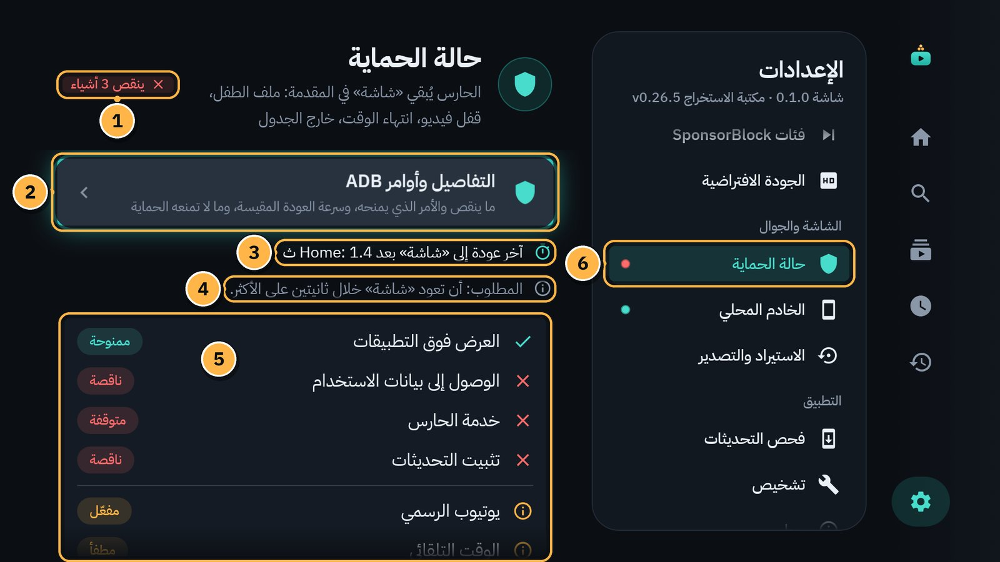
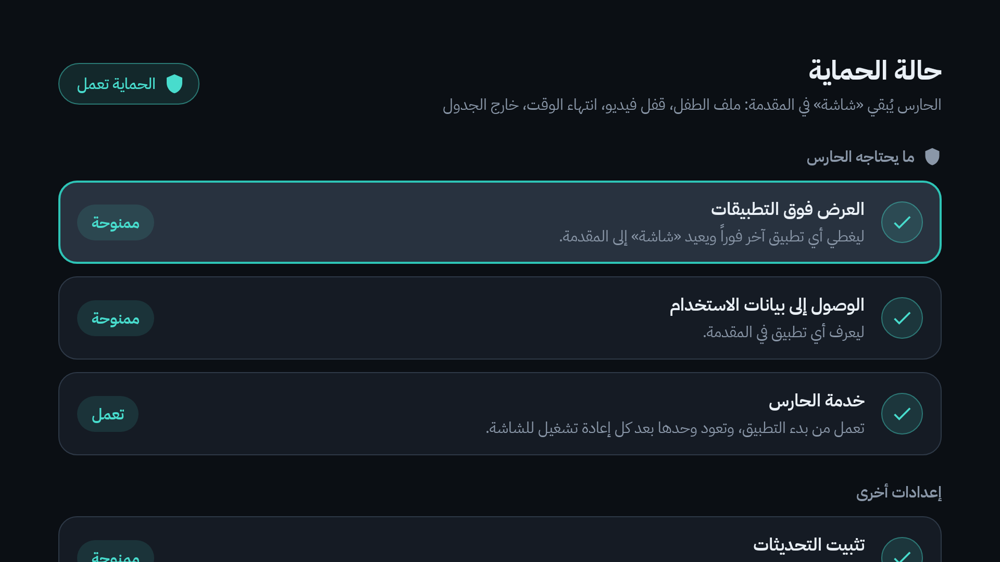
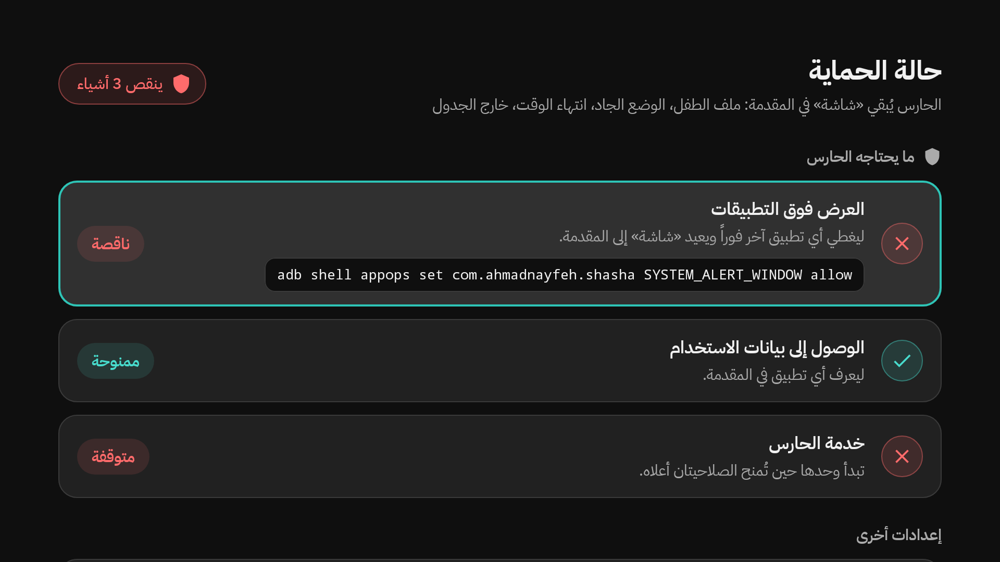
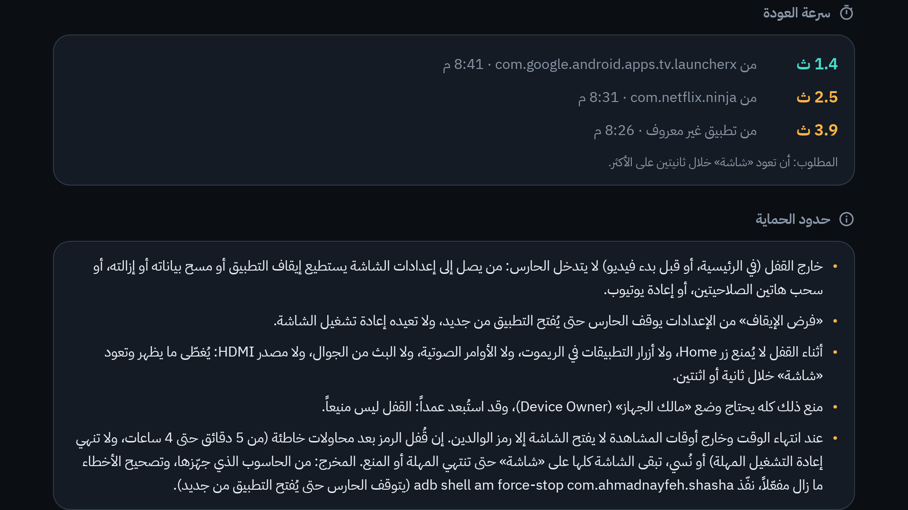

# 9. الحارس و«حالة الحماية»

زر `HOME` في الريموت لا يستطيع أي تطبيق عادي أن يمنعه. لذلك في «شاشة» **حارس**: خدمة صغيرة تعمل في الخلفية، تنتبه حين يظهر تطبيق آخر في وقت لا يُسمح فيه بذلك، فتغطّيه فوراً وتعيد «شاشة» إلى المقدمة.

## متى يتدخل الحارس؟

- **ما دام ملف طفل مفتوحاً**، في أي شاشة من شاشاته، لا أثناء الفيديو فقط.
- **أثناء فيديو مقفول**، في أي ملف ([الفصل 8](08-video-lock.md)).
- **عند «انتهى الوقت»**، و**خارج أوقات المشاهدة** ([الفصل 7](07-time-limits.md)).

وفي غير ذلك **ملف الكبار حر**: تفتح منه أي تطبيق كالمعتاد. ولا يتدخل الحارس والتلفاز مطفأ، أو وشاشة التوقف (Screensaver) ظاهرة.

## ماذا يرى من يضغط `HOME`؟

1. تغطي الشاشةَ فوراً رسالة: «لحظة… نعود إلى «شاشة»».
2. وفي ملف الطفل تضيف: «في ملف الطفل تبقى «شاشة» في المقدمة. الخروج منه برمز الوالدين.»
3. خلال ثانية أو ثانيتين تعود «شاشة»، ويكمل الفيديو.

كذلك مع أزرار التطبيقات في الريموت (YouTube وNetflix…)، والأوامر الصوتية، والبث من الجوال، وتغيير مصدر الصورة.

> [!TIP]
> تريد تطبيقاً آخر؟ اخرج من ملف الطفل (**خروج** ورمز الوالدين) واختر ملف الكبار. بعدها لا يتدخل الحارس.

## ماذا يحتاج الحارس؟

صلاحيتين يمنحهما برنامج التثبيت مرة واحدة من الحاسوب ([الفصل 1](01-getting-started.md)):

- **العرض فوق التطبيقات:** ليغطي أي تطبيق آخر فوراً.
- **الوصول إلى بيانات الاستخدام:** ليعرف أي تطبيق في المقدمة.

بعدها يعمل الحارس وحده: من أول فتح لـ «شاشة»، وبعد كل إعادة تشغيل للتلفاز، وبعد كل تحديث.

## «حالة الحماية»

هنا ترى أن كل شيء يعمل. الإعدادات ← **حالة الحماية** (لا تحتاج رمزاً).

1. **الخلاصة:** «الحماية تعمل» بالفيروزي حين يكتمل كل شيء، أو بالأحمر ما ينقص، مثل «ينقص 3 أشياء».
2. **التفاصيل وأوامر ADB:** يفتح الشاشة الكاملة: ما ينقص، والأمر الدقيق الذي يمنحه، وسرعة العودة، وحدود الحماية.
3. **آخر عودة إلى «شاشة» بعد Home:** كم ثانية استغرقت آخر عودة، مثل «1.4 ث».
4. **المطلوب:** أن تعود «شاشة» خلال ثانيتين على الأكثر.
5. **الصلاحيات والخدمة:** أمام كل عنصر حالته: «ممنوحة» أو «ناقصة»، و«تعمل» أو «متوقفة».
6. **النقطة الحمراء** بجانب «حالة الحماية» في القائمة: شيء ينقص.

وهكذا تبدو حين يكتمل كل شيء:

وحين ينقص شيء، تعرض الشاشة الأمر الذي يمنحه تحته مباشرة. الأسهل: أعد تشغيل برنامج التثبيت من الحاسوب ([دليل التثبيت](../install-guide.md)).

وفي أسفل «حالة الحماية» أيضاً:

- **تثبيت التحديثات:** صلاحية يحتاجها «فحص التحديثات» ([الفصل 16](16-updates.md)).
- **يوتيوب الرسمي:** «مفعّل» أو «معطّل». تعطيله اختياري، وفي ملف الطفل يغطيه الحارس على أي حال.
- **الوقت التلقائي:** إن كان مطفأً، فمن يغيّر ساعة التلفاز يغيّر الحصة والجدول. فعّله.

## كيف تعرف سرعة العودة؟ (لصاحب البيت)

1. ادخل ملف طفل، وشغّل فيديو.
2. اضغط `HOME` في الريموت. تعود «شاشة» بعد لحظة.
3. كرّر ذلك مرات، وجرّب أيضاً زر YouTube أو Netflix في الريموت.
4. اخرج من ملف الطفل (**خروج** ورمز الوالدين) إلى ملف الكبار.
5. الإعدادات ← **حالة الحماية**: اقرأ «آخر عودة إلى «شاشة» بعد Home».
6. ولكل العودات الأخيرة: **التفاصيل وأوامر ADB** ← قسم «سرعة العودة». لكل عودة زمنها، ومن أي تطبيق كانت، ومتى:

الرقم الفيروزي ضمن المطلوب (ثانيتان أو أقل)، والكهرماني أبطأ منه. وإن لم تُقَس بعد تقول الشاشة: «لم تُقَس بعد. للتجربة: ادخل ملف طفل، ثم اضغط زر Home في الريموت.»

## حدود الحماية: ما لا يستطيع الحارس منعه

القفل داخل التطبيق مضمون. أما الحارس فـ «أفضل جهد»، وليس منيعاً:

- **الأزرار لا تُمنع:** `HOME`، وأزرار التطبيقات، والأوامر الصوتية، والبث من الجوال، ومصدر HDMI. يُغطّى ما يظهر، وتعود «شاشة» خلال ثانية أو اثنتين. (مصدر HDMI قد يتأخر نحو 3 ثوانٍ.)
- **فصل الكهرباء أو إعادة التشغيل:** يعود الحارس وحده بعد اكتمال تشغيل التلفاز، لا من اللحظة الأولى.
- **في ملف الكبار** يصل من يمسك الريموت إلى إعدادات التلفاز: يستطيع إيقاف «شاشة» بالقوة (Force stop)، أو مسح بياناته، أو إزالته. لذلك **لا تترك ملف الكبار مفتوحاً للأطفال.**
- **التاريخ والساعة:** إن أُطفئ ضبطهما التلقائي، فتغييرهما يغيّر الحصة والجدول.
- **أوامر الحاسوب (ADB)**، و**إعادة ضبط المصنع**، و**الأجهزة الأخرى** في البيت: كلها خارج قدرة «شاشة».

منع ذلك كله يحتاج وضعاً خاصاً اسمه «مالك الجهاز» (Device Owner)، وقد استُبعد عمداً.

## مخرج الطوارئ

في ملف الطفل، وعند «انتهى الوقت»، وخارج أوقات المشاهدة، لا يُخرج من «شاشة» إلا رمز الوالدين: على التلفاز، أو من الجوال.

إن قُفل الرمز بعد محاولات خاطئة (من 5 دقائق حتى 4 ساعات)، أو نُسي، يبقى التلفاز كله على «شاشة»، حتى عليك. **المخرج الأخير من الحاسوب الذي ثبّت «شاشة»**: أمر يوقف التطبيق فيتوقف الحارس حتى يُفتح من جديد. الأمر مكتوب في «حالة الحماية» ← «حدود الحماية»، وفي [README](../../README.md) و[MAINTENANCE.md](../../MAINTENANCE.md). اطلبه من صاحب البيت.

---

[السابق: قفل الفيديو](08-video-lock.md) · [الفهرس](README.md) · [التالي: الجوال ريموتاً](10-phone-remote.md)
