# 10. الجوال ريموتاً

جوالك يصير ريموتاً لـ «شاشة»: ترسل منه روابط يوتيوب إلى التلفاز، وتبحث بالكتابة المريحة، وتوقف وتقدّم، وتبدّل الملف. وللوالدين فيه **قسم الأب**: يفتحون الوقت، ويفكّون قفل فيديو، ويديرون قوائم السماح والاشتراكات والنسخة الاحتياطية.

لا تطبيق تثبّته: هي صفحة ويب على شبكة البيت، تفتحها من متصفح الجوال.

## الاقتران بالتلفاز (مرة واحدة)

1. الجوال على شبكة Wi-Fi نفسها التي عليها التلفاز.
2. على التلفاز: الإعدادات ← **الخادم المحلي**.
3. تأكد أن **تشغيل الخادم** مفعّل، وأن اللوحة تقول «يعمل على …» (عنوان التلفاز).
4. اختر **رمز الاقتران QR**، واكتب رمز الوالدين. تفتح شاشة «التحكم من الجوال» (الصورة أدناه).
5. امسح الرمز بكاميرا الجوال، وافتح الرابط الظاهر. تفتح صفحة «شاشة» في متصفح الجوال.

والرمز نفسه يظهر في آخر خطوة من أول تشغيل ([الفصل 1](01-getting-started.md)).

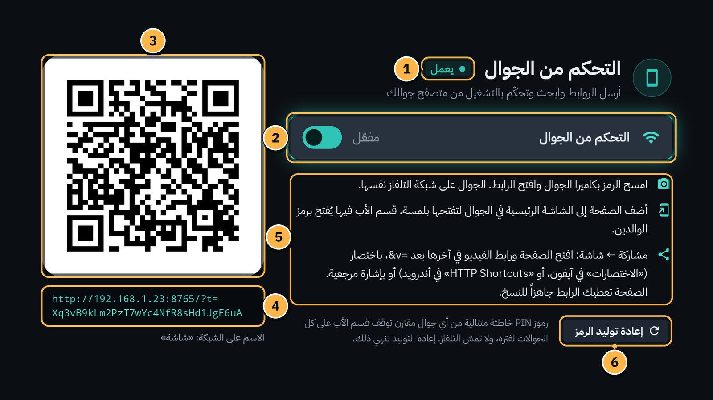

1. **الحالة:** «يعمل». (أو «متوقف»، أو «لا شبكة محلية».)
2. **التحكم من الجوال:** مفتاح التشغيل والإيقاف.
3. **رمز QR:** امسحه بكاميرا الجوال.
4. **الرابط نفسه مكتوباً:** إن لم تعمل الكاميرا، اكتبه في متصفح الجوال.
5. **ثلاث نصائح:** المسح، والإضافة إلى الشاشة الرئيسية للجوال، و«مشاركة ← شاشة».
6. **إعادة توليد الرمز:** يلغي اقتران كل الجوالات (أدناه).

## أضف الصفحة إلى الشاشة الرئيسية للجوال

هكذا تفتحها بلمسة، كأنها تطبيق:

- **آيفون (Safari):** زر المشاركة ← «إضافة إلى الشاشة الرئيسية».
- **أندرويد (Chrome):** القائمة ⋮ ← «إضافة إلى الشاشة الرئيسية».

تظهر أيقونة «شاشة» على جوالك. والصفحة تتذكّر الاقتران.

## أقسام الصفحة

في أسفل الصفحة أربعة تبويبات:

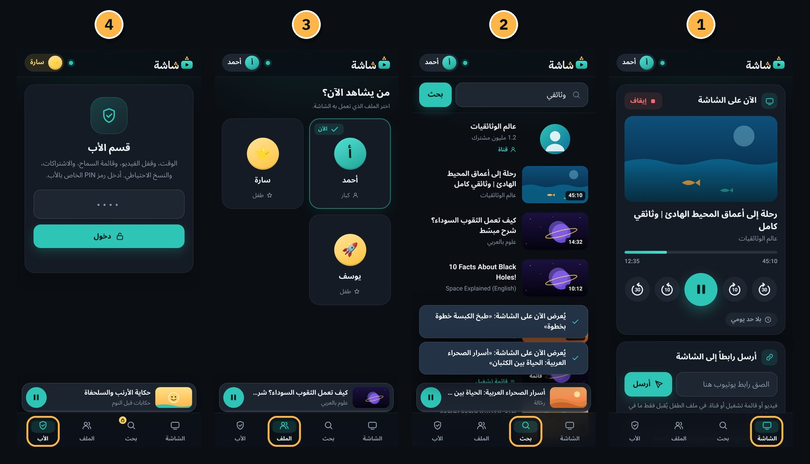

1. **الشاشة:** ما يُعرض على التلفاز الآن، والتحكم فيه، وإرسال رابط.
2. **بحث:** ابحث في يوتيوب من الجوال، والنتيجة على التلفاز.
3. **الملف:** «من يشاهد الآن؟»: بدّل ملف التلفاز.
4. **الأب:** «قسم الأب»، برمز الوالدين.

### تبويب «الشاشة»

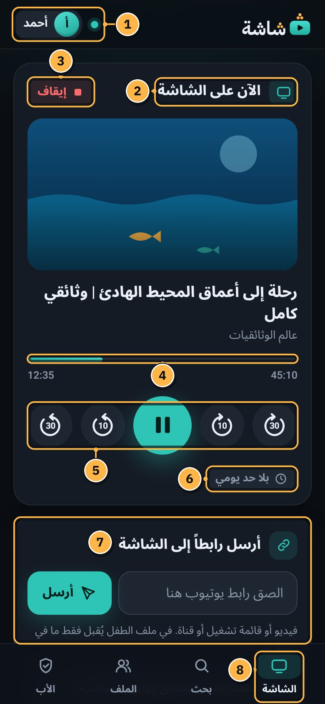

1. **الملف المفتوح على التلفاز.** والنقطة بجانبه: الجوال متصل بالتلفاز.
2. **«الآن على الشاشة»:** الفيديو المعروض، بصورته وعنوانه وقناته.
3. **إيقاف:** يغلق الفيديو على التلفاز، كزر `BACK`. وما دام الفيديو مقفولاً يُرفض: «الفيديو مقفول حتى ينتهي…» ([الفصل 8](08-video-lock.md)).
4. **شريط التقدّم والوقت.**
5. **التحكم:** رجوع 30 ثانية، رجوع 10 ثوانٍ، تشغيل / إيقاف مؤقت، تقديم 10 ثوانٍ، تقديم 30 ثانية.
6. **الوقت الباقي:** مثل «متبقٍ 38 دقيقة»، أو «بلا حد يومي».
7. **«أرسل رابطاً إلى الشاشة»:** الصق رابط يوتيوب، ثم **أرسل**. يقبل رابط فيديو أو قائمة تشغيل أو قناة.
8. **التبويبات.**

بعد الإرسال يقول الجوال مثلاً: «يُعرض الآن على الشاشة: «…»».

### تبويب «بحث»

اكتب ما تريد، ثم **بحث**. اضغط نتيجة لتُعرض على التلفاز. وفي أسفل الصفحة مشغّل صغير لما يُعرض الآن.

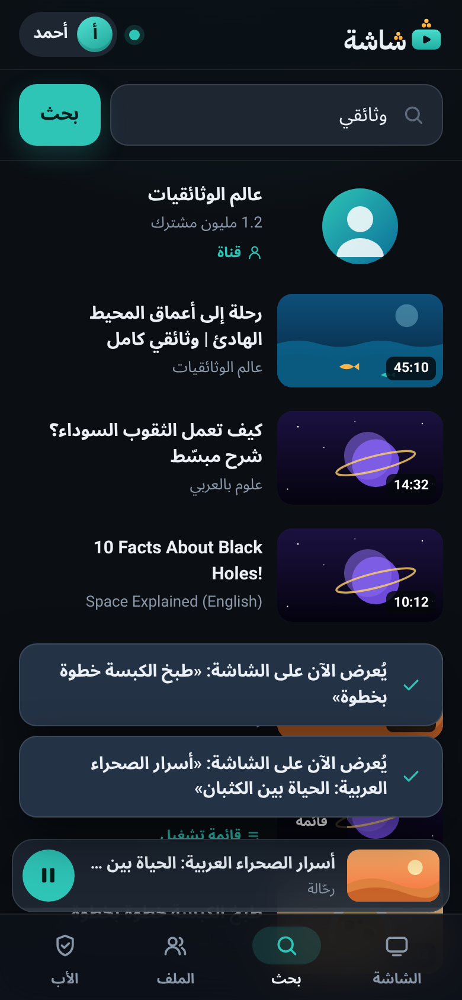
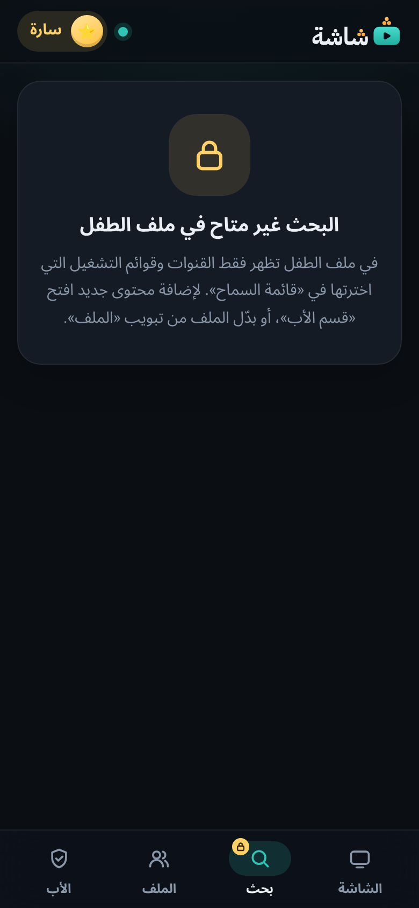

وفي ملف الطفل لا بحث من الجوال أيضاً: «البحث غير متاح في ملف الطفل».

### تبويب «الملف»

«من يشاهد الآن؟»: اضغط ملفاً لتنقل التلفاز إليه.

- الخروج من ملف طفل، والانتقال إلى ملف الكبار: يطلبان رمز الوالدين.
- وملف الكبار يطلب الرمز على التلفاز أيضاً قبل أن يُفتح.

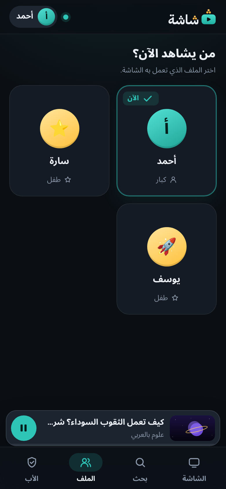
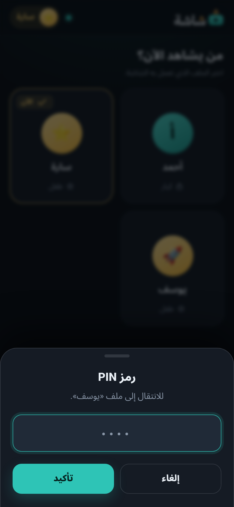

## قسم الأب

اضغط **الأب**، واكتب رمز الوالدين، ثم **دخول**.

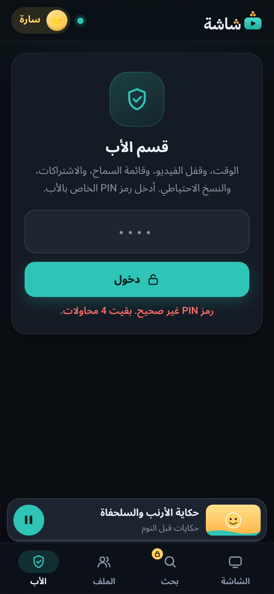

- تنتهي الجلسة بعد 30 دقيقة دون استخدام، أو بزر **خروج**.
- الرمز الخاطئ يقول: «رمز PIN غير صحيح. بقيت 4 محاولات.».

في القسم خمسة تبويبات. هذه أربعة منها:

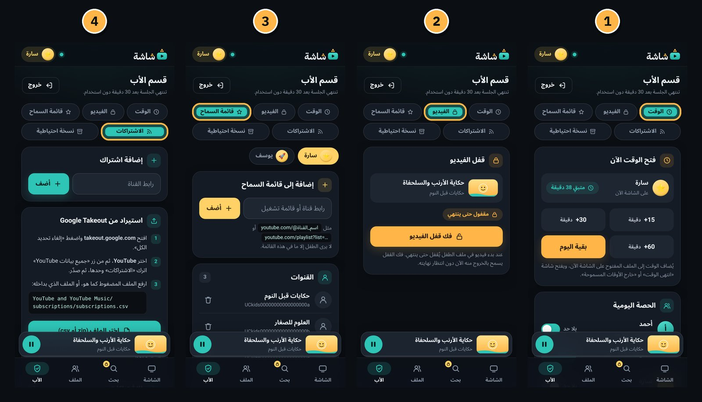

1. **الوقت:**
   - «فتح الوقت الآن»: +15 أو +30 أو +60 دقيقة، أو «بقية اليوم»، للملف المفتوح على التلفاز. يفتح شاشة «انتهى الوقت» أو «خارج الأوقات المسموحة».
   - «الحصة اليومية» لكل ملف: `−` و`+` بخطوات 15 دقيقة، أو «بلا حد»، ثم **حفظ**.
2. **الفيديو:** حالة «قفل الفيديو»، وزر **فك قفل الفيديو** ([الفصل 8](08-video-lock.md)).
3. **قائمة السماح:** اختر الطفل من أعلى. الصق رابط قناة (مثل `youtube.com/@name`) أو رابط قائمة تشغيل، ثم **أضف**. ولإزالة عنصر: أيقونة الحذف بجانبه ← **إزالة**.
4. **الاشتراكات:** «إضافة اشتراك» برابط القناة، و«استيراد من Google Takeout» ([الفصل 3](03-home-and-subscriptions.md))، وقائمة قنواتك مع أيقونة الحذف.

والخامس **نسخة احتياطية**: تنزيل النسخة واستعادتها ([الفصل 15](15-backup-and-restore.md)).

> [!IMPORTANT]
> **لرمز الجوال عدّاده الخاص.** خمسة رموز خاطئة من الجوال توقف قسم الأب 5 دقائق، ثم 15 دقيقة، ثم ساعة، ثم 4 ساعات. ولا يتأثر بها رمز التلفاز: تخمينات طفل على التلفاز لا تقفل جوال الأب، والعكس.
>
> لكن العدّاد واحد لكل الجوالات المقترنة. إن أوقفه جوال طفل يخمّن، فـ **إعادة توليد الرمز** على التلفاز تنهي ذلك (أدناه).

## مشاركة ← شاشة

شاهدت فيديو في تطبيق يوتيوب على جوالك وتريده على التلفاز؟

1. في تبويب **الشاشة** افتح «المشاركة من تطبيق يوتيوب مباشرة». فيها رابط جاهز ينتهي بـ `&v=`، وزر **نسخ**.
2. ضع بعد `&v=` أي رابط يوتيوب، وافتحه في متصفح الجوال: يُرسل إلى التلفاز وحده.
3. الأسهل: اجعل هذا الرابط اختصاراً للمشاركة، بتطبيق «الاختصارات» (Shortcuts) في آيفون، أو «HTTP Shortcuts» في أندرويد، أو احفظه إشارة مرجعية. عندها تشارك من يوتيوب إلى التلفاز بلمسة.

والرابط يحفظ وقت البداية إن كان فيه.

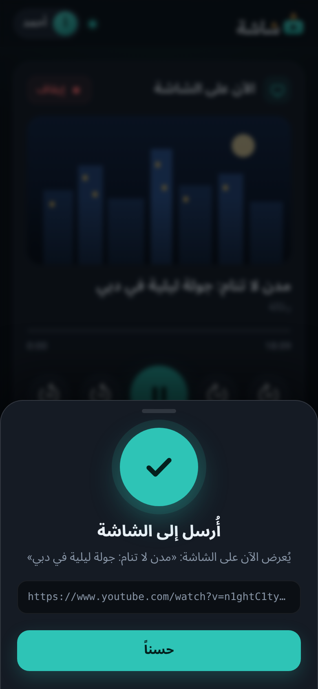
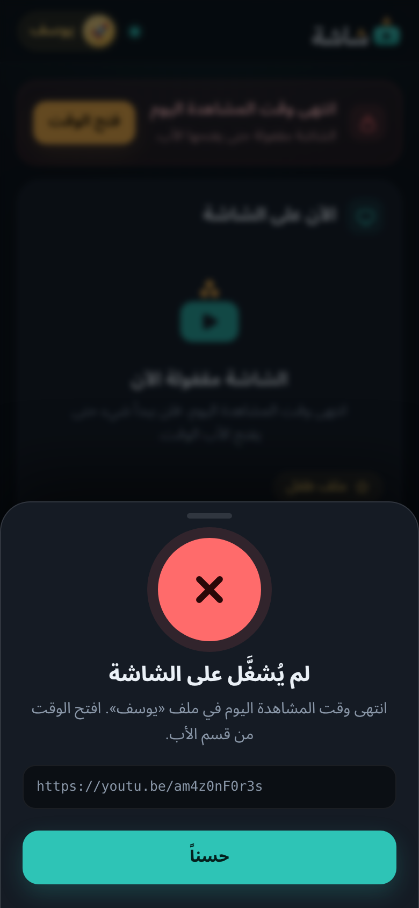
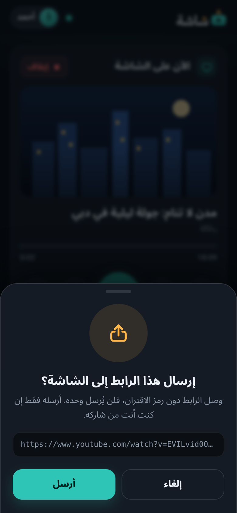

- **«أُرسل إلى الشاشة»:** نجح.
- **«لم يُشغَّل على الشاشة»:** رُفض، والسبب مكتوب (مثل انتهاء الوقت).
- **«إرسال هذا الرابط إلى الشاشة؟»:** وصل رابط دون رمز الاقتران. أرسله فقط إن كنت أنت من شاركه.

## قواعد ملف الطفل تسري على الجوال

الجوال لا يتجاوز الرقابة. ما دام ملف طفل مفتوحاً على التلفاز:

- الرابط من خارج قائمة السماح يُرفض، ولا يتغير شيء على التلفاز.
- لا بحث.
- عند «انتهى الوقت» لا يُقبل أي رابط.

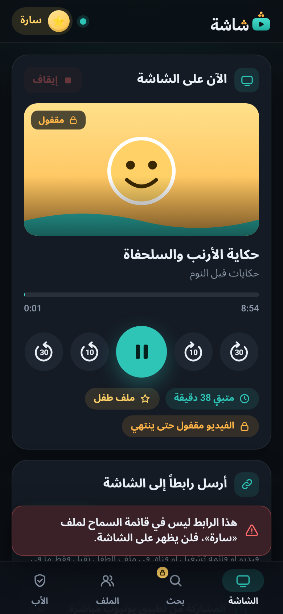
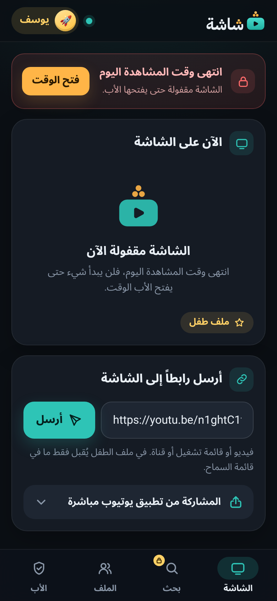

## إعادة توليد رمز الاقتران

متى؟ ضاع جوال مقترن أو أُعطي لغيرك، أو عرف ضيف رابط الصفحة، أو اقترن جوال طفل، أو أوقفت الرموز الخاطئة قسم الأب.

1. على التلفاز: الإعدادات ← **الخادم المحلي** ← **رمز الاقتران QR**.
2. **إعادة توليد الرمز** ← **إعادة التوليد**.
3. تتوقف كل الجوالات فوراً. امسح الرمز الجديد من كل جوال تريده، وحدّث الأيقونة واختصار المشاركة.

## حين لا تعمل الصفحة

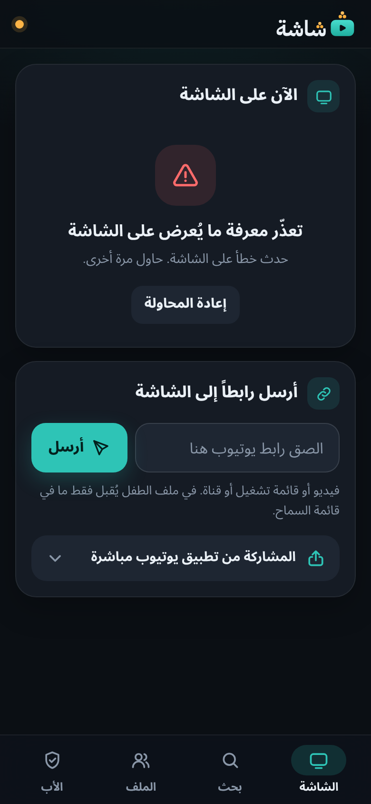

- **«امسح رمز QR من جديد»:** أُعيد توليد الرمز، أو تغيّر عنوان التلفاز. امسح الرمز الجديد.
- **«تعذّر الوصول إلى الشاشة»:** تأكد أن «شاشة» يعمل على التلفاز، وأن الجوال على شبكة Wi-Fi نفسها.
- **«الشاشة في وضع الاستعداد…»:** شغّل التلفاز، ثم أعد الإرسال.

> [!TIP]
> احجز عنوان التلفاز في إعدادات الراوتر (DHCP reservation)، فلا يتغير، ولا تضطر إلى مسح الرمز من جديد.

## الأمان

- كل طلب من الجوال يحتاج رمز الاقتران المخفي داخل الرابط. لا تشارك الرابط مع أحد.
- الخادم يستمع على شبكة البيت فقط، لا على الإنترنت.
- وقسم الأب يحتاج رمز الوالدين فوق ذلك.

---

[السابق: الحارس و«حالة الحماية»](09-guard-and-protection.md) · [الفهرس](README.md) · [التالي: قوائم السماح والحظر](11-allow-and-block-lists.md)
