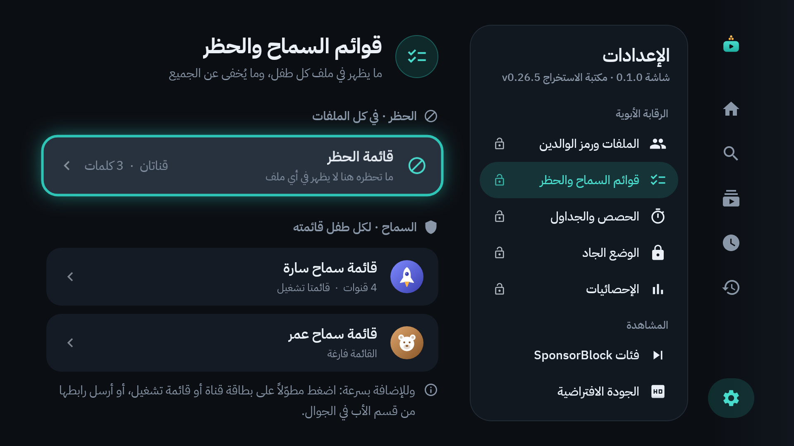
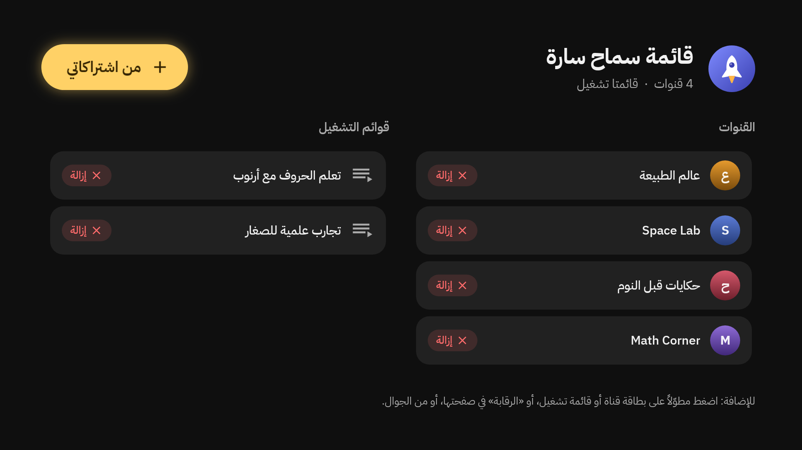
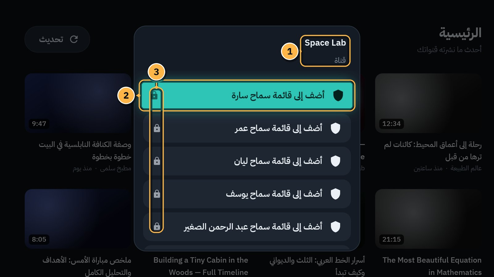
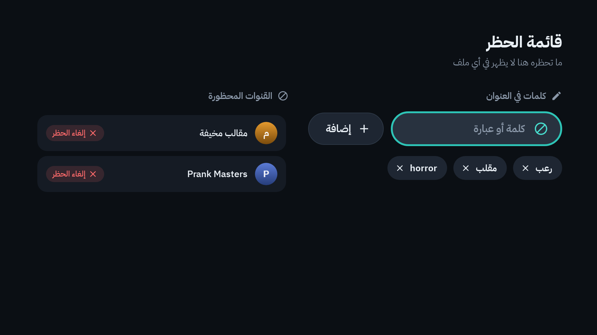
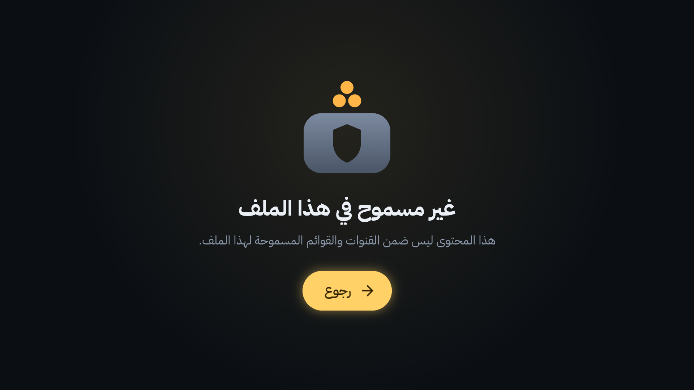

# 11. قوائم السماح والحظر

قائمتان تقرّران ما يظهر في كل ملف:

| | قائمة السماح | قائمة الحظر |
|---|---|---|
| لمن؟ | لكل طفل قائمته | للبيت كله: كل الملفات، والكبار أيضاً |
| ماذا فيها؟ | قنوات وقوائم تشغيل تختارها أنت | قنوات، وكلمات في العنوان |
| النتيجة | لا يرى الطفل **إلا** ما فيها | لا يظهر ما فيها **لأحد** |

وكلتاهما تُفتح برمز الوالدين. الإعدادات ← **قوائم السماح والحظر**:

## قائمة سماح الطفل

الإعدادات ← **قوائم السماح والحظر** ← **قائمة سماح <اسم الطفل>**.

- **القنوات** على اليمين، و**قوائم التشغيل** على اليسار.
- بجانب كل عنصر زر **إزالة**.
- **من اشتراكاتي** في الأعلى: اختر قنوات من اشتراكاتك بسرعة.

### أربع طرق للإضافة

**1. من اشتراكاتك:** في قائمة السماح اختر **من اشتراكاتي**، ثم القنوات التي تريدها.

**2. من قائمة البطاقة:** في ملف الكبار، قف على بطاقة قناة أو قائمة تشغيل أو فيديو، واضغط `OK` مطوّلاً (أو `MENU`):

1. **اسم القناة** (أو القائمة) التي تتصرف فيها.
2. **أضف إلى قائمة سماح <اسم الطفل>:** زر لكل طفل. (إن كانت مضافة: **أزِل من قائمة سماح …**.)
3. **القفل الصغير:** يطلب رمز الوالدين، إن لم تُدخله في الدقائق الخمس الأخيرة.

وفي أسفل القائمة **حظر القناة** أيضاً.

**3. من زر «الرقابة»:** في صفحة القناة أو صفحة قائمة التشغيل ([الفصل 4](04-search-channels-playlists.md)). يفتح القائمة نفسها.

**4. من الجوال:** «الأب» ← «قائمة السماح» ← اختر الطفل ← الصق رابط القناة (مثل `youtube.com/@name`) أو رابط قائمة التشغيل ← **أضف** ([الفصل 10](10-phone-remote.md)).

### كيف تعمل؟

- **قناة مسموحة:** كل فيديوهاتها تظهر في ملف الطفل.
- **قائمة تشغيل مسموحة:** كل فيديوهاتها تعمل داخلها، ولو كانت من قنوات أخرى.
- **رابط فيديو** (من الجوال مثلاً) يُحكم عليه بقناة الفيديو نفسه. فلا يمرّ فيديو غير مسموح لأن رابطه يذكر قائمة مسموحة.
- قائمة الحظر وإخفاء المقاطع القصيرة يسريان على ملف الطفل أيضاً.

> [!TIP]
> ابدأ بقنوات قليلة تثق بها، وأضف مع الوقت. القائمة الفارغة تعني أن الطفل لا يرى شيئاً.

## قائمة الحظر

الإعدادات ← **قوائم السماح والحظر** ← **قائمة الحظر**. «ما تحظره هنا لا يظهر في أي ملف».

**كلمات في العنوان:**

1. قف على خانة «كلمة أو عبارة» واضغط `OK`، واكتب الكلمة.
2. اختر **إضافة**.

كل فيديو في عنوانه هذه الكلمة يختفي من كل الملفات. ولإزالة كلمة اضغط `OK` عليها.

**القنوات المحظورة:**

- تُحظر القناة من قائمة بطاقتها ← **حظر القناة**، أو من زر **الرقابة** في صفحتها.
- تظهر هنا مع زر **إلغاء الحظر**.
- إن كنت مشتركاً في قناة محظورة، يُكتب بجانبها «مشترك فيها»، مع زر **إلغاء الاشتراك**.

## ماذا يرى من يصل إلى شيء محظور؟

لا يظهر المحظور في «الرئيسية» ولا في البحث ولا في القوائم. وإن وصل إليه أحد برابط، يرى رسالة هادئة بدل الفيديو، مثل «قناة محظورة» أو «عنوان محظور» أو «غير مسموح في هذا الملف»، مع زر **رجوع**.

---

[السابق: الجوال ريموتاً](10-phone-remote.md) · [الفهرس](README.md) · [التالي: تخطي المقاطع](12-sponsorblock.md)
