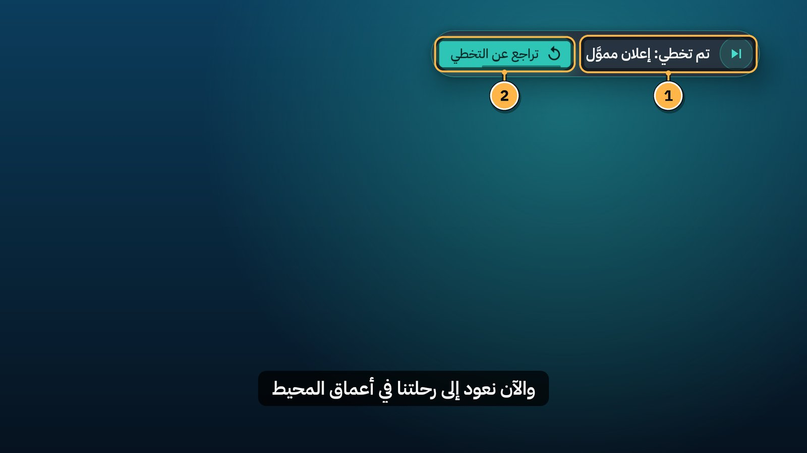
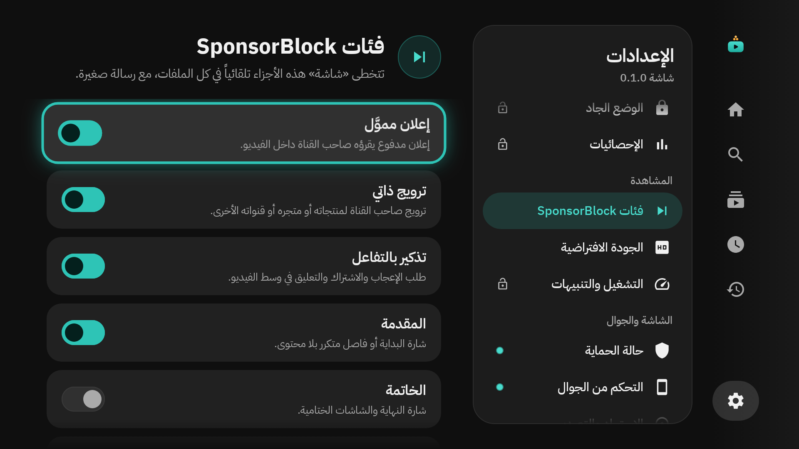
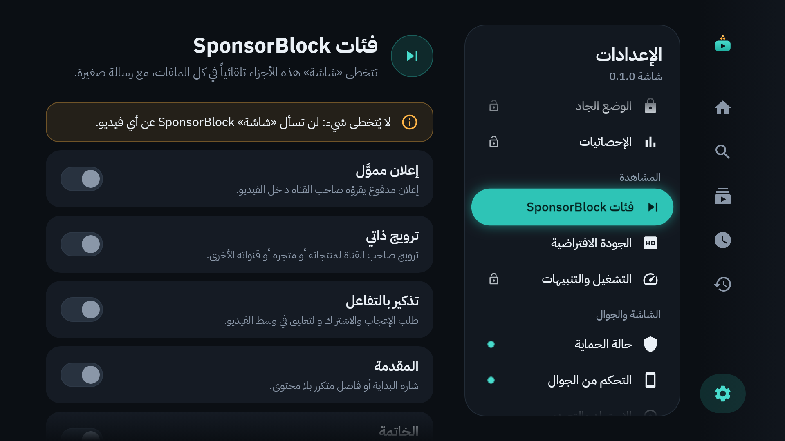

# 12. تخطي المقاطع (SponsorBlock)

كثير من صنّاع المحتوى يقرؤون إعلانات مدفوعة داخل فيديوهاتهم، أو يطيلون المقدمة وطلبات الاشتراك. «شاشة» يتخطى هذه الأجزاء وحده، بمعلومات من **SponsorBlock**: مشروع مجاني يحدّد فيه متطوعون هذه الأجزاء في ملايين الفيديوهات.

## كيف يبدو التخطي؟

1. **«تم تخطي: إعلان مموَّل»:** رسالة صغيرة في الأعلى، ثلاث ثوانٍ. يقفز الفيديو إلى ما بعد الجزء.
2. **تراجع عن التخطي:** في ملف الكبار فقط، خمس ثوانٍ. اضغط `OK` فيرجع الفيديو إلى بداية الجزء، ولا يُتخطى ثانية في هذه المشاهدة.

وفي ملف الطفل يُتخطى الجزء مع الرسالة فقط، بلا زر تراجع:

`BACK` يغلق الرسالة. ولا تخطي في البث المباشر.

## الفئات

الإعدادات ← **فئات SponsorBlock** (لا تحتاج رمزاً). «تتخطى «شاشة» هذه الأجزاء تلقائياً في كل الملفات، مع رسالة صغيرة.»

**مفعّلة من البداية:**

| الفئة | ما هي |
|---|---|
| إعلان مموَّل | إعلان مدفوع يقرؤه صاحب القناة داخل الفيديو. |
| ترويج ذاتي | ترويج صاحب القناة لمنتجاته أو متجره أو قنواته الأخرى. |
| تذكير بالتفاعل | طلب الإعجاب والاشتراك والتعليق في وسط الفيديو. |
| المقدمة | شارة البداية أو فاصل متكرر بلا محتوى. |
| الخاتمة | شارة النهاية والشاشات الختامية. |

**تفعّلها إن شئت:**

| الفئة | ما هي |
|---|---|
| معاينة أو تلخيص | لقطات مما سيأتي في الفيديو، أو ملخص لما سبق. |
| تحية أو تشويق | تحيات ولقطات تشويقية في البداية لا تحمل معلومة. |
| استطراد | حديث جانبي أو مزاح خارج موضوع الفيديو. |
| جزء غير موسيقي | في مقاطع الموسيقى: الأجزاء التي ليست موسيقى. |

- قف على الفئة واضغط `OK` لتفعيلها أو إيقافها.
- **العودة إلى الاختيار الافتراضي** يرجع الفئات الخمس الأولى. (يظهر حين يختلف اختيارك عنها.)
- الفئات واحدة لكل الملفات.

إن أطفأت الفئات كلها، تقول الشاشة: «لا يُتخطى شيء: لن تسأل «شاشة» SponsorBlock عن أي فيديو.»

## الخصوصية

عند بدء كل فيديو يسأل «شاشة» SponsorBlock مرة واحدة. ولا يرسل رقم الفيديو نفسه، بل **أول أربعة أحرف فقط من بصمته**. يعيد الخادم أجزاء فيديوهات كثيرة تشترك في هذه البداية، ويختار «شاشة» الفيديو الصحيح على التلفاز نفسه. فلا يعرف SponsorBlock ماذا تشاهد.

وتُحفظ الإجابة 24 ساعة (وساعة واحدة إن لم يكن للفيديو أجزاء)، فلا يُسأل عن الفيديو نفسه كل مرة.

## مع قفل الفيديو

التخطي التلقائي لا يُحسب «تقديماً»: الفيديو الذي تخطّى «شاشة» خاتمته ينتهي نهاية طبيعية، ويُفكّ قفله ([الفصل 8](08-video-lock.md)).

## النسبة والرخصة

بيانات التخطي من SponsorBlock على sponsor.ajay.app، يساهم بها مجتمعه، ومرخّصة بموجب CC BY-NC-SA 4.0 (نسب المصدر، وغير تجاري، والمشاركة بالمثل). يظهر ذلك في الإعدادات ← **حول**، وفي أسفل **فئات SponsorBlock**، بنص المشروع نفسه:

> Uses SponsorBlock data licensed used under CC BY-NC-SA 4.0 from https://sponsor.ajay.app/.

---

[السابق: قوائم السماح والحظر](11-allow-and-block-lists.md) · [الفهرس](README.md) · [التالي: الإحصائيات](13-statistics.md)
