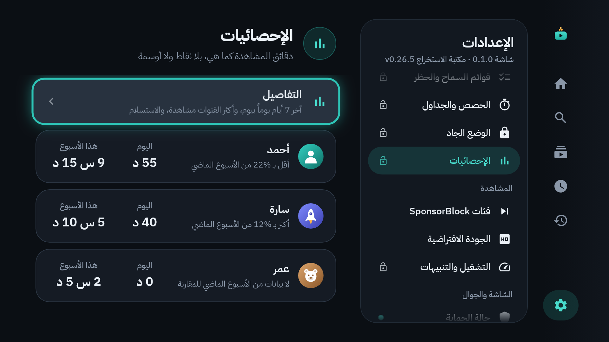
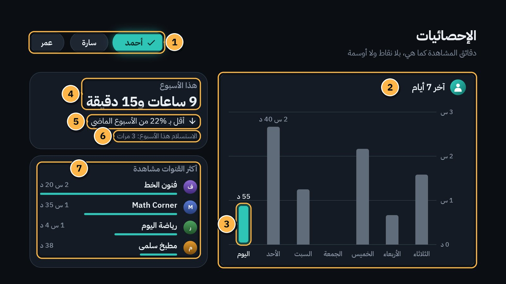
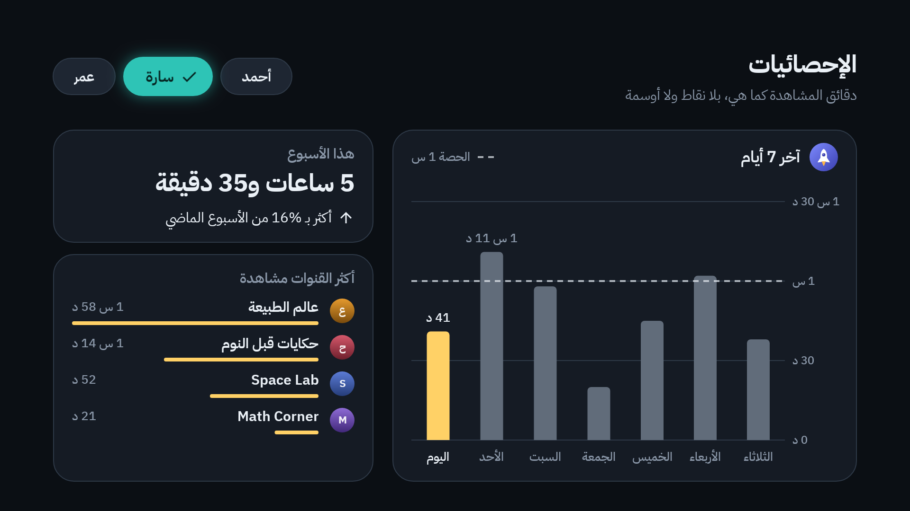

# 13. الإحصائيات

كم يشاهد كل فرد في البيت؟ الإحصائيات تجيب بالدقائق كما هي: **بلا نقاط، ولا أوسمة، ولا سلاسل أيام**. لا شيء يدفع أحداً إلى أن يشاهد أكثر.

## أين تجدها؟

الإعدادات ← **الإحصائيات** ← **فتح برمز الوالدين**.

في اللوحة لكل ملف: دقائق **اليوم**، ودقائق **هذا الأسبوع**، ومقارنة قصيرة بالأسبوع الماضي. وللتفاصيل اختر **التفاصيل**.

## شاشة التفاصيل

1. **الملف:** اختر من تريد إحصائياته.
2. **آخر 7 أيام:** عمود لكل يوم، بطول دقائق المشاهدة فيه.
3. **اليوم:** عمود اليوم ملوّن، وفوقه دقائقه.
4. **هذا الأسبوع:** مجموع الوقت، مثل «9 ساعات و15 دقيقة».
5. **المقارنة:** «أقل بـ 22% من الأسبوع الماضي» مثلاً، أو «أكثر بـ …»، أو «مثل الأسبوع الماضي».
6. **الاستسلام:** كم مرة خرج صاحب الملف من فيديو قبل نهايته ([الفصل 8](08-video-lock.md)). مثل «الاستسلام هذا الأسبوع: 3 مرات»، أو «لا استسلام هذا الأسبوع».
7. **أكثر القنوات مشاهدة:** القنوات التي أخذت أكثر الوقت، مع مدة كل منها.

وفي ملف له حصة يومية، يظهر خط متقطّع عند الحصة («الحصة 1 س» مثلاً)، فترى أي الأيام اقتربت منها:

## كيف تُحسب؟

- تُحسب الدقائق ما دامت شاشات الملف ظاهرة على التلفاز، كما في الحصة اليومية ([الفصل 7](07-time-limits.md)).
- تبقى الأرقام على التلفاز وحده، ولا تُرسل إلى أي مكان.
- تُحفظ آخر 90 يوماً تقريباً، وتدخل في النسخة الاحتياطية ([الفصل 15](15-backup-and-restore.md)).
- حذف ملف يحذف إحصائياته معه.

---

[السابق: تخطي المقاطع](12-sponsorblock.md) · [الفهرس](README.md) · [التالي: خريطة الإعدادات](14-settings-map.md)
