# 14. خريطة الإعدادات

الإعدادات في ملف الكبار فقط. من القائمة الجانبية ← **الإعدادات** (أيقونة الترس في أسفلها).

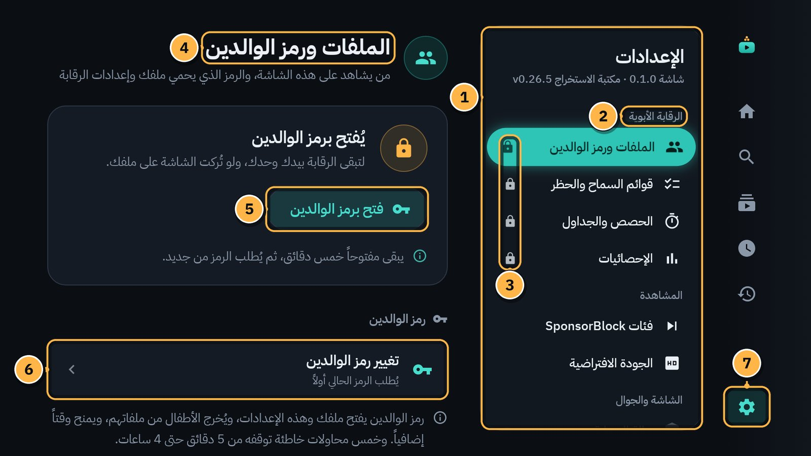

1. **قائمة الإعدادات:** كل العناصر في مجموعات. في أعلاها إصدار «شاشة» وإصدار مكتبة يوتيوب.
2. **اسم المجموعة:** مثل «الرقابة الأبوية».
3. **القفل:** هذه العناصر تُفتح برمز الوالدين.
4. **لوحة العنصر المختار:** تتغير وأنت تتنقل في القائمة.
5. **فتح برمز الوالدين:** يفتح عناصر الرقابة. تبقى مفتوحة خمس دقائق، ثم يُطلب الرمز من جديد.
6. **زر داخل اللوحة:** مثل **تغيير رمز الوالدين**.
7. **الإعدادات** في القائمة الجانبية.

## التنقل

- `↑` و`↓`: بين عناصر القائمة. اللوحة تتبعها.
- `OK` أو `←`: ادخل إلى اللوحة.
- `→` أو `BACK`: عد إلى القائمة.
- `BACK` من القائمة: إلى القائمة الجانبية.

«شاشة» يتذكّر آخر زر وقفت عليه في كل لوحة، فتعود إليه.

## كل العناصر

| المجموعة | العنصر | ما فيه | برمز؟ | الفصل |
|---|---|---|---|---|
| الرقابة الأبوية | **الملفات ورمز الوالدين** | **إدارة الملفات** (إضافة طفل، الأسماء والصور، إخفاء المقاطع القصيرة، الحذف)، و**تغيير رمز الوالدين** | نعم | [6](06-profiles-and-child.md) |
| | **قوائم السماح والحظر** | قائمة الحظر للبيت كله، وقائمة سماح لكل طفل | نعم | [11](11-allow-and-block-lists.md) |
| | **الحصص والجداول** | الحصة اليومية وأوقات المشاهدة لكل ملف | نعم | [7](07-time-limits.md) |
| | **الإحصائيات** | اليوم وهذا الأسبوع لكل ملف، و**التفاصيل** | نعم | [13](13-statistics.md) |
| المشاهدة | **فئات SponsorBlock** | الأجزاء التي تُتخطى تلقائياً | لا | [12](12-sponsorblock.md) |
| | **الجودة الافتراضية** | أعلى جودة يبلغها المشغّل وحده | لا | أدناه |
| الشاشة والجوال | **حالة الحماية** | صلاحيات الحارس، وسرعة العودة، وحدود الحماية | لا | [9](09-guard-and-protection.md) |
| | **الخادم المحلي** | التحكم من الجوال: **تشغيل الخادم**، و**رمز الاقتران QR** | عنصراه | [10](10-phone-remote.md) |
| | **الاستيراد والتصدير** | **النسخة الاحتياطية** (برمز)، و**استيراد الاشتراكات من Takeout** | جزئياً | [15](15-backup-and-restore.md) و[3](03-home-and-subscriptions.md) |
| التطبيق | **فحص التحديثات** | الإصدار المثبّت، والبحث عن إصدار أحدث | لا | [16](16-updates.md) |
| | **تشخيص** | **فيديوهات تجريبية**، و«معلومات للتشخيص» | لا | [17](17-when-youtube-breaks.md) |
| | **حول** | الإصدار، والتنبيه القانوني، ومصدر بيانات التخطي، والمكتبات ورخصها | لا | [19](19-legal.md) |

## اللوحات

<table>
<tr>
<td>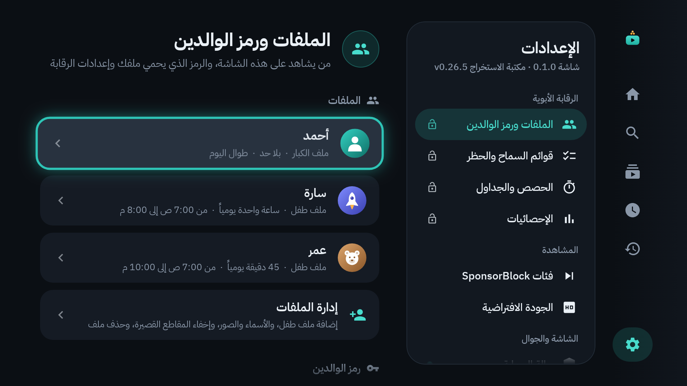 الملفات ورمز الوالدين</td>
<td>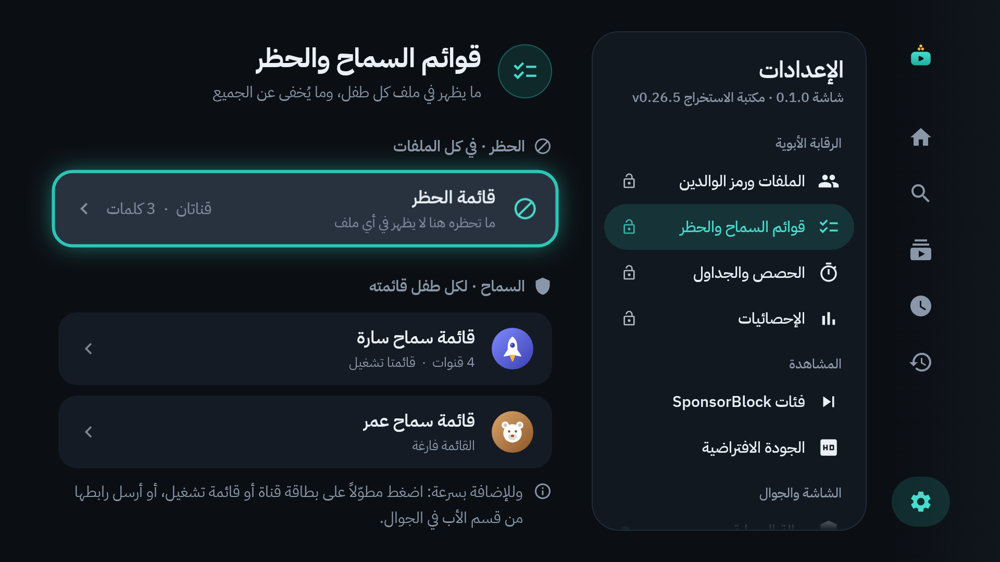 قوائم السماح والحظر</td>
</tr>
<tr>
<td>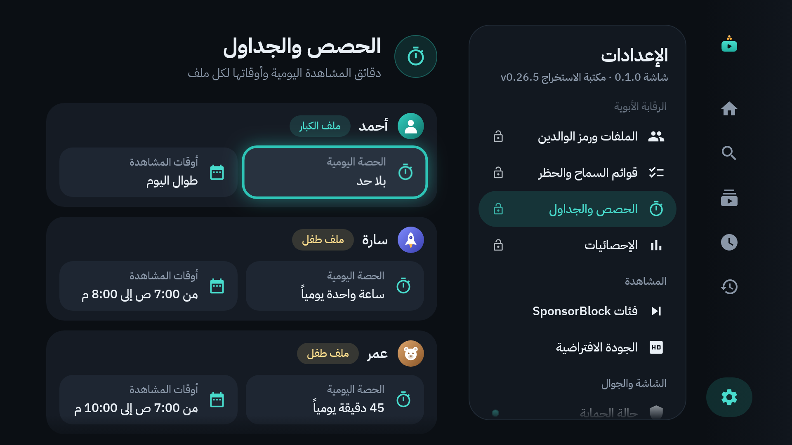 الحصص والجداول</td>
<td>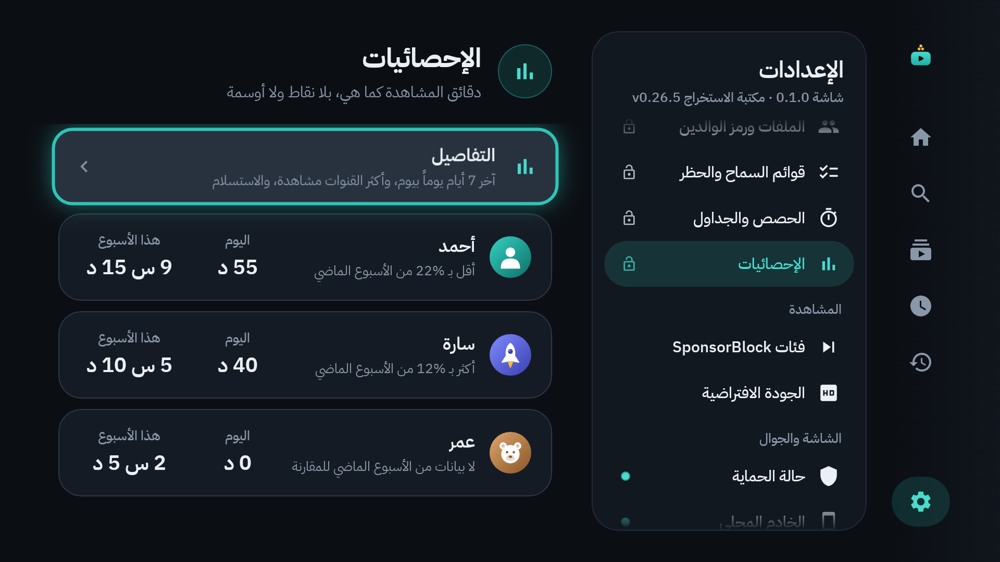 الإحصائيات</td>
</tr>
<tr>
<td>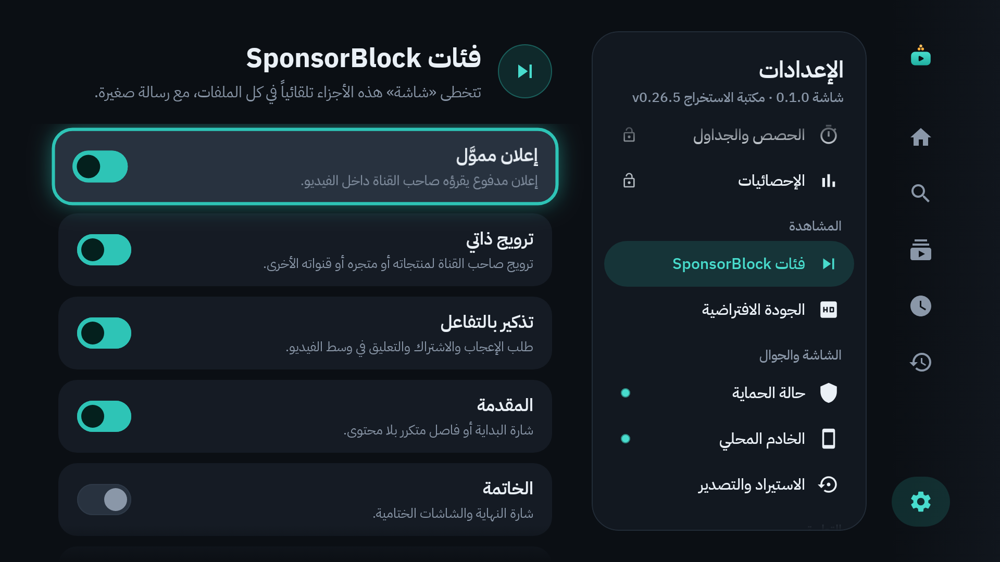 فئات SponsorBlock</td>
<td>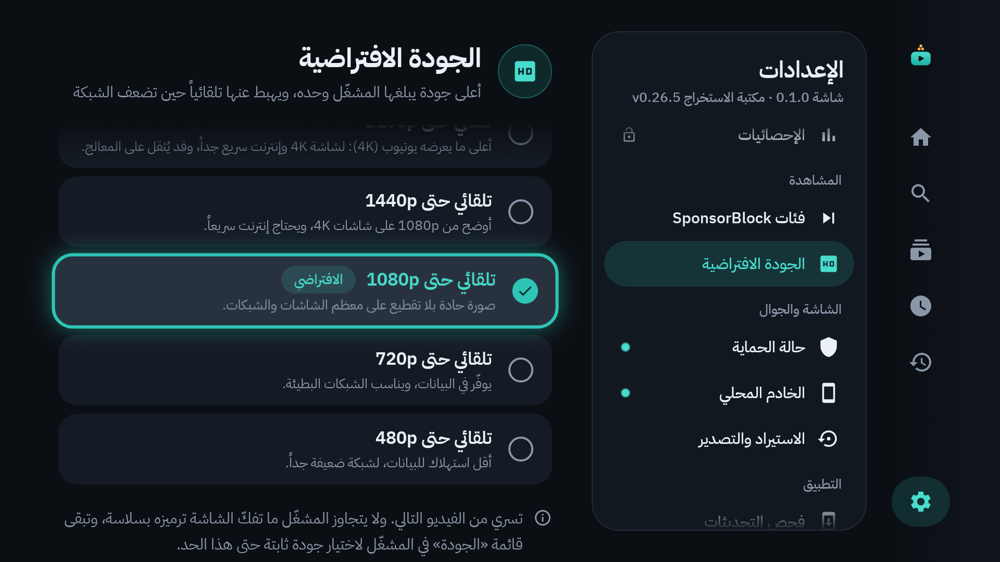 الجودة الافتراضية</td>
</tr>
<tr>
<td>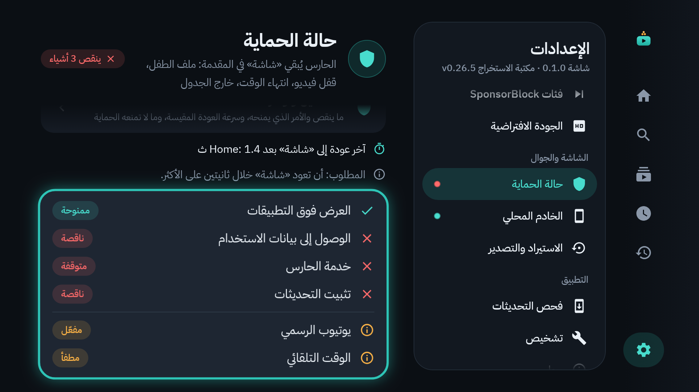 حالة الحماية</td>
<td>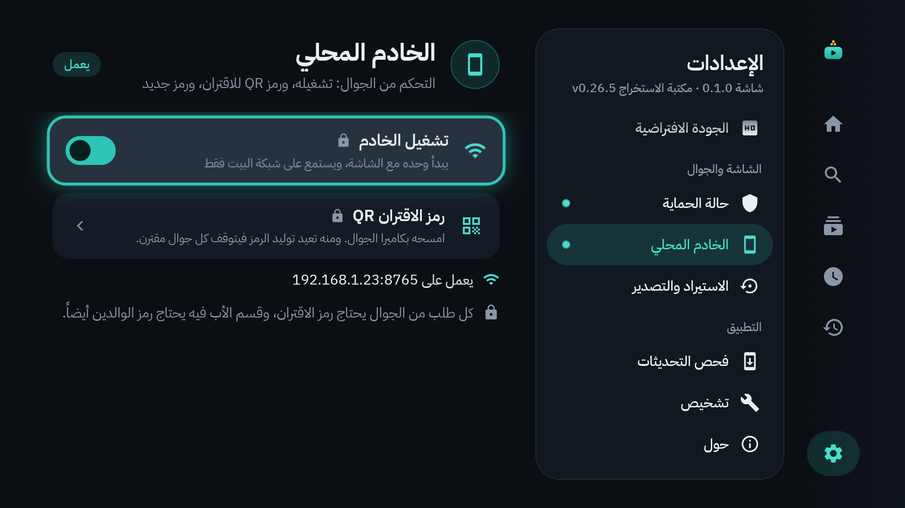 الخادم المحلي</td>
</tr>
<tr>
<td>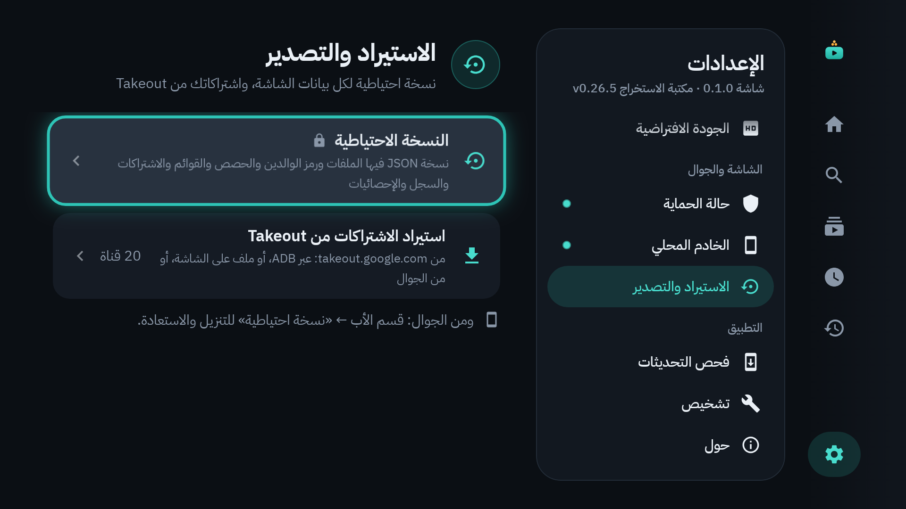 الاستيراد والتصدير</td>
<td>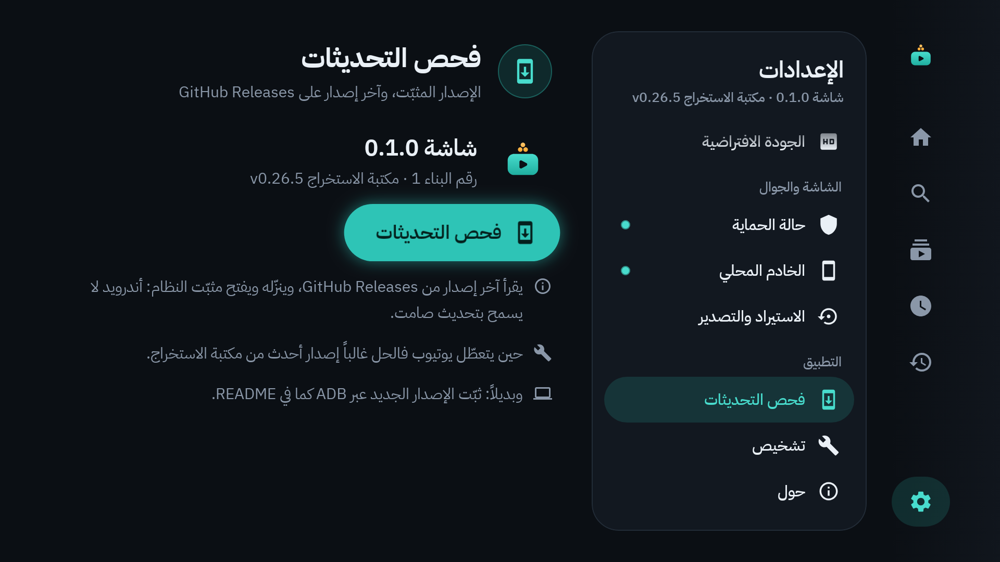 فحص التحديثات</td>
</tr>
<tr>
<td>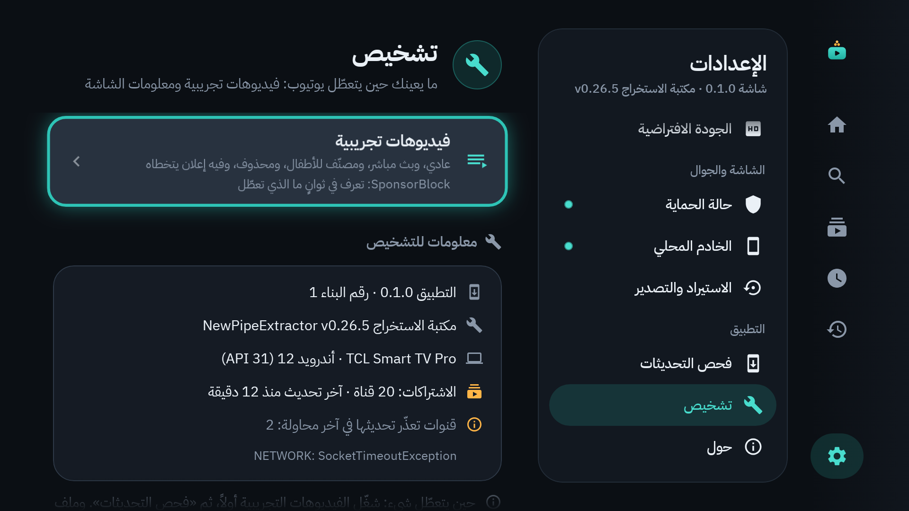 تشخيص</td>
<td>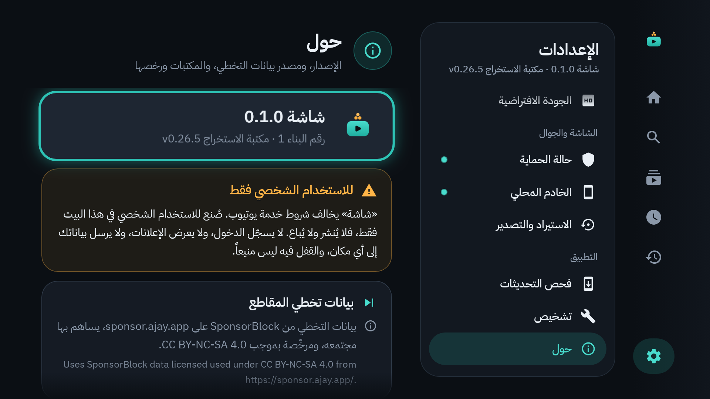 حول</td>
</tr>
</table>

## الجودة الافتراضية

الإعدادات ← **الجودة الافتراضية**. اختر الحد الأعلى الذي يبلغه المشغّل وحده:

| الاختيار | متى تختاره |
|---|---|
| تلقائي حتى 2160p | أعلى ما يعرضه يوتيوب (4K): لشاشة 4K وإنترنت سريع جداً، وقد يُثقل على المعالج. |
| تلقائي حتى 1440p | أوضح من 1080p على شاشات 4K، ويحتاج إنترنت سريعاً. |
| **تلقائي حتى 1080p** (الافتراضي) | صورة حادة بلا تقطيع على معظم الشاشات والشبكات. |
| تلقائي حتى 720p | يوفّر في البيانات، ويناسب الشبكات البطيئة. |
| تلقائي حتى 480p | أقل استهلاك للبيانات، لشبكة ضعيفة جداً. |

يسري من الفيديو التالي. ويهبط المشغّل تحت الحد وحده حين تضعف الشبكة. ولجودة ثابتة لفيديو واحد: قائمة **الجودة** في المشغّل ([الفصل 5](05-player.md)).

## الخادم المحلي

الإعدادات ← **الخادم المحلي**. عنصراه عليهما قفل صغير: يطلبان رمز الوالدين.

- **تشغيل الخادم:** يبدأ وحده مع التلفاز، ويستمع على شبكة البيت فقط. أطفئه إن لم تكن تستعمل الجوال.
- **رمز الاقتران QR:** يفتح شاشة «التحكم من الجوال» ([الفصل 10](10-phone-remote.md)).
- تحتهما: «يعمل على …» عنوان التلفاز على الشبكة.

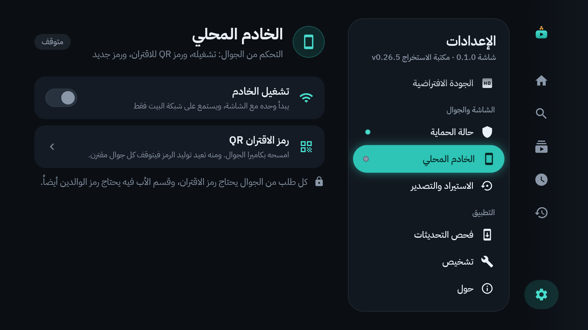

---

[السابق: الإحصائيات](13-statistics.md) · [الفهرس](README.md) · [التالي: النسخ الاحتياطي والاستعادة](15-backup-and-restore.md)
