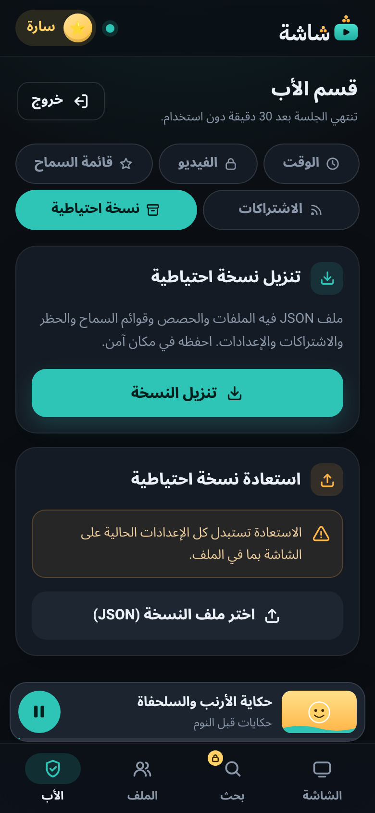
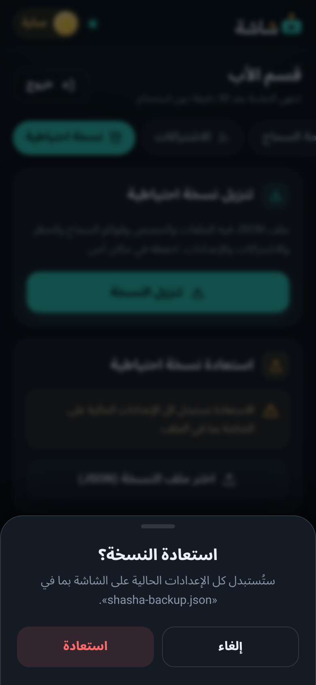
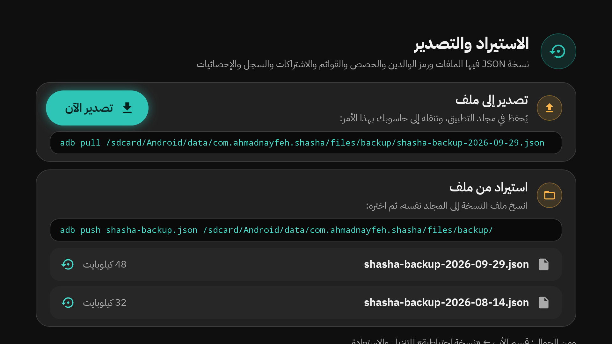

# 15. النسخ الاحتياطي والاستعادة

كل بيانات «شاشة» على التلفاز وحده: لا حساب ولا سحابة. لذلك احفظ نسخة احتياطية من حين لآخر، وخصوصاً **قبل حذف التطبيق أو إعادة ضبط التلفاز**.

النسخة ملف واحد بصيغة JSON، اسمه مثل `shasha-backup-2026-09-29.json`.

## ما في النسخة وما ليس فيها

| في النسخة | ليس فيها |
|---|---|
| الملفات بقواعدها، وقوائم السماح والحظر | فيديوهات «الرئيسية» (تُجلب من جديد وحدها) |
| بصمة رمز الوالدين (لا الرمز نفسه) | قفل الفيديو الحالي |
| الوقت الإضافي الممنوح | مهلة الرمز الخاطئ |
| الاشتراكات، و«شاهد لاحقاً»، والسجل، ومواضع الاستكمال | رمز اقتران الجوال |
| الإحصائيات و«الاستسلام» | ذاكرة SponsorBlock المؤقتة |
| إعدادات SponsorBlock والجودة | |

## الطريقة الأسهل: من الجوال

**حفظ نسخة:**

1. صفحة الجوال ← **الأب** ← رمز الوالدين ← **نسخة احتياطية**.
2. «تنزيل نسخة احتياطية» ← **تنزيل النسخة**.
3. يُحفظ الملف في جوالك. انقله إلى مكان آمن (بريدك، أو حاسوبك).

**الاستعادة:**

1. **الأب** ← **نسخة احتياطية** ← «استعادة نسخة احتياطية».
2. **اختر ملف النسخة (JSON)**، واختر الملف.
3. يسألك الجوال «استعادة النسخة؟». اختر **استعادة**.

## من التلفاز

الإعدادات ← **الاستيراد والتصدير** ← **النسخة الاحتياطية** (برمز الوالدين):

**حفظ نسخة:**

1. في «تصدير إلى ملف» اختر **تصدير الآن**.
2. تقول الشاشة «حُفظت النسخة: …». الملف في مجلد التطبيق على التلفاز.
3. لنقله إلى الحاسوب تعرض الشاشة أمر `adb pull` المناسب. (يحتاج الحاسوب الذي ثبّت «شاشة».)

**الاستعادة:**

1. انسخ ملف النسخة إلى المجلد نفسه. تعرض الشاشة أمر `adb push` لذلك.
2. تحت «استيراد من ملف» تظهر الملفات الموجودة، وحجم كل منها.
3. اختر الملف، ثم **استعادة**.

> [!WARNING]
> **الاستعادة تستبدل كل بيانات التلفاز** بما في الملف: الملفات، ورمز الوالدين، والقوائم، والاشتراكات، والسجل، والإحصائيات. لا يمكن التراجع. والعملية كلها واحدة: إن فشلت، لم يتغير شيء («تعذّرت الاستعادة، ولم يتغيّر شيء.»).

## متى لا تُقبل الاستعادة؟

- **أثناء فيديو مقفول:** فكّ قفله أولاً، ثم استعد.
- **نسخة من إصدار أحدث:** «هذه النسخة من إصدار أحدث من «شاشة». حدّث التطبيق أولاً.» ([الفصل 16](16-updates.md)).
- **ملف غير صحيح:** «هذا الملف ليس نسخة احتياطية من «شاشة».».

## نصائح

- احفظ نسخة حديثة **خارج التلفاز**. حذف التطبيق يحذف مجلد النسخ معه.
- إن أعدت تثبيت التطبيق ثم استعدت النسخة، فاقرن الجوال من جديد: رمز الاقتران لا يدخل في النسخة.
- رمز الوالدين يعود كما كان وقت حفظ النسخة.

---

[السابق: خريطة الإعدادات](14-settings-map.md) · [الفهرس](README.md) · [التالي: التحديثات](16-updates.md)
