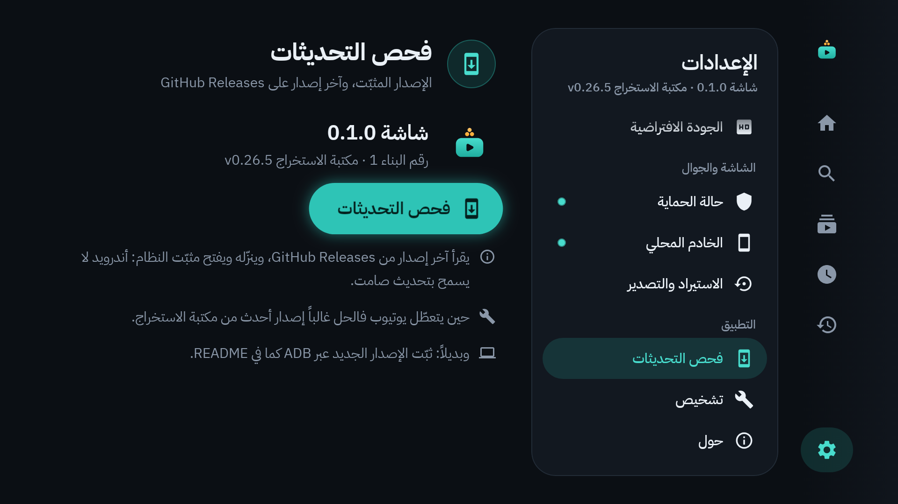
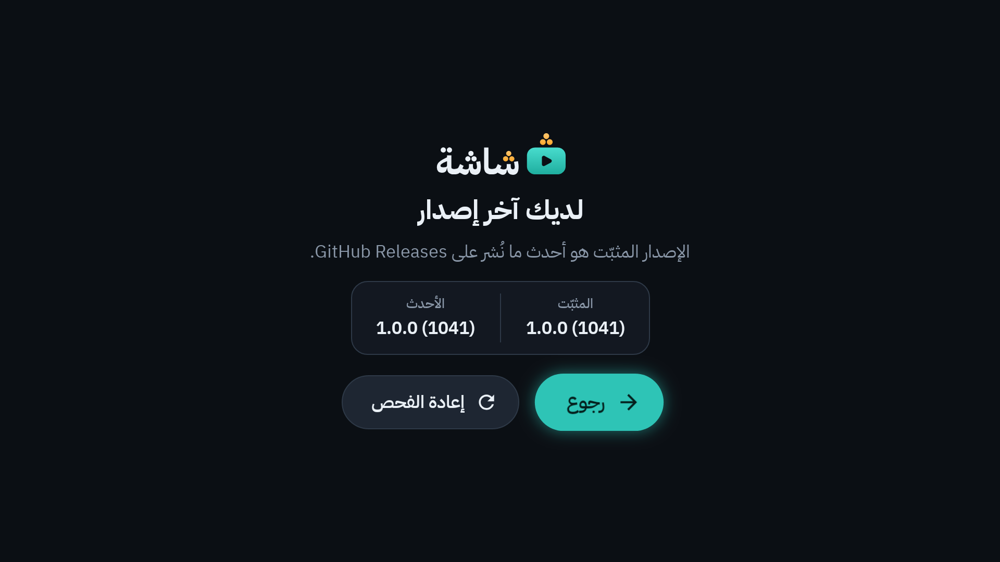
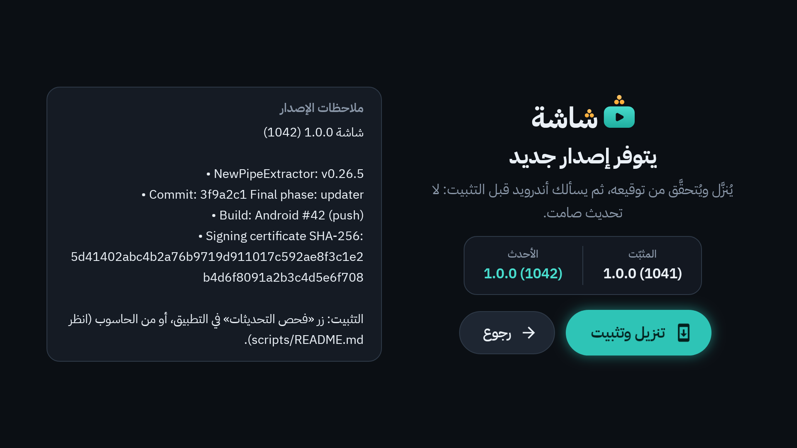
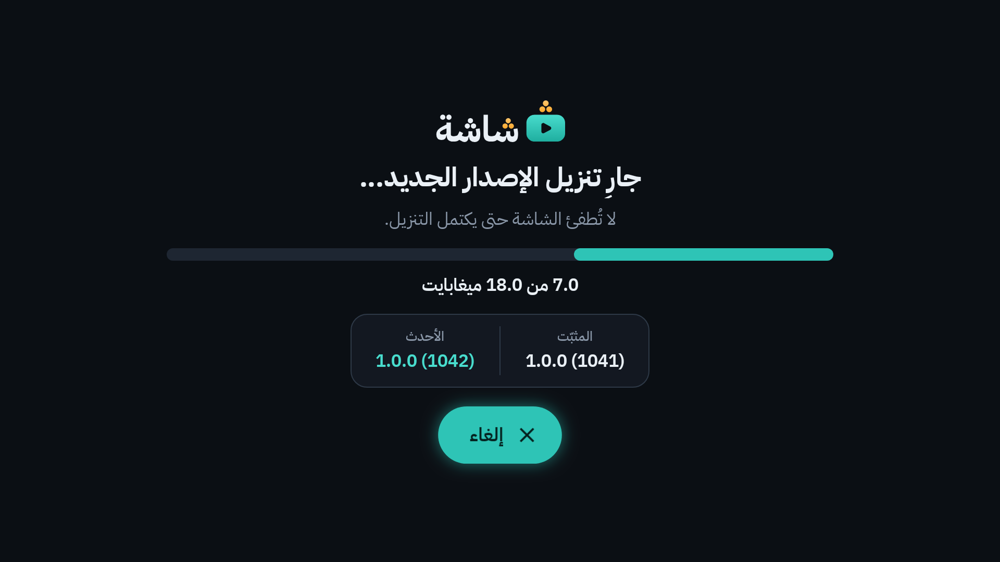
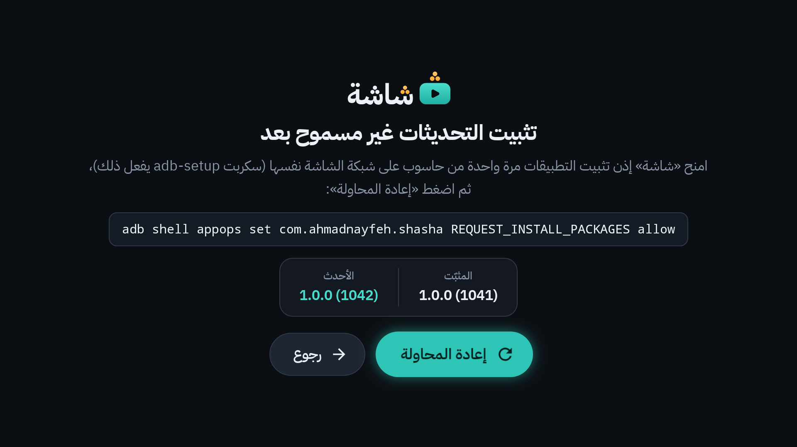
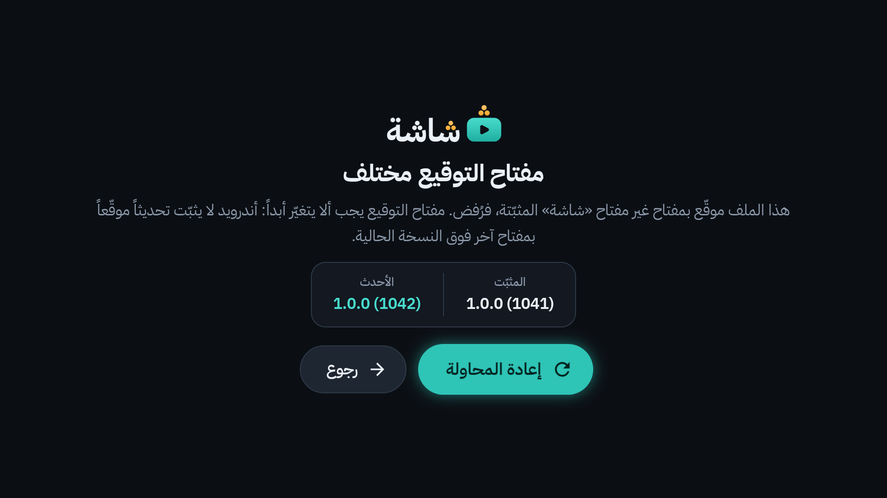
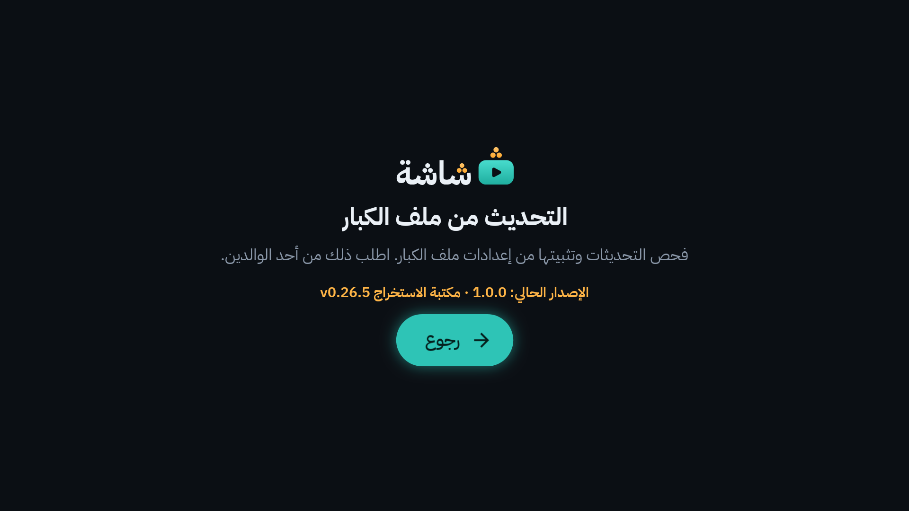

# 16. التحديثات

يوتيوب يغيّر طريقة عمله من حين لآخر، فيتعطل «شاشة» حتى يصدر إصدار جديد. لذلك التحديث سهل، من التلفاز نفسه. والتحديث يحتفظ بكل شيء: الملفات، والرمز، والاشتراكات، والسجل، والإعدادات، واقتران الجوال.

## التحديث من التلفاز

من ملف الكبار: الإعدادات ← **فحص التحديثات**.

في اللوحة الإصدار المثبّت: «شاشة 1.0.0» مثلاً، و«رقم البناء … · مكتبة الاستخراج …». ثم:

1. اختر **فحص التحديثات**. تظهر «جارٍ البحث عن تحديث…».
2. إن لم يكن هناك جديد: «لديك آخر إصدار». اختر **رجوع**.

3. وإن وُجد جديد: «يتوفر إصدار جديد»، مع الإصدارين «المثبّت» و«الأحدث»، و«ملاحظات الإصدار». اختر **تنزيل وتثبيت**.

4. «جارٍ تنزيل الإصدار الجديد…». لا تُطفئ التلفاز حتى يكتمل التنزيل. (**إلغاء** يوقفه.)

5. «أكّد التحديث في نافذة النظام». أندرويد يسأل قبل كل تحديث: وافق في نافذته بالريموت (زر «Update» أو «Install»).
6. بعد التثبيت تُغلق «شاشة». افتحها من جديد من واجهة التلفاز.

قبل التثبيت يتحقق «شاشة» أن الملف هو «شاشة» نفسه، وأحدث من المثبّت، وموقّع بالمفتاح نفسه. وإلا رفضه.

## رسائل قد تراها

| الرسالة | معناها | ماذا تفعل |
|---|---|---|
| «تثبيت التحديثات غير مسموح بعد» | ينقص إذن التثبيت، ويُمنح مرة واحدة من الحاسوب. | أعد تشغيل المثبّت من الحاسوب، ثم **إعادة المحاولة**. |
| «فحص التحديثات يحتاج رمز قراءة» | بُني هذا الإصدار دون رمز القراءة من GitHub. | حدّث من الحاسوب (أدناه)، وأخبر صاحب البيت. |
| «رمز القراءة مرفوض» | انتهت صلاحية رمز القراءة أو أُلغي. | أخبر صاحب البيت: يجدّده، ثم يثبّت الإصدار التالي من الحاسوب. |
| «تعذّر الوصول إلى GitHub» | لا إنترنت على التلفاز. | تأكّد من الشبكة، ثم **إعادة المحاولة**. |
| «مفتاح التوقيع مختلف» | الملف موقّع بمفتاح آخر، فرُفض حمايةً لبياناتك. | لا تثبّته. أخبر صاحب البيت. |
| «انقطع التنزيل» | لم يكتمل الملف. | **إعادة المحاولة**. |

## في ملف الطفل

الطفل لا يصل إلى التحديث. إن ضغط **فحص التحديثات** من شاشة خطأ، يقرأ: «التحديث من ملف الكبار».

## التحديث من الحاسوب

البديل دائماً: شغّل المثبّت من الحاسوب بالإصدار الجديد. يثبّته فوق القديم، ويحتفظ بالبيانات، ويعيد منح الصلاحيات. التفاصيل في [دليل التثبيت](../install-guide.md).

> [!NOTE]
> لماذا لا يحدّث «شاشة» نفسه بصمت؟ لأن أندرويد لا يسمح بذلك: يسأل صاحب الجهاز قبل كل تثبيت.

---

[السابق: النسخ الاحتياطي والاستعادة](15-backup-and-restore.md) · [الفهرس](README.md) · [التالي: عندما يتعطل يوتيوب](17-when-youtube-breaks.md)
