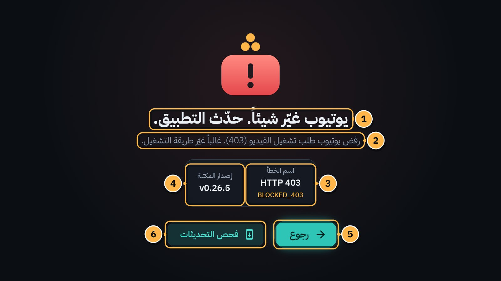
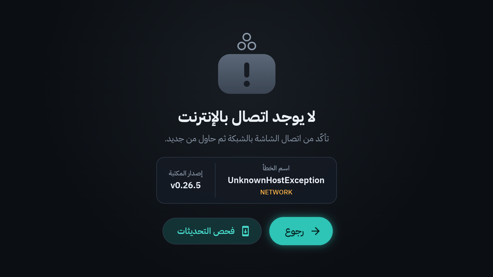
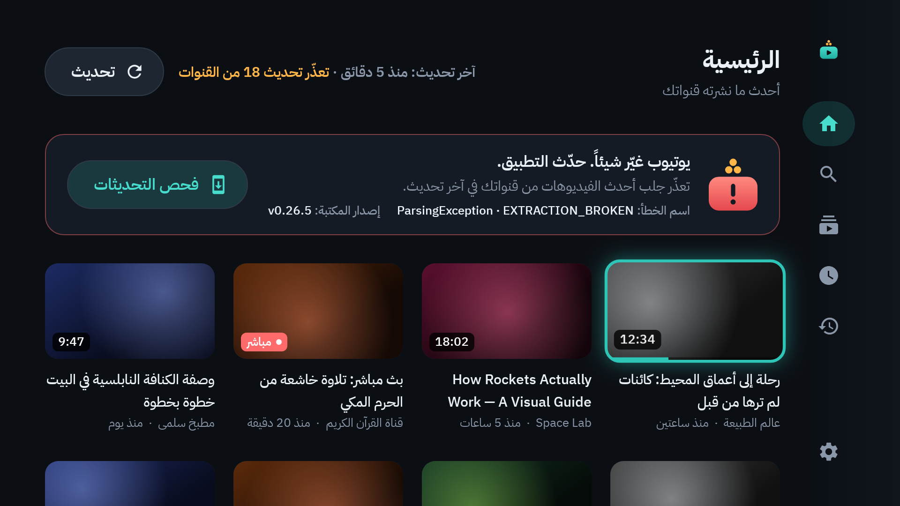
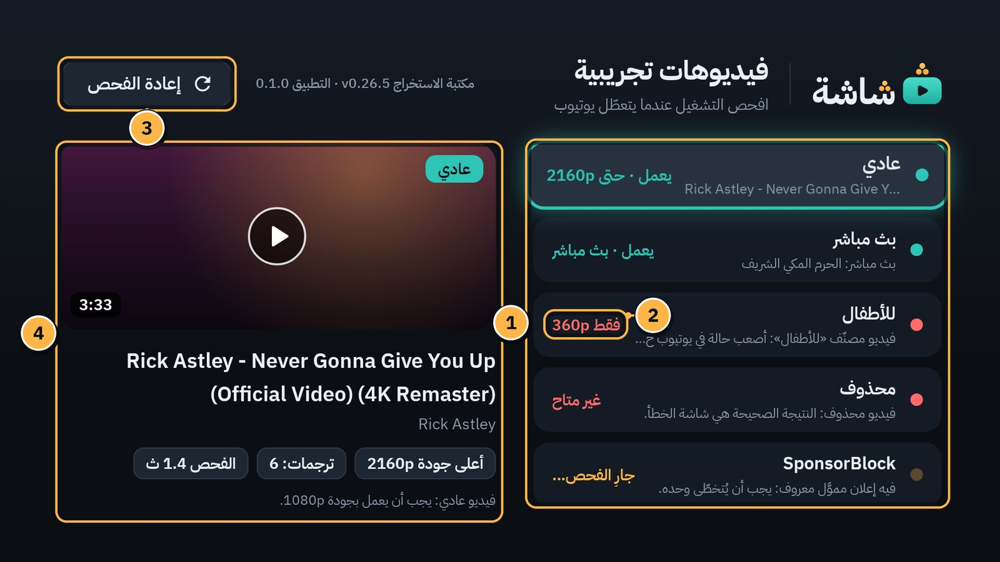
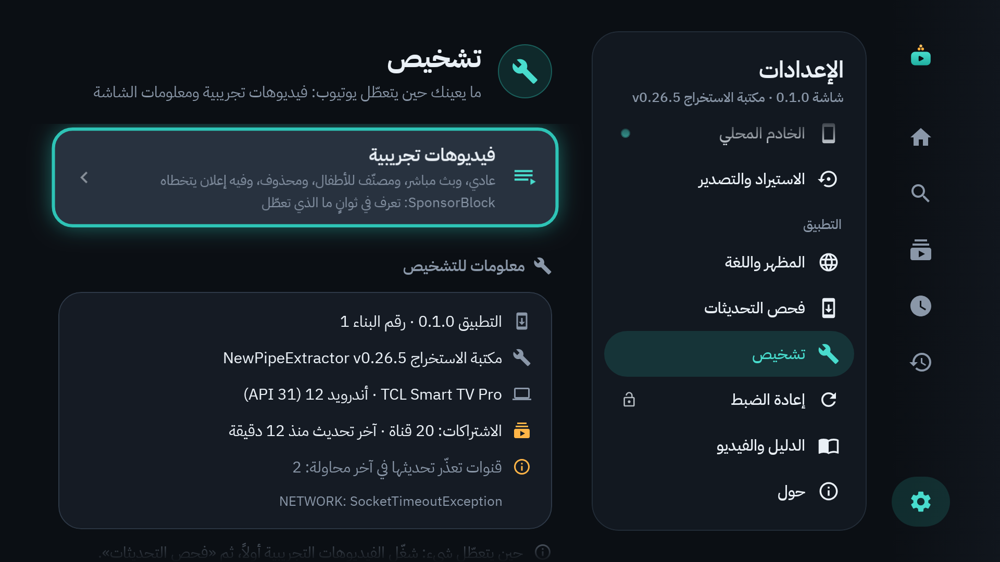

# 17. عندما يتعطل يوتيوب

سيحدث هذا، وهو ليس ذنبك. يوتيوب يغيّر طريقة عمله كل شهر إلى ثلاثة أشهر تقريباً، فتتعطل التطبيقات غير الرسمية مثل «شاشة» حتى يصدر إصلاح. لذلك صُمّم «شاشة» كي **يظهر العطل بوضوح، ولا يحدث بصمت**.

## شاشة الخطأ الموحدة

أي عطل في يوتيوب يظهر في شاشة واحدة، في المشغّل وصفحات القنوات والبحث وقوائم التشغيل:

1. **العنوان:** «يوتيوب غيّر شيئاً. حدّث التطبيق.». (أو «لا يوجد اتصال بالإنترنت» إن كانت المشكلة في الشبكة.)
2. **سطر يشرح المشكلة** بكلمات بسيطة.
3. **اسم الخطأ:** اسمه التقني ونوعه، مثل `HTTP 403` و`BLOCKED_403`. هذا ما يحتاجه صاحب البيت.
4. **إصدار المكتبة:** إصدار الجزء الذي يقرأ يوتيوب، مثل `v0.26.5`.
5. **رجوع.**
6. **فحص التحديثات:** يبحث عن إصدار يصلح العطل ([الفصل 16](16-updates.md)).

وقد ترى أزراراً إضافية: **إعادة المحاولة** (لمشاكل الشبكة)، و**شغّل بجودة 360p على أي حال** (لفيديوهات الأطفال في ملف الكبار، [الفصل 5](05-player.md))، و**إلغاء الاشتراك** (لقناة أُغلقت).

والجوال يتلقى الرسالة نفسها حين يرسل رابطاً لا يعمل.

## أنواع الأخطاء

| النوع (كما في «تشخيص») | ماذا يعني | ماذا تفعل |
|---|---|---|
| «لا اتصال» | لا إنترنت. ليس يوتيوب. | افحص الشبكة، ثم **إعادة المحاولة**. |
| «طلبات كثيرة» | طلبات كثيرة في وقت قصير. | انتظر بضع دقائق، ثم **إعادة المحاولة**. |
| «غير متاح» | الفيديو محذوف أو مخفي. | طبيعي لفيديو واحد. إن ظهر لكل فيديو فهو عطل. |
| «خاص»، «مقيَّد بالعمر»، «محجوب في بلدك»، «مدفوع»، «قناة مغلقة» | صفة في الفيديو نفسه. | طبيعي: «شاشة» لا يسجّل الدخول، فلا يعرض هذه أبداً. |
| «360p فقط» | لم يعطِ يوتيوب إلا جودة 360p. | لفيديوهات «للأطفال» هذا متوقع ([الفصل 5](05-player.md)). ولفيديو عادي: عطل. |
| «مرفوض 403» | رفض يوتيوب تشغيل الفيديو. | جرّب فيديو آخر. إن تكرر مع كل فيديو: **فحص التحديثات**. |
| «تحقّق روبوت» | يوتيوب يشكّ في شبكة البيت مؤقتاً. | انتظر، أو أعد تشغيل الراوتر. إن استمر أياماً: **فحص التحديثات**. |
| «تعطّل الاستخراج» | لم يفهم «شاشة» ردّ يوتيوب. | غالباً يحتاج إصداراً أحدث: **فحص التحديثات**. |

**القاعدة:** خطأ في فيديو واحد يخص ذلك الفيديو غالباً. أما الخطأ نفسه في كل فيديو، فيعني أن يوتيوب غيّر شيئاً.

## حين يتعذّر تحديث «الرئيسية»

إن فشل جلب فيديوهات قنوات كثيرة، تظهر فوق «الرئيسية» رسالة «تعذّر تحديث N من القنوات»، مع اسم الخطأ وإصدار المكتبة، وزر **فحص التحديثات**:

## «تشخيص»: اعرف ما الذي تعطّل في ثوانٍ

من ملف الكبار: الإعدادات ← **تشخيص** ← **فيديوهات تجريبية**.

1. **خمسة فيديوهات ثابتة**، لكل منها طريقة تعطّل مختلفة: «عادي»، و«بث مباشر»، و«للأطفال»، و«محذوف»، و«SponsorBlock».
2. **النتيجة** بجانب كل منها، مثل «يعمل · حتى 2160p»، أو «360p فقط»، أو «غير متاح».
3. **إعادة الفحص:** يعيد الفحص كله.
4. **تفاصيل الفيديو المختار:** أعلى جودة، وعدد الترجمات، وزمن الفحص. واضغط `OK` على صف لتشغّل فيديوه (بلا قفل).

**النتائج الصحيحة الآن:**

| الصف | النتيجة الصحيحة |
|---|---|
| «عادي» | «يعمل · حتى …p» |
| «بث مباشر» | «يعمل · بث مباشر» (إن انتهى هذا البث فالخطأ متوقَّع) |
| «للأطفال» | «360p فقط» |
| «محذوف» | «غير متاح»: شاشة الخطأ هنا هي النتيجة الصحيحة |
| «SponsorBlock» | «يعمل»، وعند تشغيله يُتخطى إعلانه المموَّل (من نحو 1:59 إلى 2:42) |

**إن فشل «عادي» بغير «لا اتصال»، فيوتيوب غيّر شيئاً.**

وفي لوحة **تشخيص** نفسها «معلومات للتشخيص»: إصدار التطبيق ورقم البناء، وإصدار مكتبة الاستخراج، ونوع التلفاز ونظامه، وحالة تحديث الاشتراكات وآخر خطأ.

## ماذا تفعل؟ (لكل أفراد البيت)

1. **جرّب فيديو آخر.** إن عمل، فالمشكلة في الفيديو الأول وحده.
2. **«لا يوجد اتصال بالإنترنت»؟** تأكد من Wi-Fi التلفاز، ثم **إعادة المحاولة**.
3. **اضغط فحص التحديثات.** إن وُجد إصدار جديد فثبّته ([الفصل 16](16-updates.md)).
4. **صوّر شاشة الخطأ بجوالك**: يظهر فيها «اسم الخطأ» و«إصدار المكتبة». أرسل الصورة لصاحب البيت.
5. **انتظر قليلاً.** الإصلاح يأتي عادةً خلال أيام، ويصل بـ «فحص التحديثات». وما يعمل من «شاشة» يبقى يعمل.

> [!CAUTION]
> لا تحاول تسجيل الدخول بحساب غوغل في أي مكان لحل المشكلة. «شاشة» لا يسجّل الدخول أبداً، وهذا مقصود.

## لصاحب البيت

الخطوات كاملة في [MAINTENANCE.md](../../MAINTENANCE.md) (يوتيوب تعطّل — ماذا أفعل؟). باختصار: اقرأ «اسم الخطأ» ← افتح «تشخيص» ← افحص «YouTube canary» في GitHub Actions ← ابحث عن إصدار أحدث من مكتبة NewPipeExtractor ← ارفع رقمها ← شغّل الاختبارات ← جرّب على التلفاز ← انشر إصداراً جديداً يثبّته الجميع بـ «فحص التحديثات».

---

[السابق: التحديثات](16-updates.md) · [الفهرس](README.md) · [التالي: أسئلة شائعة وحل المشكلات](18-faq.md)
