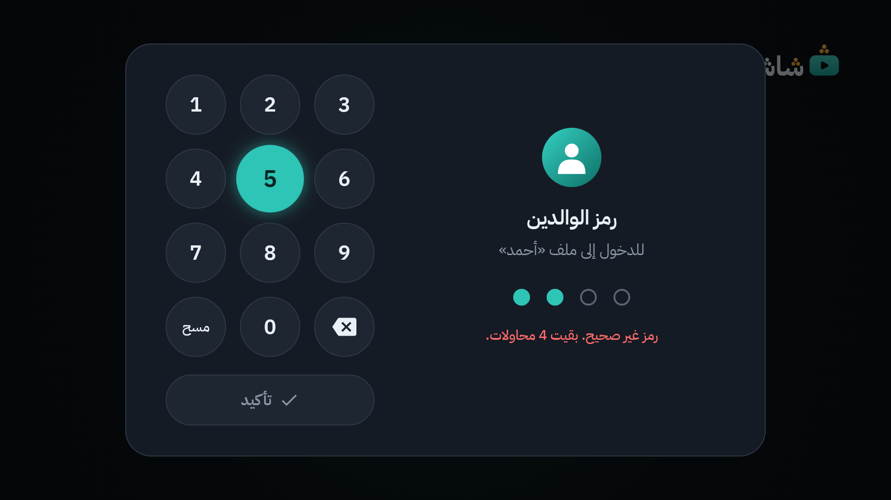

# 18. أسئلة شائعة وحل المشكلات

## عامة

### هل يحتاج «شاشة» حساب غوغل؟

لا، أبداً. «شاشة» لا يسجّل الدخول إلى يوتيوب. اشتراكاتك محفوظة على التلفاز نفسه ([الفصل 3](03-home-and-subscriptions.md)).

### هل فيه إعلانات؟

لا تظهر إعلانات يوتيوب. أما الإعلان الذي يقرؤه صاحب القناة داخل الفيديو، فيتخطاه «شاشة» وحده في أغلب الأحيان ([الفصل 12](12-sponsorblock.md)).

### لماذا لا أرى «مقترح لك» ولا «شائع» ولا فيديوهات ذات صلة؟

عمداً. «شاشة» يعرض ما تختاره أنت فقط: قنواتك، وما تبحث عنه. ولا يبدأ فيديو وحده إلا داخل قائمة تشغيل.

### هل يعمل على تلفاز آخر، أو على الجوال؟

جُرّب لتلفاز البيت (TCL بنظام Google TV) وحده. ولا يُوزَّع لأحد ([الفصل 19](19-legal.md)).

### هل يمكن تنزيل الفيديوهات، أو تشغيل الصوت والشاشة مطفأة؟

لا. ليس في «شاشة» تنزيل ولا تشغيل في الخلفية.

## الرئيسية والمشاهدة

### «الرئيسية» فارغة

- لم تُضف اشتراكات بعد؟ استوردها من Google Takeout، أو ابحث عن قناة واشترك فيها ([الفصل 3](03-home-and-subscriptions.md)).
- أضفتها للتو؟ انتظر دقائق، أو اضغط **تحديث**.

### فيديو جديد نشرته قناتي لم يظهر

«الرئيسية» تتحدّث وحدها كل ساعتين. اضغط **تحديث** في أعلاها لتجلب الجديد الآن.

### الفيديو يتقطّع

- تأكد من قوة Wi-Fi عند التلفاز.
- اخفض الحد الأعلى للجودة: الإعدادات ← **الجودة الافتراضية** ← «تلقائي حتى 720p» ([الفصل 14](14-settings-map.md)).
- أو اختر جودة ثابتة أقل من قائمة **الجودة** في المشغّل ([الفصل 5](05-player.md)).

### لماذا تظهر شارة «360p» والصورة أقل وضوحاً؟

هذه فيديوهات مصنّفة «للأطفال». يوتيوب لا يعطي «شاشة» لها إلا جودة 360p حالياً ([الفصل 5](05-player.md)).

### ظهرت «يوتيوب غيّر شيئاً. حدّث التطبيق.»

انظر [الفصل 17](17-when-youtube-breaks.md). باختصار: جرّب فيديو آخر، ثم **فحص التحديثات**، ثم صوّر الشاشة وأرسلها لصاحب البيت.

### ضغطت `BACK` فلم يخرج الفيديو

الفيديو مقفول حتى ينتهي ([الفصل 8](08-video-lock.md)). في ملف الطفل: رمز الوالدين. وفي ملف الكبار: اضغط مطوّلاً على `BACK` عشر ثوانٍ، ثم اكتب الجملة.

## الأطفال والرقابة

### طفلي لا يرى قناة يحبها

- هل هي في قائمة سماحه؟ أضفها ([الفصل 11](11-allow-and-block-lists.md)).
- هل هي في قائمة الحظر؟ أو في عنوان الفيديو كلمة محظورة؟
- هل هي مقاطع قصيرة، و**إخفاء المقاطع القصيرة** مفعّل في ملفه؟ ([الفصل 6](06-profiles-and-child.md))

### الطفل ضغط `HOME` فعادت «شاشة» وحدها!

هذا الحارس، وهو مقصود: ما دام ملف طفل مفتوحاً تبقى «شاشة» في المقدمة ([الفصل 9](09-guard-and-protection.md)).

### كيف أفتح Netflix أو إعدادات التلفاز؟

اخرج من ملف الطفل أولاً: القائمة الجانبية ← **خروج** ← رمز الوالدين ← اختر ملف الكبار. بعدها يعمل كل شيء كالمعتاد.

### انتهى وقت الطفل ويحتاج دقائق قليلة

على التلفاز: **فتح بالرمز** ← الرمز ← **+15** مثلاً. أو من الجوال: «الأب» ← «الوقت» ← «فتح الوقت الآن» ([الفصل 7](07-time-limits.md)).

### تقول الشاشة «محاولات خاطئة كثيرة. حاول بعد …»

كُتب الرمز خطأً خمس مرات. انتظر حتى ينتهي العدّ. تطول المهلة مع كل مرة: 5 دقائق، ثم 15، ثم ساعة، ثم 4 ساعات، حتى يُكتب الرمز الصحيح. ولا تنهيها إعادة تشغيل التلفاز.

الجوال له عدّاده الخاص: قسم الأب في الجوال يعمل ولو كان رمز التلفاز موقوفاً، والعكس ([الفصل 10](10-phone-remote.md)).

### نسيت رمز الوالدين

لا يوجد «نسيت الرمز» داخل «شاشة»، عمداً: لو وُجد لاستعمله الأطفال.

الحل عند صاحب البيت، من **الحاسوب الذي ثبّت «شاشة»**: يحفظ نسخة احتياطية، ويمسح بيانات التطبيق، ويضبط رمزاً جديداً، ثم يستعيد بقية البيانات. الخطوات الدقيقة في [MAINTENANCE.md](../../MAINTENANCE.md) (قسم «إن نسيت رمز الوالدين»).

### طلب «شاشة» الرمز حين عدت إليه

إن غبت عن ملف الكبار أكثر من 15 ثانية (زر `HOME` مثلاً)، وفي البيت ملف طفل، يُقفل ملفك وحده ويطلب الرمز من جديد. هكذا لا يبقى مفتوحاً للأطفال ([الفصل 6](06-profiles-and-child.md)).

### علق التلفاز على «شاشة» ولا يعرف أحد الرمز

انظر «مخرج الطوارئ» في [الفصل 9](09-guard-and-protection.md#مخرج-الطوارئ): الحل من الحاسوب الذي ثبّت «شاشة».

## الجوال

### صفحة الجوال لا تفتح، أو تقول «امسح رمز QR من جديد»

1. الجوال والتلفاز على شبكة Wi-Fi نفسها؟
2. «شاشة» يعمل على التلفاز، والتلفاز ليس في وضع الاستعداد؟
3. تغيّر عنوان التلفاز، أو أُعيد توليد الرمز؟ افتح على التلفاز: الإعدادات ← **الخادم المحلي** ← **رمز الاقتران QR**، وامسحه من جديد ([الفصل 10](10-phone-remote.md)).

### أرسلت رابطاً فلم يُعرض

الجوال يقول السبب. أشهرها:

- ملف طفل مفتوح، والرابط خارج قائمة سماحه.
- انتهى الوقت، أو خارج أوقات المشاهدة.
- فيديو مقفول يُعرض الآن: فكّ قفله من «الأب» ← «الفيديو».
- «من يشاهد الآن؟» ظاهرة على التلفاز: اختر الملف أولاً.

### قسم الأب في الجوال موقوف

رموز خاطئة كثيرة من جوال ما. انتظر، أو أعد توليد رمز الاقتران على التلفاز، فتنتهي المهلة ([الفصل 10](10-phone-remote.md)).

## التثبيت والإزالة

### «فحص التحديثات» لا يعمل

انظر جدول الرسائل في [الفصل 16](16-updates.md). والبديل دائماً: المثبّت من الحاسوب.

### هل يبقى كل شيء بعد إعادة تشغيل التلفاز؟

نعم. الملفات والإعدادات تبقى، والحارس وخادم الجوال يعودان وحدهما بعد اكتمال التشغيل. والفيديو المقفول يعود كما كان.

### كيف أعيد تطبيق يوتيوب الرسمي؟ أو أتراجع عن التثبيت؟

شغّل المثبّت من الحاسوب بخيار التراجع (`--undo`)، كما في [دليل التثبيت](../install-guide.md#التراجع-وإزالة-التطبيق). يعيد يوتيوب الرسمي، ويسحب صلاحيات «شاشة»، ويوقف الحارس. ويبقى «شاشة» مثبّتاً ببياناته.

### كيف أحذف «شاشة» تماماً؟

**احفظ نسخة احتياطية أولاً** ([الفصل 15](15-backup-and-restore.md)). ثم على التلفاز: افتح Settings، ثم Apps، ثم «شاشة»، واختر Uninstall. الحذف يمسح كل بياناته.

---

[السابق: عندما يتعطل يوتيوب](17-when-youtube-breaks.md) · [الفهرس](README.md) · [التالي: تنبيه قانوني وخصوصية](19-legal.md)
