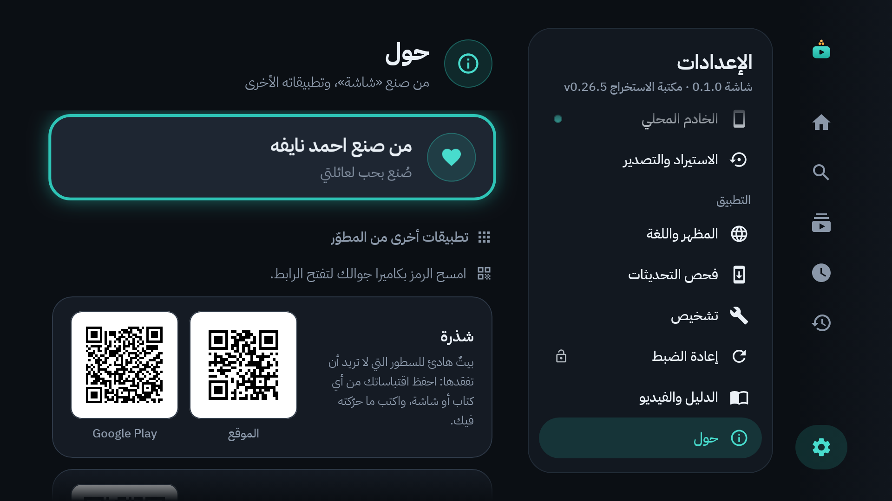
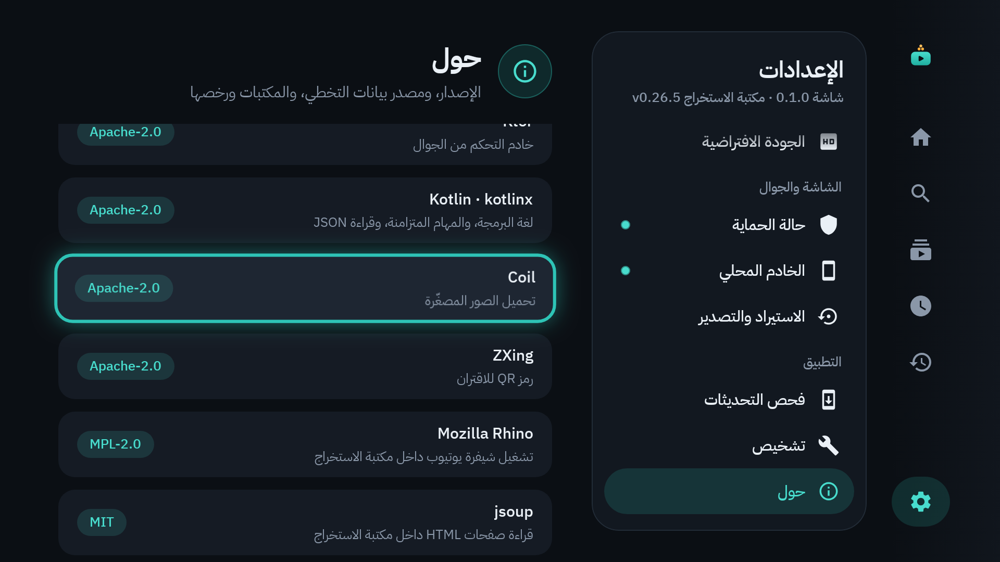

# 19. تنبيه قانوني وخصوصية

اقرأ هذا الفصل مرة واحدة. هو قصير ومهم.

## للاستخدام الشخصي في هذا البيت فقط

> [!CAUTION]
> **«شاشة» يخالف شروط خدمة يوتيوب.** صُنع للاستخدام الشخصي في هذا البيت فقط.
>
> - لا تنشره، ولا تبعه.
> - لا تعطِ ملف التطبيق (APK) ولا مجلد التثبيت لأحد.
> - أبقِ مستودعه على GitHub خاصاً.

يظهر هذا التنبيه نفسه في الإعدادات ← **حول**:

## القفل ليس منيعاً

القفل **داخل** «شاشة» مضمون: قفل الفيديو، وملف الطفل، وانتهاء الوقت. أما **الحارس** الذي يعيد «شاشة» إلى المقدمة فهو «أفضل جهد»، ويمكن تجاوزه، ومن ذلك:

- تبديل مصدر الصورة (زر Input أو مدخل HDMI) إلى جهاز آخر.
- فصل الكهرباء أو إعادة تشغيل التلفاز: يعود الحارس بعد اكتمال التشغيل، لا فوراً.
- إعادة ضبط المصنع: تمسح التطبيق وكل بياناته.
- أوامر من حاسوب مأذون له (ADB).
- تغيير التاريخ والساعة يدوياً، إن أُطفئ ضبطهما التلقائي: يغيّر الحصص والجداول.
- الثانية أو الثانيتان قبل أن يغطي الحارس تطبيقاً آخر.

منع ذلك كله يحتاج وضع «مالك الجهاز» (Device Owner)، وقد استُبعد عمداً. التفاصيل في [الفصل 9](09-guard-and-protection.md). «شاشة» أداة تساعد الأسرة، لا بديل عن حضور الوالدين.

## خصوصيتك

- **لا تسجيل دخول**، ولا حسابات، ولا إعلانات، ولا تحليلات، ولا تتبّع.
- **كل البيانات على التلفاز نفسه:** الملفات، والاشتراكات، والسجل، والإحصائيات. لا تُرسل إلى أي خادم.
- **لا يتصل «شاشة» بالإنترنت إلا لثلاثة أشياء:**
  1. يوتيوب: لجلب الفيديوهات.
  2. SponsorBlock: لمعرفة أجزاء التخطي، دون أن يعرف أي فيديو تشاهد ([الفصل 12](12-sponsorblock.md)).
  3. GitHub: لفحص التحديثات، حين تطلبه أنت.
- **خادم الجوال** على شبكة البيت وحدها، ولا يُفتح إلا برمز الاقتران ([الفصل 10](10-phone-remote.md)).

## الرخص والنسب

- **بيانات التخطي:** من SponsorBlock (sponsor.ajay.app)، يساهم بها مجتمعه، ومرخّصة بموجب CC BY-NC-SA 4.0: نسب المصدر، وغير تجاري، والمشاركة بالمثل.
- **الخط:** IBM Plex Sans Arabic، حقوقه لـ IBM، مرخّص SIL Open Font License 1.1.
- **المكتبات:** مكتبات مفتوحة المصدر، تجد أسماءها ورخصها في الإعدادات ← **حول** ← «المكتبات ورخصها». أهمها NewPipeExtractor (GPL-3.0) التي تقرأ يوتيوب.
- **أفكار** من مشاريع مفتوحة المصدر، بشيفرة كُتبت من جديد: SmartTube وtv-app-lock.
- **يوتيوب وGoogle TV** علامتان تجاريتان لـ Google. و«شاشة» غير مرتبط بهما.

---

[السابق: أسئلة شائعة وحل المشكلات](18-faq.md) · [الفهرس](README.md)
